# Atlas obrazovek aplikace pacienta (SCHEMA 87)

*Část předávacího dokumentu pro programátora ostré aplikace. Stav makety: `maketa-rozhodovaci/`, `NF.SCHEMA = 87`. Zdroj pravdy je `15-ZDROJ-PRAVDY-MAKETA.md` a při rozporu chování makety; rozpory, které jsme při psaní atlasu našli, jsou na konci v oddílu „Rozpory k rozhodnutí“. Ordinace (lékař, sestra, registr) a postup programování jsou v samostatných částech předání.*

Snímky jsou pořízené z makety v šířce 390 px (mobilní emulace), jen samotná obrazovka aplikace: bez lišty ukázky, panelu prezentujícího, štítků schvalování, štítku DEMO a bez vysvětlivek ukázky. Slot `NF.slots.patientTag` byl při snímání vypnutý, takže obrazovka vypadá tak, jak ji vykreslí jádro bez prezentační vrstvy (`demo/`). Lišta záložek je na snímku pod obsahem, v aplikaci je přichycená ke spodnímu okraji displeje. Data na snímcích jsou syntetická (modelový pacient z příběhu ukázky). Snímky P10, P22, P27 a P46 jsou pořízené znovu ve SCHEMA 87 (posuvník jednotek, „jiný čas“, krok 3 při glukóze pod 4); ostatní obrazovky se ve SCHEMA 87 viditelně nezměnily, nové snímání dalo shodné obrázky.

## Jak číst tento atlas

Každá obrazovka má identifikátor (P01–P57), snímek a devět oddílů:

- **Co to je** – jedna věta.
- **K čemu je pacientovi.**
- **Kde v životě a v aplikaci** – kdy se objeví, odkud se na ni přijde, kam se jde dál.
- **Co se na ní počítá** – funkce jádra (`NF.…` v `app/core.js`), vstupy, výstupy a prahy z parametrů registru (`NF.param(S, 'ID', 'klíč', výchozí)`).
- **Pravidla** – položky registru. *Klinická* položka je ta, kterou schvaluje garant (v maketě „ke schválení“, chová se jako schválená); *provozní* položka (`scope: 'provozni'`) je popis pravidla aplikace a neschvaluje ji nikdo.
- **Stavy a hraniční případy.**
- **Co jde do stopy** – zápisy `NF.log(S, 'druh', …)`. Stopa je deník všech výpočtů a událostí; v ostré aplikaci musí vznikat stejné záznamy se stejnou vazbou na položku registru.
- **Pozor při programování** – co z ukázky nepřenášet a které zásady `15` odst. 2 a pravidla P1–P11 (`15` odst. 15b) tu platí.
- **Testy, které ji hlídají** – soubor a název testu ve složce `maketa-rozhodovaci/`.

Zkratky v textu: *stav* `S` = celý stav aplikace (`NF.createState`); *zápis* (episode) = jeden záznam jídla v `S.episodes`; *slot* = jídlo dne (snídaně, oběd, večeře); *započítaný zápis* = zápis, který vstupuje do učení jídla (`NF.usableEp`).

### Společná pravidla pro všechny obrazovky pacienta

- **Vykreslení.** Obrazovky pacienta kreslí `app/screens.js` (`V.patient(S)` → `patientScreen`); akce tlačítek jsou v `app/ui.js` (atribut `data-action` = název akce, `data-value` = hodnota). Jádro vrací HTML řetězce; ostrá aplikace může mít jinou technologii, ale musí zachovat obsah, pořadí, stavy a akce.
- **Štítky schvalování pacient nevidí** (zásada 4, SCHEMA 86). Kde položka působí, jádro vloží jen skrytou značku `<span class="item-ref" data-item="ID" hidden>` (`V.appr` uvnitř `patientWrap`). Vazba na položku musí zůstat ve stopě. Slot `NF.slots.patientTag` dokresluje štítky jen v ukázce pro garanta – nepřenáší se.
- **Zamítnutá položka** (`NF.usable(S, id)` je `false`) přestane působit a na jejím místě se ukáže oznámení. Od SCHEMA 87 ho kreslí jádro samo: neutrální věta „Tato část teď není k dispozici.“ (`NF.OFF_TEXT` v `app/screens.js`, prvek `<div class="hint neutral off-default" role="status" data-off="ID">`). Na jedné obrazovce se hlásí jednou za vykreslení, nemluví o garantovi a nevyzývá k volání. U položek, jejichž zamítnutí je jen záznam nesouhlasu (C-CILE, K-KRITERIA, Z-GLUKOZA), a u P-LEKAR se oznámení neukazuje. Maketa text přepisuje slotem `NF.slots.offNotice` na „Tahle část nefunguje“ s vysvětlením pro garanta; to se nepřenáší. V ostré aplikaci jsou pravidla schválená předem, takže oznámení uvidí pacient jen po stažení položky.
- **Štítek DEMO** (`.demo-band`) kreslí jádro jen bez prezentační vrstvy. V ostré aplikaci se nepřenáší.
- **Čísla posuvníkem.** Každé číslo, které pacient volí, se volí posuvníkem hodnoty (`V.slider`) s jemným krokem −/+ po stranách. Od SCHEMA 87 to platí i pro jednotky inzulinu: „Ano, jinak“ v kroku 1 (P27), „Píchnuto jinak“ v kroku 3, bazál „Jinak“ (P22) a oprava inzulinu (P10) používají `V.unitsSlider` se značkou „předepsáno N j.“ a akce `mealUnitsSet`, `basalUnitsSet`, `fixInsulinUnitsSet`. Rozsah je 1–60 j. z jediné konstanty jádra `NF.DOSE_RANGE` (pomocníci `NF.validDose`, `NF.clampDose`); stejný rozsah platí v ordinaci. Starší akce po krocích (`mealUnits`, `basalUnits`, `fixInsulinUnits`) zůstaly v maketě jen kvůli kompatibilitě a do ostré aplikace se nepřenášejí.
- **Položky ve stopě.** Od SCHEMA 87 nese každá událost výpočtu a bezpečnostního pravidla pole `polozky = [{ id, version, fp, stav }]`: pevný seznam položek podle druhu události (`NF.TRACE_ITEMS`) a položky, které událost sama jmenuje (`item`, `items[].item`, `proposals[].item`). `fp` je otisk znění `NF.itemFingerprint`. Zobrazení bezpečnostního pravidla se zapisuje vždy, když ho obrazovka pacientovi ukáže (`NF.noteRule`): `pravidlo.nizka` (I-HYPO), `pravidlo.mene` (I-MENE), `pravidlo.nevim` (I-NEVIM) a jako dřív `pravidlo.vysoka` (I-VYSOKA). Pole `shown` říká, zda bylo pravidlo v plánu; když nebylo, pacient na místě viděl oznámení.
- **Vykání bez rodu, hlas „my“**, žádné „report, medián, skóre, garant, studie, čistá data“ (hlavní test „Pacientské texty jsou bez rodu…“, „Pacientské obrazovky bez zakázaných slov…“).
- **Pravidla obsahu P1–P11** (`15` odst. 15b) hlídá `obsah-pacienta.test.cjs` nad 138 stavy příběhu: jeden `h1` a nejvýš jedno aktivní hlavní tlačítko (P1); „Co teď“ nad ohybem 780 px (P2); krok jídla ≤ 1,5 výšky obrazovky, Dnes ≤ 2 (P3); limity slov (P4); „proč“ jednou větou, víc pod „Proč…“ (P5); „Co dál / Potom“ jedním řádkem (P6); „jak si vedu“ slovem a ikonou, čísla v Podrobnostech (P7); bezpečnostní pravidla krátce s „Celé pravidlo“ (P8); žádné texty pro lékaře, garanta či provoz (P9); žádná věta dvakrát (P10); jedna úroveň rozbalení (P11).
- **Barvy a tvary** jen z `app/tokens.css` (zelená = v cíli, oranžová = nad cílem/upozornění, červená = pod 4, petrolejová = akce); stav vždy slovem i ikonou (`15` odst. 15a). Odpověď na otázku je volba (obdélník s obrysem, plný až po vybrání), akce je pilulka.

## Jak je aplikace pacienta postavená

Aplikace má **čtyři záložky** ve spodní liště (`tabbar` v `screens.js`): **Dnes · Jídla · Můj plán · Bezpečí**. Záložky jsou skryté na obrazovkách, kde pacient prochází vedený tok: převzetí plánu, kontrolní otázka, zápis jídla, nový plán. Detail jídla patří pod Jídla, „Co uvidí lékař“ pod Můj plán, „Napsat podpoře“ pod Bezpečí.

Dokud pacient nepřevezme plán (`p.understood`), aplikace ho z jakékoli stránky vrátí do převzetí (`patientScreen`: `takeover`, u druhého a dalšího plánu `newplan`).

**Tok jídla** má tři kroky (`V.meal`):

1. **Krok 1 – inzulin a hodnoty ze senzoru.** Otázky jedna po druhé (P1): inzulin → (čeká-li) nejvyšší glukóza po minulém jídle a pokles pod 4 → (čeká-li) noční otázka → glukóza teď. Zpětný zápis: inzulin → čas jídla a inzulinu → glukóza při jídle → nejvyšší po jídle a pokles.
2. **Krok 2 – jídlo a porce.** Hledání, „naposledy“, nové jídlo jen názvem; porce menší · obvyklá · větší.
3. **Krok 3 – rada a zápis.** Stav jídla slovem, rady (odpovídat nemusí), bezpečnostní pravidlo v okamžiku události, uložení.

Svačina (čtvrtý a další zápis dne) má jen kroky 2 a 3, bez inzulinu a bez porce.

**Den** má tři pevné sloty a bazál. Stav slotu (`NF.mealState`): zapsáno · vynecháno · chybí (denní doba minula: snídaně po 10:00, oběd po 15:30, večeře po 21:00; od SCHEMA 87 parametry `snidane_do`, `obed_do`, `vecere_do` provozní položky S-PRIPOMINKY, čte je `NF.daypartEnd`) · na řadě · další (do 3 h po hlavním jídle, B-HYPO `dalsi_slot_h`). Lékař žádná časová okna nenastavuje.

### Mapa přechodů

```
[Lékař vydá plán, sestra zaučí]
        │
        ▼
P01 → P02 → P03 → P04 → P05 → P06 ──(správná odpověď, „Plán přebírám“)──► P08 Dnes
 └─ bez zaučení: P07 (dál nejde)          P02 „Ne, něco nesedí“ → zůstává, „Ukažte telefon sestře“

DNES (P08–P25)
 ├─ „Chystám se jíst“ / uzel pásu dne „teď“ ──► Krok 1 (P26–P34) → Krok 2 (P39, P40) → Krok 3 (P42–P46, P48) → Dnes
 ├─ „Snídaně už byla“ / „Ano, byla“ / „Doplnit“ (včera) ──► Krok 1 zpětně (P35–P38) → Krok 2 → Krok 3 zpětně (P47) → Dnes
 ├─ „Dnes bez snídaně“ / „Ne, bez snídaně“ ──► otázka na inzulin v kartě (P12) → Dnes (+ pravidlo I-MENE, P15)
 ├─ „Zapsat svačinu“ ──► Krok 2 svačina (P41) → Krok 3 → Dnes
 ├─ „Není mi dobře“ ──► režim nemoci na Dnes (P19, P20)
 ├─ „Zobrazit jídlo“ (Jak to dopadlo) ──► P50 detail jídla
 ├─ „Co uvidí lékař“ (před kontrolou) ──► P52
 └─ „Můj plán“ (Jak si vedu) ──► P51

Krok 1–3 ── tlačítko „Bezpečí“ ──► P56 (list přes obrazovku, zápis zůstává rozpracovaný) ── „Zpět k zápisu“
Krok 1 ── „Zpět na Dnes“ ──► dotaz „Zahodit rozpracovaný zápis?“

JÍDLA P49 ── řádek jídla ──► P50 detail ── „Zpět na jídla“
MŮJ PLÁN P51 ── „Co uvidí lékař“ ──► P52;  ── „Známe už N vašich jídel“ ──► P49
BEZPEČÍ P54 ── klepnutí na pravidlo ──► P55 (celé znění);  ── „Napsat podpoře“ ──► P57
Kontrola u lékaře → nový plán ──► P53 „Co se změnilo“ ── „Rozumím, pokračuji“ ──► Dnes
Oznámení telefonu (připomínka) ── klepnutí ──► Dnes
```

### Přehled obrazovek

| Skupina | ID |
|---|---|
| Převzetí plánu (první spuštění) | P01 Co chceme do kontroly · P02 Vaše dávky · P03 Vaše návyky · P04 Jak to funguje · P05 Co neděláme · P06 Kontrolní otázka · P07 Převzetí bez zaučení |
| Dnes | P08 První den · P09 Další jídlo · P10 Opravit inzulin · P11 Zmeškané jídlo · P12 Vynechané jídlo s inzulinem · P13 Týdenní shrnutí · P14 Jak to dopadlo · P15 Méně jídla než obvykle · P16 Otázka „Klesla glukóza pod 4?“ · P17 Pokles zapsán · P18 Opakované poklesy · P19 Nemoc · P20 Nemoc, „Už je vám lépe?“ · P21 Před kontrolou a export „Jak na to“ · P22 Čas na bazál · P23 Vše zapsáno · P24 Inzulin čeká na potvrzení · P25 Jiná dávka než v plánu |
| Zápis jídla, krok 1 | P26 Inzulin · P27 Ano, jinak · P28 Nevím · P29 Glukóza teď · P30 Glukóza pod 4 · P31 Glukóza nad 15 · P32 Nejvyšší po minulém jídle · P33 Pokles po minulém jídle · P34 Noční pokles u snídaně |
| Zpětný zápis, krok 1 | P35 Inzulin · P36 Čas jídla · P37 Glukóza při jídle · P38 Nejvyšší po jídle nad 15 |
| Krok 2 | P39 Jídlo a porce · P40 Nové jídlo jen názvem · P41 Svačina |
| Krok 3 | P42 Neznámé jídlo · P43 Před píchnutím: rady · P44 Po píchnutí · P45 Menší porce po píchnutí · P46 Glukóza pod 4 · P47 Zpětný zápis · P48 Při nemoci |
| Jídla | P49 Vaše jídla · P50 Detail jídla |
| Můj plán a kontrola | P51 Můj plán · P52 Co uvidí lékař · P53 Nový plán: co se změnilo |
| Bezpečí | P54 Bezpečí · P55 Celé pravidlo · P56 Bezpečí z kroku jídla · P57 Napsat podpoře |

---

# A. Převzetí plánu (první spuštění)

Převzetí je průvodce o šesti stránkách (`V.takeover`, `V.understand`; `15` odst. 7b.9). Každá stránka má hlavičku se „Zpět“ (od 2. stránky), tlačítko „Bezpečí“, nadpis „Váš plán · N ze 6“ a pruh průběhu. Stránka se drží ve stavu `S.onboarding.page`; akce `takeoverPage`. Převzetí začne platit až s dokončeným zaučením u sestry (`S.training.result === 'done'`).

## P01 · Převzetí 1/6 – Co chceme do kontroly

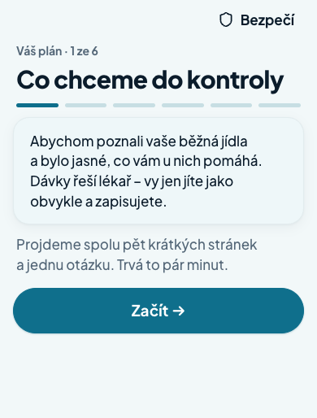

- **Co to je:** první stránka převzetí plánu s cílem do příští kontroly.
- **K čemu je pacientovi:** jednou větou ví, k čemu aplikace je: poznat jeho běžná jídla a co mu u nich pomáhá; dávky řeší lékař.
- **Kde v životě a v aplikaci:** v ordinaci po vydání plánu lékařem a zaučení sestrou, pacient poprvé otevře aplikaci. Aplikace sem přesměruje z jakékoli stránky, dokud plán není převzatý. Dál „Začít →“ na P02.
- **Co se na ní počítá:** nic. Text je `NF.texts(S, 'S-CESTA').goal`; při chybějícím textu výchozí věta v kódu.
- **Pravidla:** S-CESTA (provozní, text cíle).
- **Stavy a hraniční případy:** bez plánu „Plán zatím nemáte“ (lékař prochází zařazení); bez zaučení viz P07.
- **Co jde do stopy:** nic (stránkování převzetí se nezapisuje).
- **Pozor při programování:** jedno hlavní tlačítko (P1); stránku nelze přeskočit odkazem z jiné záložky.
- **Testy:** `faze2-jadro.test.cjs` „A26 převzetí bez zaučení se zastaví na první stránce“; hlavní sada „Prověrka sedmi pohledů (19. 10. 2026): … převzetí …“; `obsah-pacienta.test.cjs` (převzetí je v pokrytých obrazovkách).

## P02 · Převzetí 2/6 – Vaše dávky inzulinu

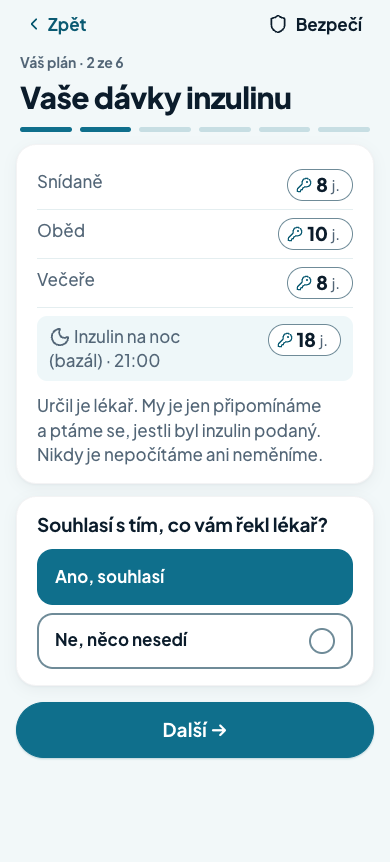

- **Co to je:** tabulka čtyř dávek z plánu a otázka „Souhlasí s tím, co vám řekl lékař?“.
- **K čemu je pacientovi:** zkontroluje, že v telefonu má tytéž dávky, které mu lékař řekl. Je to jediná nezávislá kontrola zadání dávky.
- **Kde v životě a v aplikaci:** v ordinaci, po P01. „Ano, souhlasí“ odemkne „Další →“ na P03; „Ne, něco nesedí“ zobrazí „Ukažte telefon sestře. Plán zatím nepřebírejte…“ a dál nepustí.
- **Co se na ní počítá:** nic; zobrazuje `p.doses` aktivního plánu (`NF.activePlan`), token dávky `V.dose` (číslo + „j.“, nikdy rozdíl). Odpověď ukládá akce `doseReadback` do `S.onboarding.readback`.
- **Pravidla:** zásada 1 (aplikace dávku jen zobrazuje). Žádná položka registru.
- **Stavy a hraniční případy:** bez odpovědi je „Další“ zamčené s větou proč; při „Ne“ zamčené s „Pokračovat půjde, až sestra dávky ověří“. Akce `confirmUnderstanding` odmítne převzetí i později, dokud je odpověď „Ne“.
- **Co jde do stopy:** od SCHEMA 87 `plan.davky.overeni` s odpovědí „souhlasí“ nebo „nesouhlasí“, číslem plánu a kopií dávek plánu (položka S-DAVKA v `polozky`). Zpětné přečtení dávky je jediná nezávislá kontrola zadání dávky, proto ho stopa musí nést.
- **Pozor při programování:** dávky se nesmí předvyplňovat ani přepočítávat; pacient je nemůže změnit.
- **Testy:** hlavní sada „SCHEMA 87 (bod 1): odpovědi pacienta, podmínky zařazení, výchozí hodnoty, ověření dávek a ověřovací body lékaře jdou do stopy“; `kontrola4-obsah.test.cjs` „06 A2, B4, B6: Co neděláme, vylučovací kritéria, otázka na novou dávku“; hlavní sada „Aplikace nikde nepočítá ani nenavrhuje dávku; volí ji lékař“.

## P03 · Převzetí 3/6 – Vaše návyky

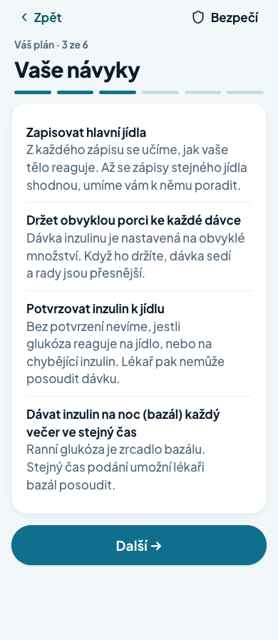

- **Co to je:** seznam návyků z plánu, každý s jednou větou proč.
- **K čemu je pacientovi:** ví, co od něj plán čeká (zapisovat hlavní jídla, obvyklá porce, potvrzovat inzulin, bazál každý večer).
- **Kde v životě a v aplikaci:** P02 → P03 → P04.
- **Co se na ní počítá:** `NF.planHabits(S, p.id)` – návyky plánu z katalogu `app/data/catalogs.js`.
- **Pravidla:** R-NAVYKY (klinická, startovní sada návyků).
- **Stavy a hraniční případy:** zamítnutá R-NAVYKY → seznam prázdný a na jeho místě oznámení zamítnuté části (v jádře „Tato část teď není k dispozici.“, v ukázce „Tahle část nefunguje“); plán jde převzít i bez návyků.
- **Co jde do stopy:** nic.
- **Pozor při programování:** návyky začnou platit až převzetím (`NF.confirmUnderstanding` je přepne z `prepared` na `active`).
- **Testy:** `faze2-jadro.test.cjs` „A05 zamítnutí R-NAVYKY, R-POKYNY a P-NEMOC má účinek“.

## P04 · Převzetí 4/6 – Jak to funguje

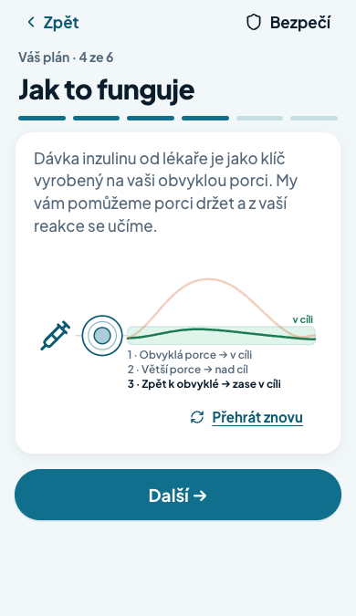

- **Co to je:** vysvětlující animace „klíč a talíř“ (`V.explainerKey`): dávka je klíč vyrobený na obvyklou porci.
- **K čemu je pacientovi:** pochopí, proč aplikace hlídá obvyklou porci a ne sacharidy.
- **Kde v životě a v aplikaci:** P03 → P04 → P05.
- **Co se na ní počítá:** nic. Animace je CSS nad inline SVG; statický stav = konec animace (při omezeném pohybu se ukáže rovnou).
- **Pravidla:** zásada 2 (konzistence jídla k pevné dávce).
- **Stavy a hraniční případy:** tlačítko „Přehrát znovu“; při `prefers-reduced-motion` se tlačítka přehrání skryjí.
- **Co jde do stopy:** nic.
- **Pozor při programování:** slovo „klíč“ se v textech pacienta nezavádí jako pojem (jen přirovnání v této větě); obrázek má textovou alternativu.
- **Testy:** hlavní sada „Druhá dávka kritiky (19. 10. 2026)…“ (animace), `faze2-pribeh.test.cjs` „Každý krok má název…; žádné „vpravo“ ani „klíč“ “ (vyprávění).

## P05 · Převzetí 5/6 – Co neděláme

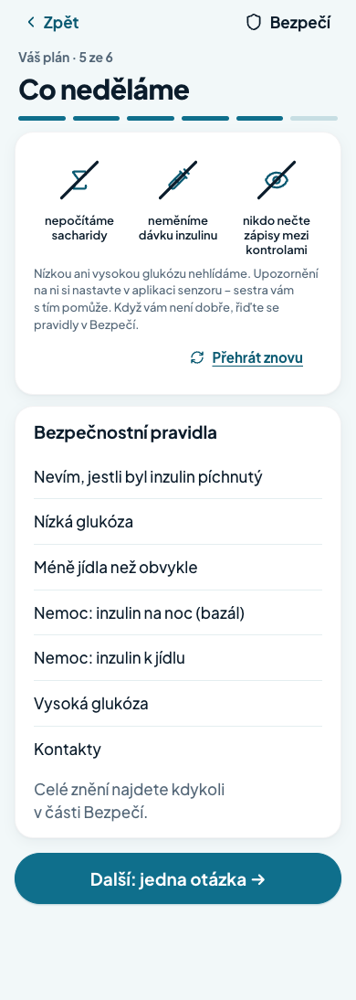

- **Co to je:** tři přeškrtnuté činnosti (nepočítáme sacharidy, neměníme dávku, nikdo nečte zápisy mezi kontrolami) a názvy bezpečnostních pravidel.
- **K čemu je pacientovi:** ví, co od aplikace nečekat: nízkou ani vysokou glukózu nehlídá, upozornění si nastaví v aplikaci senzoru.
- **Kde v životě a v aplikaci:** P04 → P05 → „Další: jedna otázka →“ P06.
- **Co se na ní počítá:** `V.notsCard`; seznam pravidel `V.instructionsList(S, p, true)` – jen názvy, celé znění je v Bezpečí.
- **Pravidla:** R-POKYNY (klinická: pravidla jsou součást plánu), I-HYPO, I-VYSOKA, I-MENE, I-NEVIM, I-NEMOC-BAZAL, I-NEMOC-JIDLO, I-KONTAKT (klinické).
- **Stavy a hraniční případy:** zamítnutá R-POKYNY → místo seznamu oznámení; bez pravidel v plánu věta „Když vám není dobře, v Bezpečí najdete, kam se obrátit.“.
- **Co jde do stopy:** nic.
- **Pozor při programování:** zásada 5 – věta „nikdo nečte zápisy mezi kontrolami“ musí v ostré aplikaci zůstat pravdivá.
- **Testy:** `kontrola4-obsah.test.cjs` „06 A2, B4, B6…“.

## P06 · Převzetí 6/6 – Kontrolní otázka

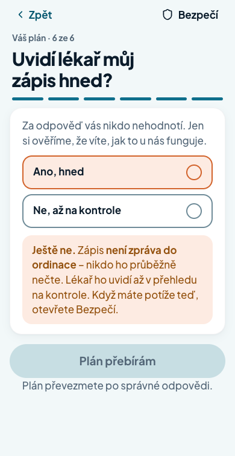

- **Co to je:** otázka „Uvidí lékař můj zápis hned?“ s volbami „Ano, hned“ / „Ne, až na kontrole“ a tlačítkem „Plán přebírám“.
- **K čemu je pacientovi:** ověří si, že zápis není zpráva do ordinace; s potížemi teď mu pomůže Bezpečí.
- **Kde v životě a v aplikaci:** P05 → P06 → „Plán přebírám“ → Dnes (P08) s hláškou „Hotovo. Plán platí.“.
- **Co se na ní počítá:** `NF.handover` (pokud plán ještě nebyl předán) a `NF.confirmUnderstanding`: nastaví `p.understood`, `p.understoodAt`, aktivuje návyky, u nového plánu označí staré milníky jako viděné.
- **Pravidla:** P-LEKAR (klinická: lékař mezi kontrolami nic nedělá).
- **Stavy a hraniční případy:** „Ano, hned“ je označené jako chybná odpověď s vysvětlením; „Plán přebírám“ je aktivní jen po správné odpovědi a s dokončeným zaučením.
- **Co jde do stopy:** `plan.kontrolni.otazka` při každé odpovědi (`answer`, `correct`; od SCHEMA 87), dále `plan.predan` a `plan.prevzat`.
- **Pozor při programování:** od `understoodAt` se počítá, které sloty dne převzetí se nedoptávají (`NF.yesterdayGaps`).
- **Testy:** hlavní sada „Zaučení: body podle návyků, náhled telefonu, návyky platí až po otázce“.

## P07 · Převzetí bez dokončeného zaučení

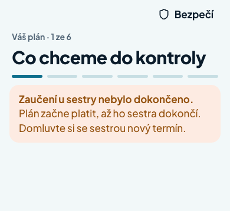

- **Co to je:** první stránka převzetí s větou „Zaučení u sestry nebylo dokončeno. Plán začne platit, až ho sestra dokončí. Domluvte si se sestrou nový termín.“ a bez tlačítka dál.
- **K čemu je pacientovi:** ví, proč aplikace zatím nic nedělá a co má udělat.
- **Kde v životě a v aplikaci:** sestra označila zaučení jako nezdařené (`NF.finishTraining` s výsledkem jiným než `done`). Pacient zůstane tady, dokud sestra zaučení nedokončí.
- **Co se na ní počítá:** `S.training.result`; akce `takeoverPage` bez zaučení vždy vrátí stránku 1.
- **Pravidla:** Z-BODY (provozní, body zaučení).
- **Stavy a hraniční případy:** rady se nedávají (`NF.adviceGate`: „Poradíme vám, až převezmete plán od lékaře.“); zápis jídla jádro odmítne (`NF.saveEpisode`: „Zapisovat jde až po převzetí plánu od lékaře.“).
- **Co jde do stopy:** nic na této obrazovce (nezdar zaučení zapisuje sestra).
- **Pozor při programování:** pacient neprojde šest stránek, aby se nakonec dozvěděl, že nemůže začít.
- **Testy:** `faze2-jadro.test.cjs` „A26 převzetí bez zaučení se zastaví na první stránce“; `zaverecne80.test.cjs` „02 B7, C2, C3, C4, C7: … nezdařené zaučení“.

---

# B. Dnes

Dnes (`V.today`) je hlavní obrazovka. Složení shora dolů (`15` odst. 15b „Dnes = co teď a jak si vedu“):

1. datum, pozdrav podle hodiny a malé tlačítko „Není mi dobře“ (přepínač režimu nemoci);
2. při nemoci karta „Při nemoci“ (P19);
3. otázka „Klesla glukóza pod 4?“, když čeká (P16);
4. karta **„Co teď“** – jediný hrdina obrazovky, jedno hlavní tlačítko a řádek „Potom: …“;
5. pravidla pro nemoc (při nemoci);
6. bezpečnost jen aktuální: karta po poklesu (P17), po opakovaných poklesech (P18), pravidlo po menší porci nebo vynechaném jídle (P15);
7. večer otázky k minulému jídlu, „Vítejte zpět“ po ≥ 7 dnech bez zápisu, inzulin čeká (P24), jiná dávka (P25);
8. výsledek jídla (P14), novinka (milník) nebo týdenní shrnutí (P13), „Za N dní jdete na kontrolu“ (P21), „Včera chybí …“;
9. pás dne se zápisem a „Opravit inzulin“ (P10);
10. „Zapsat svačinu“ (odkaz), „Jak si vedu“ s řádkem do Mého plánu.

Karta „Co teď“ se vybírá v tomto pořadí: jídlo na řadě nebo další (`NF.focusMeal`: nejdřív zmeškaný slot, pak první prázdný) → čas na bazál (od 2 h před časem bazálu, dokud není potvrzený) → zmeškaný slot → „Dnešní jídla jsou zapsaná“. Živá hodnota glukózy se na Dnes nikdy neukazuje (`15` odst. 7b.1).

## P08 · Dnes – první den po převzetí

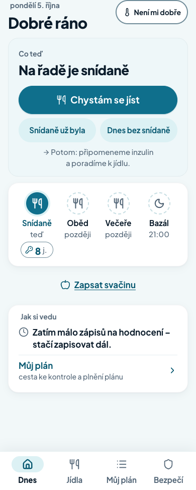

- **Co to je:** Dnes hned po převzetí plánu, bez zápisů.
- **K čemu je pacientovi:** vidí, co je na řadě (jídlo, dávka v pásu dne), a že zatím není co hodnotit.
- **Kde v životě a v aplikaci:** po P06 v ordinaci, a kdykoli později otevřením aplikace nebo záložkou Dnes.
- **Co se na ní počítá:** `NF.focusMeal`, `NF.daySlots`, `NF.howAmI` (věta „Zatím málo zápisů na hodnocení – stačí zapisovat dál.“).
- **Pravidla:** P-NEMOC (klinická, přepínač nemoci), R-SKORE (klinická, věta „jak si vedu“, parametr `vedu_min` 3), B-HYPO `dalsi_slot_h` (stav „další“).
- **Stavy a hraniční případy:** bez plánu „Zatím nemáte plán“; po ukončení účasti „Účast je ukončená“ (`S.participation`); zamítnutá P-NEMOC → místo tlačítka „Není mi dobře“ oznámení.
- **Co jde do stopy:** nic (Dnes jen čte).
- **Pozor při programování:** „Co teď“ musí být celé v prvních 780 px (P2); nulové stavy („0 z 0“) nahrazuje věta.
- **Testy:** `obsah-pacienta.test.cjs` P1, P4/P8, P6/P7; hlavní sada „Tři sloty dne: prázdný na řadě radí, prázdný minulý se doptá; pacient se může opravit“.

## P09 · Dnes – další jídlo po snídani

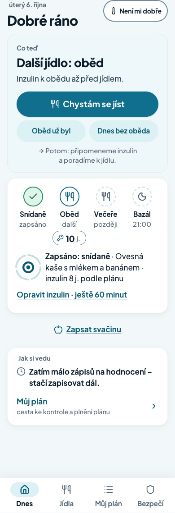

- **Co to je:** Dnes po zapsané snídani: „Další jídlo: oběd · Inzulin k obědu až před jídlem.“
- **K čemu je pacientovi:** ví, co bude dál, a že si inzulin k obědu nemá píchat hned.
- **Kde v životě a v aplikaci:** do 3 h po hlavním jídle (B-HYPO `dalsi_slot_h` 3) je další slot „další“, ne „na řadě“. Z karty „Chystám se jíst“ do kroku 1, „Oběd už byl“ do zpětného zápisu, „Dnes bez oběda“ k otázce na inzulin (P12).
- **Co se na ní počítá:** `NF.focusMeal` (stav `next`), pás dne `V.dayStrip` (uzel „další“ s tokenem dávky), `fixInsulinLine` (zápis a „Opravit inzulin · ještě N minut“).
- **Pravidla:** B-HYPO `dalsi_slot_h` (klinická), D-CISTA `oprava_min` 60 (klinická), R-SKORE; hrubé denní doby slotů S-PRIPOMINKY `snidane_do`, `obed_do`, `vecere_do` (provozní, od SCHEMA 87; chování beze změny).
- **Stavy a hraniční případy:** „Zapsat svačinu“ je odkaz; velké tlačítko svačiny je jen ve stavu „vše zapsáno“ (P23).
- **Co jde do stopy:** nic.
- **Pozor při programování:** „Na řadě + dávka“ hned po snídani by senior četl jako pokyn píchnout si – proto stav „další“.
- **Testy:** hlavní sada „Prověrka sedmi pohledů (19. 10. 2026): … Dnes …“.

## P10 · Dnes – Opravit inzulin

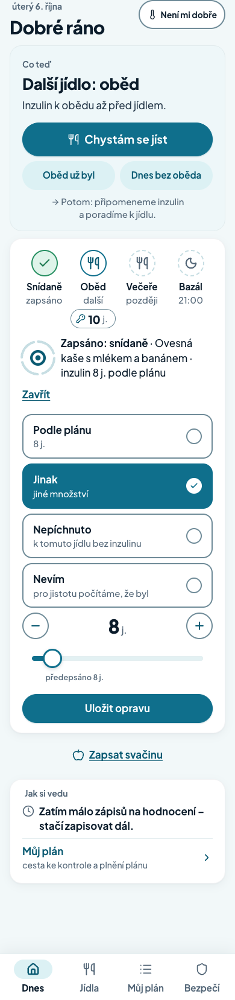

- **Co to je:** rozbalená oprava inzulinu u posledního zápisu v kartě pásu dne: Podle plánu · Jinak · Nepíchnuto · Nevím a „Uložit opravu“. Snímek ukazuje vybranou volbu „Jinak“ s posuvníkem jednotek.
- **K čemu je pacientovi:** opraví omyl v odpovědi na inzulin bez psaní.
- **Kde v životě a v aplikaci:** do 60 min od potvrzení inzulinu (`NF.canCorrectInsulin`, D-CISTA `oprava_min`) odkaz „Opravit inzulin · ještě N minut“ v kartě pásu dne. Po uložení zpět na Dnes s hláškou „Inzulin je opravený. Zápis se učí dál, do návrhu k dávce už nejde.“.
- **Co se na ní počítá:** `NF.correctInsulin(S, id, confirmed, units)`: přepíše `ep.insulin`, nastaví `ep.insulinCorrected`, přidá záznam do `ep.history`. Opravený zápis jde do učení, ne do návrhu k dávce (`NF.usableForDose`).
- **Pravidla:** D-CISTA (klinická; `oprava_min`).
- **Stavy a hraniční případy:** „Jinak“ ukáže posuvník jednotek 1–60 j. se značkou „předepsáno N j.“, výchozí hodnota je předepsaná dávka (`V.unitsSlider`, akce `fixInsulinUnitsSet`; od SCHEMA 87 místo −/+); „Uložit opravu“ je zamčené bez volby; po uplynutí 60 min odkaz zmizí; čekající inzulin („píchnu za chvíli“) se neopravuje, odpovídá se v P24; svačina se neopravuje.
- **Co jde do stopy:** `jidlo.inzulin.opraven` (z → na).
- **Pozor při programování:** okno běží od potvrzení inzulinu (`NF.insulinConfirmedAt`), ne od jídla. Rozsah jednotek bere z `NF.DOSE_RANGE`, stejně jako všechna ostatní místa.
- **Testy:** hlavní sada „SCHEMA 87 (body 3, 7): čísla pacienta posuvníkem 1–60 j. z jednoho místa; čas inzulinu „jiný čas“ posuvníkem; ordinace má týž rozsah“; hlavní sada „Čistá data pro dávku 6. 10. 2026: … oprava inzulinu do 60 minut“.

## P11 · Dnes – zmeškané jídlo, novinka a „Včera chybí“

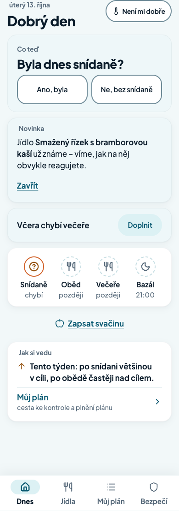

- **Co to je:** Dnes v 10:15 bez zapsané snídaně: „Byla dnes snídaně?“ s volbami „Ano, byla“ / „Ne, bez snídaně“, pod tím karta „Novinka“ a řádek „Včera chybí večeře · Doplnit“.
- **K čemu je pacientovi:** doplní jídlo, které už snědl, nebo řekne, že ho vynechal; dozví se o novém poznaném jídle.
- **Kde v životě a v aplikaci:** prázdný slot po konci denní doby (`NF.daypartEnd`: parametry S-PRIPOMINKY `snidane_do` 10, `obed_do` 15,5, `vecere_do` 21; meze 8–12, 13–17 a 19–23,5; když by parametry porušily pořadí snídaně < oběd < večeře, platí výchozí hodnoty `NF.DAYPART_END`). „Ano, byla“ → zpětný zápis (P35); „Ne, bez snídaně“ → P12; „Doplnit“ → zpětný zápis včerejšího jídla (akce `mealRetroYesterday`).
- **Co se na ní počítá:** `NF.focusMeal` (stav `missed`); `NF.pendingMilestone` (nejnovější neviděný milník); `NF.yesterdayGaps` (do 24 h od konce slotu; ne při nemoci, ne v den převzetí plánu, ne pro slot, který začal před převzetím).
- **Pravidla:** R-MILNIKY (provozní), S-CESTA (provozní) nepřímo, R-SKORE; S-PRIPOMINKY (provozní) pro hrubé denní doby slotů (od SCHEMA 87).
- **Stavy a hraniční případy:** při více chybějících včerejších jídlech řádek s tlačítkem pro každé („Doplnit oběd“, „Doplnit večeři“); na Dnes je vždy nejvýš jedna karta novinky; zavření zavře i starší neviděné (`NF.closeMilestone`).
- **Co jde do stopy:** `milnik` (při vzniku milníku, ne při zobrazení).
- **Pozor při programování:** milníky jsou jen za čin a návyk, nikdy za hodnotu glukózy (`15` odst. 7b.3).
- **Testy:** hlavní sada „SCHEMA 87 (body 4, 5, 6): meze pěti parametrů; denní doby slotů z registru (S-PRIPOMINKY, provozní); výchozí oznámení jádra bez prezentační vrstvy“; hlavní sada „Milníky: jednou, za snahu a návyk, ne za hodnotu…“; `kontrola74-obsah.test.cjs` „C3: na Dnes je nejnovější milník“; `kontrola4-obsah.test.cjs` „07 A2, B3, B8: … zapomenutý zápis ze včerejška…“.

## P12 · Dnes – vynechané jídlo: otázka na inzulin

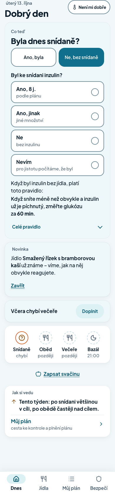

- **Co to je:** po „Ne, bez snídaně“ se v kartě „Co teď“ objeví „Byl ke snídani inzulin?“ (Ano, 8 j. · Ano, jinak · Ne · Nevím) a krátké pravidlo I-MENE.
- **K čemu je pacientovi:** když si inzulin píchl a nejedl, dostane hned bezpečnostní pravidlo.
- **Kde v životě a v aplikaci:** z P11 nebo z „Dnes bez …“ v P09. Volba zapíše vynechání a vrátí Dnes; při inzulinu v těle se ukáže P15.
- **Co se na ní počítá:** akce `mealSkip` → `NF.skipMeal(S, meal, insulin)`. Při inzulinu v těle (`NF.insulinInBody`: podle plánu, jinak, nevím) založí sledování `NF.addHypoWatch(S, 'skipped', …)` – za 60 min otázka na pokles (po večeři ráno).
- **Pravidla:** I-MENE (klinická, `v` = 60 min), B-HYPO (klinická, `pripominka_min` 60).
- **Stavy a hraniční případy:** „Nevím“ se počítá jako inzulin v těle (na stranu bezpečí); zpětný zápis do vynechaného slotu vynechání zruší a sledování přiřadí k zápisu (`NF.unskipMeal`), pokles se počítá jednou.
- **Co jde do stopy:** `jidlo.vynechano`, `hypo.sledovani` a při inzulinu v těle zobrazení pravidla `pravidlo.mene` (`where: 'vynechano'`, od SCHEMA 87).
- **Pozor při programování:** zásada 3 – po vynechaném jídle s inzulinem nikdy „snězte něco“; jen pravidlo. Aplikace k volání nevyzývá.
- **Testy:** hlavní sada „SCHEMA 87 (bod 1): pravidla pod 4, nevím a menší porce jdou do stopy jako pravidlo.vysoka; události výpočtu nesou verzi a otisk položek; krácení stopy je omezení makety“; hlavní sada „Tři sloty dne…“; `faze2-jadro.test.cjs` „A04 pokyn I-MENE po menší porci i při zamítnuté B-HYPO; místo otázky oznámení“.

## P13 · Dnes – týdenní shrnutí „Váš týden“

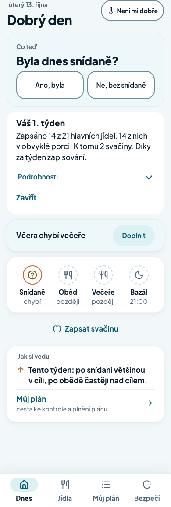

- **Co to je:** karta za uzavřený týden od vydání plánu: kolik hlavních jídel z 21 je zapsaných, kolik v obvyklé porci, svačiny zvlášť, poděkování; podrobnosti na klepnutí.
- **K čemu je pacientovi:** jednou týdně vidí, co udělal; chválí se čin, ne výsledek.
- **Kde v životě a v aplikaci:** každých 7 dní od vydání plánu, dokud ji pacient nezavře („Zavřít“). Neukazuje se, když je na Dnes novinka, ani v posledních 7 dnech před kontrolou. Poslední týden je i v Můj plán.
- **Co se na ní počítá:** `NF.weekSummary(S)`: hlavní jídla proti 21 slotům, svačiny zvlášť, obvyklá porce, nejúspěšnější přijatá rada (`best`), jídlo nejblíž k „známému“ (`near`). Nabídka na příští týden je vypnutá parametrem.
- **Pravidla:** S-TYDEN (provozní; `nabidka` 0 = vypnuto pro studii).
- **Stavy a hraniční případy:** týden bez zápisů se tiše označí jako viděný; bez rad má obsah („Nejblíž k „známému“ je X: chybí ještě N zápisů.“).
- **Co jde do stopy:** `tyden.zobrazen` (při zavření).
- **Pozor při programování:** žádné série, body ani hodnocení glukózy.
- **Testy:** hlavní sada „Týdenní shrnutí po 7 dnech jednou…“.

## P14 · Dnes – Jak to dopadlo (s otázkou při rozchodu)

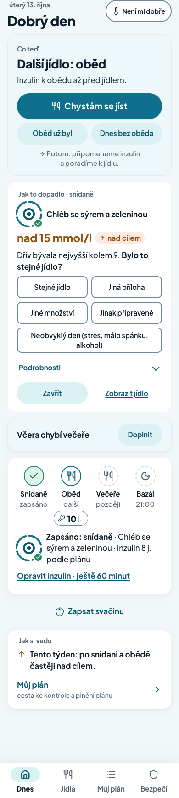

- **Co to je:** karta s výsledkem posledního jídla: nejvyšší hodnota velkým písmem se štítkem stavu (v cíli · nad cílem · pokles), věta, případně otázka „Bylo to stejné jídlo?“, „Podrobnosti“ se stupnicí, „Zavřít“ a „Zobrazit jídlo“.
- **K čemu je pacientovi:** uzavírá smyčku učení: vidí, kam se glukóza po jídle dostala, a dostane poděkování za čin.
- **Kde v životě a v aplikaci:** jakmile má dnešní zápis nejvyšší hodnotu (opsanou, nebo z exportu – `NF.readyAt`) a pacient ho ještě neviděl. Když je na řadě další jídlo a karta se na nic neptá, je sbalená na jeden řádek (P16). „Zobrazit jídlo“ → P50.
- **Co se na ní počítá:** `NF.lastResult(S)` vybere případ: `okAdvice`, `highAdvice` (přijatá rada), `okPlain`, `highPlain` (bez rady, s nabídkou do příště z vlastních dat), `excluded` (nezapočítaný zápis – bez čísla a verdiktu, s důvodem `NF.whyNotUsable`), `noEval`, `nodata`. „V cíli“ = vrchol ≤ horní cíl pacienta (C-CILE `high` 10,0). Srovnání „bez toho u vás bývá“ až od 4 zápisů s radou i bez ní (S-VYSLEDEK `min_n`). Otázka při rozchodu: `NF.divergence` – rozdíl vzestupu od mediánu dřívějších ≥ 3,5 mmol/l (R-REAKCE `rozchod_mmol`). Stupnice `riseBar` (kroužek = při jídle, bod = vrchol).
- **Pravidla:** S-VYSLEDEK (provozní), R-REAKCE (klinická), C-CILE (klinická), R-SKORE.
- **Stavy a hraniční případy:** odpověď na rozchod (`NF.answerDivergence`): stejné jídlo = měří se dál; jiná příloha / jinak připravené = založí samostatné jídlo a zápis přesune; jiné množství = zápis zůstane jako jiné množství, mimo učení; neobvyklý den = mimo učení. Dokud otázka čeká, karta neradí „příště můžete zkusit“. U menší porce s inzulinem v těle (`excluded`) karta nese krátké pravidlo I-MENE. Hodnota z opsaných čísel: „Podle hodnot, které jste opsali; na kontrole je upřesníme.“
- **Co jde do stopy:** `vysledek.zobrazen` (při zavření), `jidlo.rozchod` (odpověď).
- **Pozor při programování:** chválíme snahu, ne hodnotu (`15` odst. 7b); „nad 15“ a „pod 4“ se píšou slovem jako hranice, ne jako číslo (`NF.mmolB`). Nic z karty nejde do reportu lékaři.
- **Testy:** hlavní sada „Zpětná vazba: po příchodu dat karta „Jak to dopadlo“ děkuje za čin; živá glukóza na Dnes není“; `kontrola2-obsah.test.cjs` „B14, C1, C11: otázka při rozchodu…“; `kontrola3-obsah.test.cjs` „B3: zamítnutá R-REAKCE – karta „Jak to dopadlo“ se neptá na rozchod…“; `faze2-jadro.test.cjs` „A17 zpětný zápis: jedno poděkování…“.

## P15 · Dnes – Méně jídla než obvykle

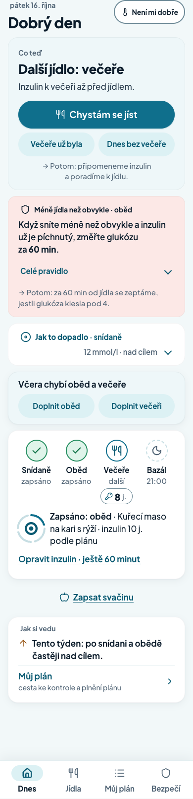

- **Co to je:** bezpečnostní karta „Méně jídla než obvykle · oběd“ s jednou větou pravidla I-MENE, „Celé pravidlo“ a řádkem „Potom: za 60 min od jídla se zeptáme, jestli glukóza klesla pod 4.“
- **K čemu je pacientovi:** po menší porci (nebo vynechaném jídle) s inzulinem v těle ví, co dělat a co přijde.
- **Kde v životě a v aplikaci:** po uložení menší porce s inzulinem podaným nebo „nevím“ (P45) nebo po vynechaném jídle s inzulinem (P12). Drží se celý den, dokud sledování nemá odpověď; když přijde čas otázky, nahradí ji P16.
- **Co se na ní počítá:** `lessFoodCards` nad `NF.openHypoWatch` a `NF.skippedWithInsulin`; čas otázky z B-HYPO `pripominka_min`.
- **Pravidla:** I-MENE (klinická, `v` 60), B-HYPO (klinická).
- **Stavy a hraniční případy:** po večeři „ráno se zeptáme, jestli glukóza klesla v noci pod 4“; se zamítnutou B-HYPO pravidlo platí dál celý den a místo otázky je oznámení; zamítnutá I-MENE → oznámení na místě pravidla.
- **Co jde do stopy:** sledování se zapsalo při uložení (`hypo.sledovani`); zobrazení karty se nezapisuje.
- **Pozor při programování:** zásada 3 – žádná rada jíst víc; pravidlo I-MENE nezávisí na B-HYPO. P8: mimo okamžik události jedna věta a „Celé pravidlo“.
- **Testy:** `faze2-jadro.test.cjs` „A04 …“; `kontrola74-obsah.test.cjs` „B17, B18: zamítnutá B-HYPO skryje otázku na pokles; zamítnutá I-MENE ukáže oznámení…“; `obsah-pacienta.test.cjs` P8.

## P16 · Dnes – otázka „Klesla glukóza pod 4?“

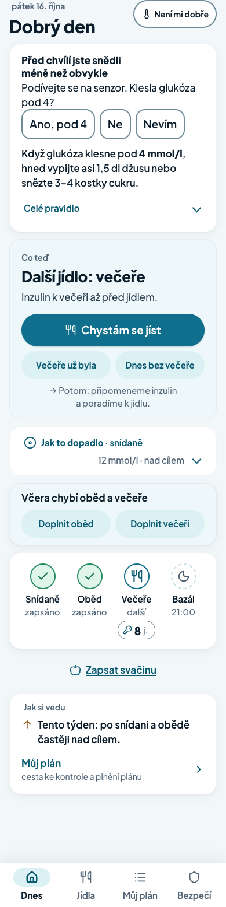

- **Co to je:** karta nad „Co teď“: „Před chvílí jste snědli méně než obvykle. Podívejte se na senzor. Klesla glukóza pod 4?“ s volbami Ano, pod 4 · Ne · Nevím a krátkým pravidlem I-HYPO.
- **K čemu je pacientovi:** jedním klepnutím zapíše, zda glukóza po menší porci klesla; pokles uvidí lékař na kontrole.
- **Kde v životě a v aplikaci:** 60 min po menší porci nebo vynechaném jídle s inzulinem; po večeři až ráno od 5:00 (noční otázka, i v kroku 1 snídaně). Otázka čeká do dalšího otevření aplikace (24 h, noční celý den). Telefon může poslat oznámení (S-PRIPOMINKY `hypo`). „Ano, pod 4“ → P17; jinak hláška „Zapsáno.“.
- **Co se na ní počítá:** `NF.pendingHypoWatch`, `NF.hypoWatchState` (waiting → due → answered / unanswered); akce `hypoAnswer` → `NF.answerHypoWatch` (přenese odpověď do zápisu `ep.manual.low`). Nadpis podle času: do 3 h „Před chvílí“, později „Dnes v 12:10“, další den „Včera v 12:10“.
- **Pravidla:** B-HYPO (klinická; `pripominka_min` 60, texty `otazka`), I-HYPO (klinická).
- **Stavy a hraniční případy:** se zamítnutou B-HYPO se otázka neptá, na místě oznámení; neodpovězená otázka po uplynutí zůstane pro lékaře jako „bez odpovědi“.
- **Co jde do stopy:** `hypo.odpoved`; při „Ano, pod 4“ navíc `pravidlo.nizka` (`where: 'odpoved'`, od SCHEMA 87).
- **Pozor při programování:** otázka je nad „Co teď“ (P2: v tu chvíli je důležitější). Aplikace živou glukózu nevidí; nic nehlídá na pozadí.
- **Testy:** `kontrola2-obsah.test.cjs` „B15: otázka na pokles u zápisu mladšího než 4 h zní „zatím“ “; `faze2-jadro.test.cjs` „A24 otázka na pokles všude stejně“; `obsah-pacienta.test.cjs` P2.

## P17 · Dnes – Pokles pod 4 je zapsaný

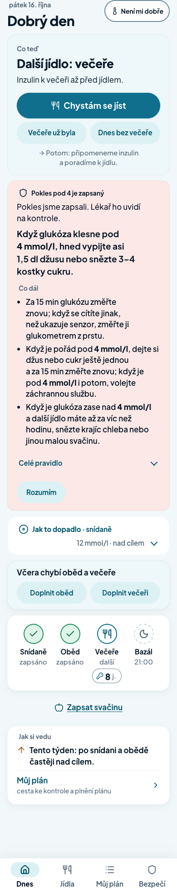

- **Co to je:** červená karta „Pokles pod 4 je zapsaný“: „Pokles jsme zapsali. Lékař ho uvidí na kontrole.“, první krok pravidla I-HYPO velkým písmem, „Co dál“ v bodech, „Celé pravidlo“, „Rozumím“.
- **K čemu je pacientovi:** v okamžiku poklesu vidí, co udělat hned.
- **Kde v životě a v aplikaci:** po odpovědi „Ano, pod 4“ (P16, P33), po nejvyšší hodnotě „pod 4“ nebo po nočním čipu (P34). Na Dnes nejvýš 3 h (`LOW_NOTICE_H`), zavírá se „Rozumím“.
- **Co se na ní počítá:** `S.lowNotice`; když počet poklesů dosáhne prahu, nahradí ji P18 (`NF.hypoAlert`).
- **Pravidla:** B-HYPO (klinická, text `zapsano`), I-HYPO (klinická).
- **Stavy a hraniční případy:** noční pokles (už odezněl) má pravidlo jen krátce; se zamítnutou B-HYPO karta neukazuje větu o zápisu, jen pravidlo a oznámení.
- **Co jde do stopy:** pokles je zapsaný akcí, která kartu vyvolala (`hypo.odpoved`, `glukoza.nejnizsi`, `glukoza.nejvyssi` nebo `hypo.noc`); „Rozumím“ nastaví `S.hypoRuleSeen`. Od SCHEMA 87 se zobrazení pravidla I-HYPO zapíše i samo jako `pravidlo.nizka` (odpověď „ano, pod 4“ na Dnes nebo v kroku 1, nejvyšší hodnota „pod 4“).
- **Pozor při programování:** P8 – okamžik události: první krok velkým písmem; bez „1 ze 2“ a bez výzvy volat.
- **Testy:** `obsah-pacienta.test.cjs` P8; `kontrola2-obsah.test.cjs` „Prohlížeč M2: karta po poklesu se zamítnutou B-HYPO neukazuje počet poklesů“.

## P18 · Dnes – opakované poklesy

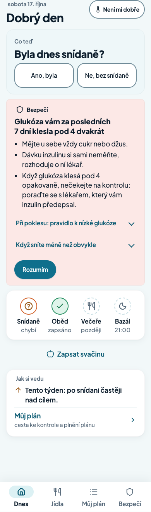

- **Co to je:** karta „Glukóza vám za posledních 7 dní klesla pod 4 dvakrát“: tři body obecné rady, dva rozbalovací řádky („Při poklesu: pravidlo k nízké glukóze“, „Když sníte méně než obvykle“) a „Rozumím“.
- **K čemu je pacientovi:** při opakovaných poklesech dostane obecnou radu a výslovně „nečekejte na kontrolu: poraďte se s lékařem, který vám inzulin předepsal“.
- **Kde v životě a v aplikaci:** jakmile je v klouzavých 7 dnech aspoň 2 poklesy. Zavírá se „Rozumím“; znovu se ukáže s každým dalším poklesem v okně.
- **Co se na ní počítá:** `NF.lowEvents(S, 7)` (poklesy ze senzoru pod dolní cíl do 4 h po jídle, opsané „pod 4“, odpovědi sledování, noční čipy; jeden pokles k jídlu dne jednou) a `NF.hypoAlert` (B-HYPO `poklesy` 2, `dny` 7); `NF.hypoAlertSeen` uloží čas posledního poklesu.
- **Pravidla:** B-HYPO (klinická; texty `opakovaneBody`, `opakovaneHypo`, `opakovaneMene`), I-HYPO, I-MENE (klinické).
- **Stavy a hraniční případy:** věta „nečekejte na kontrolu…“ je viditelná a jen jednou (v rozbaleném I-HYPO se poslední věta vynechá); dokud je karta otevřená, nahrazuje P17.
- **Co jde do stopy:** `hypo.opakovane` (při „Rozumím“).
- **Pozor při programování:** zásada 3 – rada nesmí radit porci ani dávku podle porce; aplikace k volání do ordinace sama nevyzývá a nic nikam neposílá.
- **Testy:** `kontrola4-obsah.test.cjs` „Bod 3: karta po opakovaných poklesech a I-HYPO končí větou o poradě s lékařem; bez výzvy aplikace volat“; `kontrola74-obsah.test.cjs` „A2: rada po opakovaných poklesech neradí porci, dávku podle porce ani volat“; `obsah-pacienta.test.cjs` „Povinné věty zůstávají viditelné…“.

## P19 · Dnes – režim nemoci

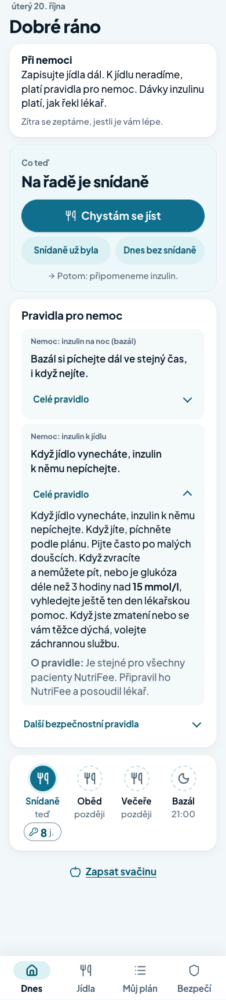

- **Co to je:** Dnes po klepnutí „Není mi dobře“: karta „Při nemoci“ („Zapisujte jídla dál. K jídlu neradíme, platí pravidla pro nemoc. Dávky inzulinu platí, jak řekl lékař.“), „Co teď“ a karta „Pravidla pro nemoc“ se dvěma pravidly krátce (bazál, inzulin k jídlu) a ostatními pravidly sbalenými.
- **K čemu je pacientovi:** při nemoci ví, jak s inzulinem, a aplikace ho nezatěžuje radami.
- **Kde v životě a v aplikaci:** tlačítko „Není mi dobře“ na Dnes (nebo přepínač v Bezpečí). Režim ukončí jen pacient (P20).
- **Co se na ní počítá:** `NF.setIllness(S, true)`: `S.illness`, zápisy téhož dne dostanou štítek nemoci (nemoc začala dřív, než ji pacient označil). `NF.ill` vypne rady (`NF.advise`: `res.illness`), zápisy z nemoci nejdou do učení (`NF.inIllness`). Po 3 dnech (P-NEMOC `dny`) karta „Nemoc trvá už N dní“ s pravidlem I-NEMOC-JIDLO.
- **Pravidla:** P-NEMOC (klinická, `dny` 3), I-NEMOC-BAZAL (`v` 3 h), I-NEMOC-JIDLO (`v` 15 mmol/l) (klinické).
- **Stavy a hraniční případy:** první den „Zítra se zeptáme, jestli je vám lépe.“; při nemoci se neukazuje „Jak si vedu“ ani „Včera chybí“; zamítnutá P-NEMOC → přepínač nahradí oznámení a nemoc nejde zapnout.
- **Co jde do stopy:** `nemoc.zacatek`, `nemoc.stitek` (kolik dnešních zápisů dostalo štítek).
- **Pozor při programování:** při nemoci všude jedna věta `NF.ILL_TEXT`; pravidla pro nemoc jsou pod „Co teď“, aby „Co teď“ zůstalo nad ohybem (přebíjí `15` odst. 8).
- **Testy:** hlavní sada „Nemoc: pacient označí i ukončí; rady jen bezpečné; data štítkovaná“; `faze2-jadro.test.cjs` „A19 při nemoci všude jedna věta“; `robustnost.test.cjs` „Nemoc: žádná .advice v kroku 3 ani u zpětného zápisu“.

## P20 · Dnes – nemoc, „Už je vám lépe?“

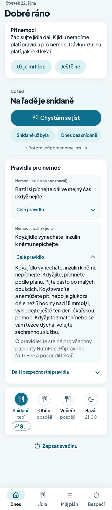

- **Co to je:** karta „Při nemoci“ druhý a další den s tlačítky „Už je mi lépe“ / „Ještě ne“.
- **K čemu je pacientovi:** jednou denně řekne, jak mu je, a sám nemoc ukončí.
- **Kde v životě a v aplikaci:** denně během nemoci, dokud není odpověď za dnešek. „Už je mi lépe“ ukončí nemoc (Dnes se vrátí do běžného stavu, hláška „Rádi to slyšíme. Rady zase platí naplno.“); „Ještě ne“ → „Dnes už máme odpověď. Zeptáme se zase zítra.“
- **Co se na ní počítá:** `NF.illnessCheckin(S, better)`; při „lépe“ `NF.setIllness(S, false)` a záznam období do `S.illnessLog`.
- **Pravidla:** P-NEMOC (klinická).
- **Stavy a hraniční případy:** nemoc ukončená dopoledne už svůj den neznačí (`NF.illnessPeriods`).
- **Co jde do stopy:** `nemoc.dotaz` u obou odpovědí („už je lépe“ i „ještě ne“, položka P-NEMOC; od SCHEMA 87) a při „Už je mi lépe“ navíc `nemoc.konec`.
- **Pozor při programování:** zásada 5 – pozastavení ukončuje pacient, lékař nic nesleduje.
- **Testy:** hlavní sada „SCHEMA 87 (bod 1): odpovědi pacienta, podmínky zařazení, výchozí hodnoty, ověření dávek a ověřovací body lékaře jdou do stopy“; hlavní sada „Nemoc: pacient označí i ukončí…“.

## P21 · Dnes – před kontrolou, připomínka exportu a „Jak na to“

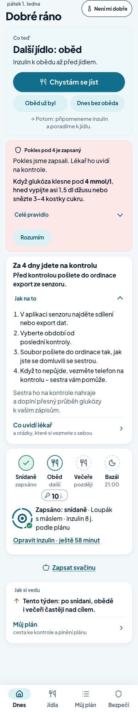

- **Co to je:** Dnes 4 dny před kontrolou: karta „Za 4 dny jdete na kontrolu“ s větou „Před kontrolou pošlete do ordinace export ze senzoru.“, rozbaleným návodem „Jak na to“ (4 kroky) a řádkem „Co uvidí lékař“. Na snímku je i karta po nočním poklesu (P17 v noční podobě).
- **K čemu je pacientovi:** nezapomene poslat export ze senzoru a podívá se, co uvidí lékař.
- **Kde v životě a v aplikaci:** od 7 dní před kontrolou (`NF.pathStats`, `left ≤ 7`). „Co uvidí lékař“ → P52.
- **Co se na ní počítá:** `soonCard`, `exportRemind` (karta zmizí, když je export za období nahraný – `S.sensorImport` ve 14 dnech před kontrolou).
- **Pravidla:** Z-IMPORT (provozní; texty `pripominka`, `navodNadpis`, `navod`), S-CESTA (provozní).
- **Stavy a hraniční případy:** „Dnes jdete na kontrolu“ v den kontroly; týdenní shrnutí se v těchto dnech na Dnes neukazuje.
- **Co jde do stopy:** nic.
- **Pozor při programování:** o typech a formátech exportu, portálech a výrobcích se na obrazovce nemluví (`15` odst. 6a). Export nahrává jen sestra; pacient v aplikaci nic nenahrává. Jak export v ostrém provozu získat, je otevřený úkol ostré aplikace.
- **Testy:** `obsah-pacienta.test.cjs` „Povinné věty zůstávají viditelné: … připomínka exportu…“; `faze2-jadro.test.cjs` „A20 (SCHEMA 74): pacient export v aplikaci nenahrává…“.

## P22 · Dnes – Čas na bazál

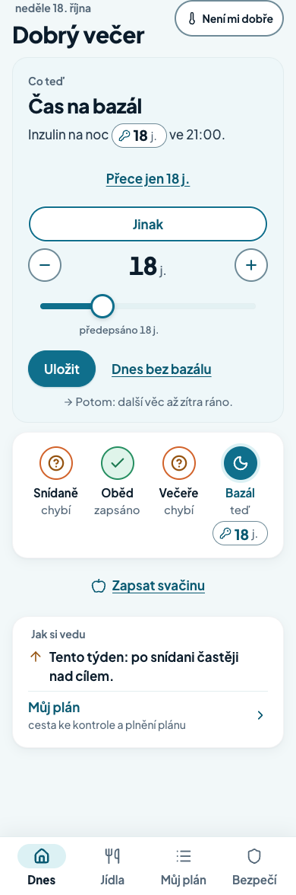

- **Co to je:** večerní „Co teď“: „Čas na bazál · Inzulin na noc 18 j. ve 21:00.“ s tlačítky „Bazál 18 j. je píchnutý“ a „Jinak“. Snímek ukazuje otevřené „Jinak“: posuvník jednotek, „Uložit“, „Dnes bez bazálu“ a odkaz zpět „Přece jen 18 j.“.
- **K čemu je pacientovi:** potvrdí večerní bazál jedním klepnutím.
- **Kde v životě a v aplikaci:** od 2 h před časem bazálu z plánu, dokud není potvrzený. Přednost má jen jídlo na řadě; zmeškané jídlo ustoupí. Po potvrzení hláška „Bazál je zapsaný.“
- **Co se na ní počítá:** `NF.confirmBasal(S, confirmed, units)`; potvrzení po půlnoci (do 4:00) patří k předchozímu dni. „Jinak“ otevře posuvník jednotek 1–60 j. se značkou „předepsáno 18 j.“ (`V.unitsSlider`, akce `basalUnitsSet`; od SCHEMA 87 místo −/+), „Uložit“ a „Dnes bez bazálu“.
- **Pravidla:** zásada 1; H-BAZAL (návyk z katalogu, součást R-NAVYKY); S-DAVKA (provozní, původ dávky).
- **Stavy a hraniční případy:** chybí-li včerejší bazál, Dnes se zeptá „Byl včera večer bazál?“ (Ano · Ne · Nevím), po poledni jako sbalený řádek; po potvrzení „další věc až zítra ráno“.
- **Co jde do stopy:** `bazal.potvrzen`.
- **Pozor při programování:** aplikace dávku nemění ani nenavrhuje; posuvník začíná na předepsané dávce a jen zapisuje, co pacient píchl.
- **Testy:** hlavní sada „SCHEMA 87 (body 3, 7): čísla pacienta posuvníkem 1–60 j. z jednoho místa; čas inzulinu „jiný čas“ posuvníkem; ordinace má týž rozsah“; hlavní sada „Bazál: připomínka večer, potvrzení podle plánu nebo jinak“; `robustnost.test.cjs` (bazál po půlnoci k předchozímu dni, v hlavní sadě „Robustnost: kalendářní dny…“).

## P23 · Dnes – dnešní jídla jsou zapsaná

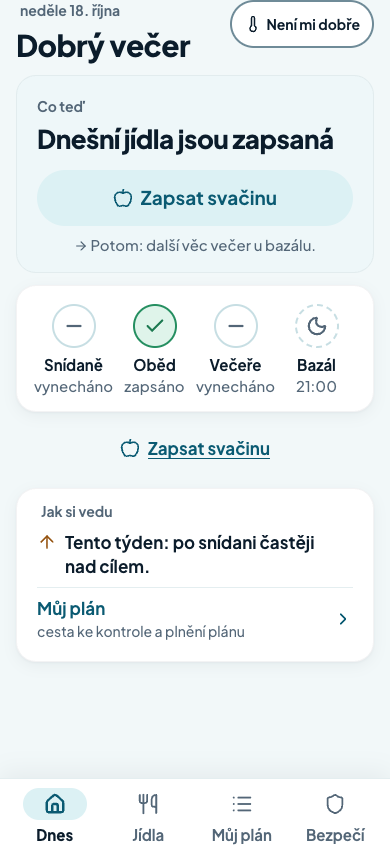

- **Co to je:** „Co teď: Dnešní jídla jsou zapsaná“ s velkým tlačítkem „Zapsat svačinu“ a řádkem „Potom: další věc večer u bazálu.“
- **K čemu je pacientovi:** ví, že je pro dnešek hotovo, a může zapsat svačinu.
- **Kde v životě a v aplikaci:** všechny tři sloty jsou zapsané nebo vynechané a ještě není čas bazálu. „Zapsat svačinu“ → P41.
- **Co se na ní počítá:** `NF.focusMeal` vrátí `null`.
- **Pravidla:** žádná vlastní.
- **Stavy a hraniční případy:** po potvrzení bazálu „další věc zítra ráno“.
- **Co jde do stopy:** nic.
- **Pozor při programování:** velké tlačítko svačiny je jen v tomto stavu; jinde je svačina odkaz (P1).
- **Testy:** hlavní sada „Svačina: bez inzulinu a bez porce…“.

## P24 · Dnes – inzulin čeká na potvrzení

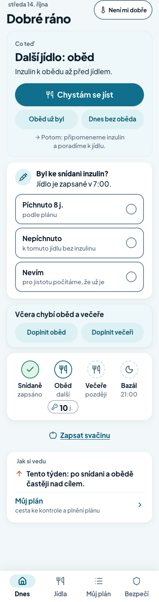

- **Co to je:** karta „Byl ke snídani inzulin? Jídlo je zapsané v 7:00.“ s volbami Píchnuto 8 j. · Nepíchnuto · Nevím (do 30 min „Inzulin ke snídani čeká na potvrzení“).
- **K čemu je pacientovi:** doplní potvrzení inzulinu, když jídlo uložil dřív, než si píchl.
- **Kde v životě a v aplikaci:** po „Uložit, píchnu za chvíli“ v kroku 3 (P43) a od SCHEMA 87 i po „Uložit, inzulin zatím ne“ v kroku 3 při glukóze pod 4 (P46). Karta zůstane na Dnes až 24 h; aplikace nic nehlídá, ptá se jen při otevření.
- **Co se na ní počítá:** `NF.pendingInsulin`, `NF.confirmPendingInsulin` (u menší porce s inzulinem založí sledování B-HYPO).
- **Pravidla:** B-HYPO (při menší porci), D-CISTA (okno opravy běží od pozdějšího potvrzení).
- **Stavy a hraniční případy:** čekající inzulin se neopravuje přes „Opravit inzulin“.
- **Co jde do stopy:** `jidlo.inzulin.potvrzen`.
- **Pozor při programování:** do 30 min věta „Až si píchnete 8 j., potvrďte to.“ – je to potvrzení, ne pokyn k dávce.
- **Testy:** hlavní sada „Před jídlem: inzulin první, kroky zamčené bez volby, zápis nese potvrzení dávky“.

## P25 · Dnes – Jiná dávka než v plánu

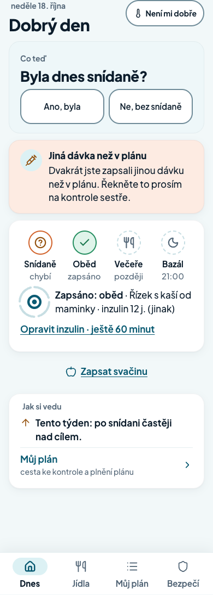

- **Co to je:** karta „Jiná dávka než v plánu: Dvakrát jste zapsali jinou dávku než v plánu. Řekněte to prosím na kontrole sestře.“
- **K čemu je pacientovi:** připomene, že nesoulad má zmínit na kontrole.
- **Kde v životě a v aplikaci:** když pacient u téhož jídla dne dvakrát po sobě zapíše „Ano, jinak“ s jinými jednotkami než v plánu. Karta nemá tlačítko; zmizí, až další zápis odpovídá plánu.
- **Co se na ní počítá:** `NF.doseOffPlan(S)` (S-DAVKA `po_sobe` 2); jedna karta i pro víc jídel dne.
- **Pravidla:** S-DAVKA (provozní).
- **Stavy a hraniční případy:** čekající inzulin se nepočítá.
- **Co jde do stopy:** nic navíc (dávky jsou v `jidlo.zapsano`).
- **Pozor při programování:** zásada 1 – aplikace se neptá proč, dávku nemění ani nenavrhuje, o jiném lékaři nemluví.
- **Testy:** hlavní sada „Aplikace nikde nepočítá ani nenavrhuje dávku…“ ; hlavní sada „SCHEMA 87 (bod 1, R7): karta „Jiná dávka než v plánu“ (S-DAVKA) a formulář podpory (S-PODPORA)“.

---

# C. Zápis jídla – krok 1

Krok 1 (`mealStep1`) má otevřenou vždy jen jednu otázku s číslem; zodpovězené otázky jsou řádky s fajfkou a „Změnit“, čekající jsou šedé řádky pod „Potom jeden pohled do aplikace senzoru“. Akce `mealQ` jen přepíná otevřenou otázku a do stopy nic nepíše. Hlavička: „Zpět na Dnes“ (s dotazem „Zahodit rozpracovaný zápis?“, když už je něco vyplněné) a „Bezpečí“ (P56). „Další: co budete jíst →“ je aktivní až po odpovědi na inzulin a na glukózu teď. Rozpracovaný zápis je `S.meal`; do `S.episodes` se nic neuloží před krokem 3.

## P26 · Krok 1 – Je inzulin už píchnutý?

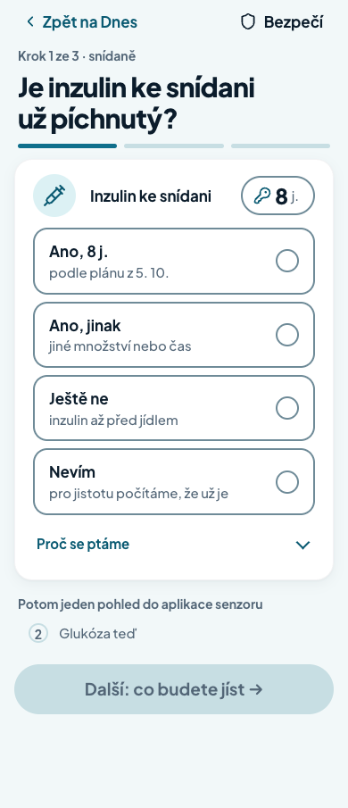

- **Co to je:** první otázka: „Inzulin ke snídani“ s tokenem dávky a volbami „Ano, 8 j. · podle plánu z 5. 10.“, „Ano, jinak“, „Ještě ne“, „Nevím“; pod tím „Proč se ptáme“.
- **K čemu je pacientovi:** jednou odpovědí zapíše inzulin; aplikace podle toho ví, jakou radu k porci smí dát.
- **Kde v životě a v aplikaci:** po „Chystám se jíst“ nebo klepnutí na uzel pásu dne. „Ano, 8 j.“ otevře volbu času (právě teď předvybrané) a pak další otázku; „Ještě ne“ rovnou další otázku.
- **Co se na ní počítá:** akce `mealBolus` (as · other · before · unknown); `NF.doseOrigin` (původ dávky „Podle plánu z 5. 10.: 8 j.“); `newDose` (prvních 3 jídel po změně dávky „nově, dřív X j.“); osa učení v „Proč se ptáme“ z `NF.tolerance(S, 'learn')` (45 min před / 30 min po).
- **Pravidla:** S-DAVKA (provozní), D-CISTA (klinická; `pred_uceni_min` 45, `po_uceni_min` 30).
- **Stavy a hraniční případy:** odpovědi jsou rovnocenné volby, plná je jen vybraná (žádná není předvybraná); čas inzulinu „právě teď · před 5 · před 15 · před 30 min · jiný čas“ (jiný čas viz P27).
- **Co jde do stopy:** nic hned; odpověď je součástí `jidlo.zapsano` při uložení.
- **Pozor při programování:** zásada 1 – dávka se nikdy nepočítá; očekávaná odpověď nesmí být předvybraná (navádělo by k potvrzení nepodané dávky).
- **Testy:** hlavní sada „Před jídlem: inzulin první, kroky zamčené bez volby, zápis nese potvrzení dávky“; `obsah-pacienta.test.cjs` P1 (jedna otevřená otázka).

## P27 · Krok 1 – Ano, jinak

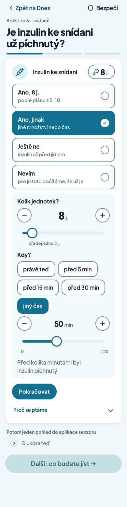

- **Co to je:** po „Ano, jinak“ box „Kolik jednotek?“ (posuvník jednotek se značkou „předepsáno 8 j.“) a „Kdy?“ (právě teď · před 5 min · před 15 min · před 30 min · jiný čas) a tlačítko „Pokračovat“. Snímek ukazuje zvolený „jiný čas“: posuvník „před kolika minutami“ s hodnotou 50 min.
- **K čemu je pacientovi:** zapíše skutečně podanou dávku a čas.
- **Kde v životě a v aplikaci:** P26 → P27 → „Pokračovat“ → další otázka.
- **Co se na ní počítá:** akce `mealUnitsSet` (posuvník jednotek, `V.unitsSlider`), `mealTime` (pevné volby; `other` otevře jiný čas) a `mealTimeAgo` (posuvník 0–120 min po 5 min, `NF.INS_AGO_MAX`; přijme jen násobky 5). Souhrnný řádek pak ukazuje „před 50 min“. Při uložení `NF.saveEpisode` převede „jinak“ se stejnými jednotkami na „podle plánu“ a čas inzulinu spočítá z posunu (do SCHEMA 86 byl oříznutý na −30 min).
- **Pravidla:** S-DAVKA (provozní; dvakrát jinak → P25).
- **Stavy a hraniční případy:** jednotky 1–60 (`NF.DOSE_RANGE`); jiný čas 0–120 min je mez vstupu, ne klinický práh – co z toho jde do učení a do návrhu k dávce, dál určuje D-CISTA; zápis „jinak“ do učení nejde (`NF.usableEp` chce potvrzení podle plánu).
- **Co jde do stopy:** v `jidlo.zapsano` (`insulin.confirmed: 'other'`, `units`).
- **Pozor při programování:** aplikace neříká, zda je jiná dávka nebo jiný čas správně; posuvník jen zapisuje skutečnost.
- **Testy:** hlavní sada „SCHEMA 87 (body 3, 7): čísla pacienta posuvníkem 1–60 j. z jednoho místa; čas inzulinu „jiný čas“ posuvníkem; ordinace má týž rozsah“; `robustnost.test.cjs` „Dávky a kroky: nečíselná hodnota nic nezmění, žádné NaN ve stavu“.

## P28 · Krok 1 – Nevím

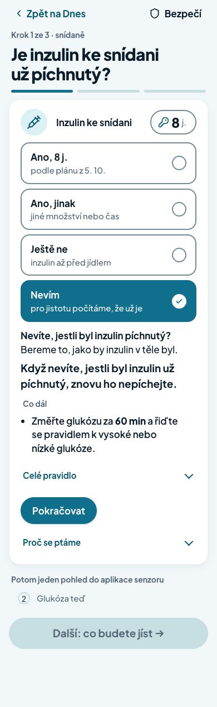

- **Co to je:** po „Nevím“ věta „Nevíte, jestli byl inzulin píchnutý? Bereme to, jako by inzulin v těle byl.“ a pravidlo I-NEVIM v okamžiku události (první krok velkým písmem, Co dál, Celé pravidlo).
- **K čemu je pacientovi:** nepíchne si inzulin podruhé a ví, kdy změřit glukózu.
- **Kde v životě a v aplikaci:** P26 → P28 → „Pokračovat“.
- **Co se na ní počítá:** `ruleEventBody(S, 'I-NEVIM')` z `NF.instrParts` (katalog `prvniKrok`, `coDal`, `kratce`); „nevím“ = inzulin v těle (`NF.insulinInBody`), rada k porci se pak dá jen z větší zpět k obvyklé.
- **Pravidla:** I-NEVIM (klinická, `v` 60 min).
- **Stavy a hraniční případy:** zamítnutá I-NEVIM nebo R-POKYNY → oznámení na místě pravidla.
- **Co jde do stopy:** při volbě „Nevím“ hned `pravidlo.nevim` (`where: 'krok1'`, položka I-NEVIM; od SCHEMA 87), odpověď pak v `jidlo.zapsano`; zápis „nevím“ do učení nejde.
- **Pozor při programování:** zásada 3 – po „nevím“ nikdy „sněz víc“; P8 – krátké věty jsou doslova ze schváleného znění.
- **Testy:** hlavní sada „SCHEMA 87 (bod 1): pravidla pod 4, nevím a menší porce jdou do stopy jako pravidlo.vysoka; události výpočtu nesou verzi a otisk položek; krácení stopy je omezení makety“; `obsah-pacienta.test.cjs` „P8: bezpečnostní pravidlo…“; `kontrola3-obsah.test.cjs` „C1, C2, C3, C13: … „nevím“ bez tvrzení o inzulinu…“; `faze2-pribeh.test.cjs` „C07, C14: scéna 12 ukáže „Nevím“ s pokynem I-NEVIM…“.

## P29 · Krok 1 – Kolik ukazuje senzor teď?

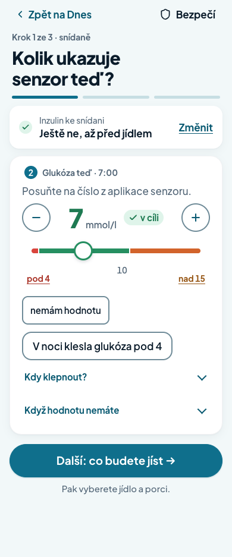

- **Co to je:** otázka „Glukóza teď“ s posuvníkem hodnoty (velké číslo se slovem a ikonou stavu, dráha 4–15 s konci „pod 4“ a „nad 15“, −/+, „nemám hodnotu“).
- **K čemu je pacientovi:** jedním pohledem do aplikace senzoru opíše hodnotu před jídlem.
- **Kde v životě a v aplikaci:** poslední otázka kroku 1 (živě). Po volbě je aktivní „Další: co budete jíst →“ s řádkem „Pak vyberete jídlo a porci.“
- **Co se na ní počítá:** `V.gluSlider` (pásma: červená pod 4, zelená do horního cíle pacienta z C-CILE, oranžová nad ním); akce `mealBefore` → `NF.chip` (celé číslo, nebo hranice `{ mmol: 4, bound: 'under' }` / `{ mmol: 15, bound: 'over' }`, nebo nic). Bez volby je jezdec jen naznačený v poloze poslední opsané hodnoty (`lastManual`) a nic se neuloží.
- **Pravidla:** Z-GLUKOZA (klinická), C-CILE (klinická).
- **Stavy a hraniční případy:** „nemám hodnotu“ zápis uloží, ale do učení nejde, dokud ho nedoplní export; „pod 4“ → P30; „nad 15“ → P31; u snídaně nepovinný noční čip (P34).
- **Co jde do stopy:** hodnota v `jidlo.zapsano` (`manual.before`, `beforeBound`).
- **Pozor při programování:** zásada 6 – bez napojení na aplikaci výrobce senzoru, pacient hodnotu opisuje; hodnota se nikdy nepředvyplní.
- **Testy:** hlavní sada „SCHEMA 84 (integrace): posuvník ukazuje směr od cíle…“; `kontrola74-obsah.test.cjs` „A3: zápisy mezi kontrolami jen opsaná celá čísla…“.

## P30 · Krok 1 – glukóza pod 4

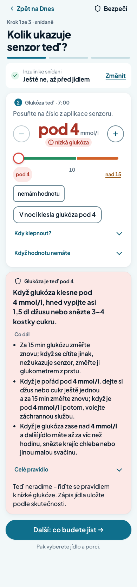

- **Co to je:** po volbě „pod 4“ hned pod posuvníkem červená karta „Glukóza je teď pod 4“ s pravidlem I-HYPO v okamžiku události a větou „Teď neradíme – řiďte se pravidlem k nízké glukóze. Zápis jídla uložte podle skutečnosti.“
- **K čemu je pacientovi:** okamžitě ví, jak léčit nízkou glukózu.
- **Kde v životě a v aplikaci:** P29 s volbou „pod 4“; zápis pokračuje, krok 3 pak neradí (P46).
- **Co se na ní počítá:** `NF.isLowValue`; `lowNowCard`; věta `NF.lowNowText` (B-HYPO `lowNow`, bez pravidla v plánu `lowNowBez`).
- **Pravidla:** I-HYPO (klinická), B-HYPO (klinická, texty), Z-GLUKOZA.
- **Stavy a hraniční případy:** bez I-HYPO v plánu věta na pravidlo neodkazuje.
- **Co jde do stopy:** při volbě „pod 4“ hned `pravidlo.nizka` (`where: 'now'`, položka I-HYPO, `shown` podle plánu; od SCHEMA 87, stejně jako `pravidlo.vysoka` u „nad 15“), hodnota pak v `jidlo.zapsano`.
- **Pozor při programování:** rychlý cukr je léčba nízké glukózy, ne rada k porci; procházka se nenabízí.
- **Testy:** hlavní sada „SCHEMA 87 (bod 1): pravidla pod 4, nevím a menší porce jdou do stopy jako pravidlo.vysoka; události výpočtu nesou verzi a otisk položek; krácení stopy je omezení makety“; hlavní sada „Rozhodnutí vlastníka 25. 10. 2026: při glukóze pod 4 před jídlem krok 3 neradí vůbec…“.

## P31 · Krok 1 – glukóza nad 15

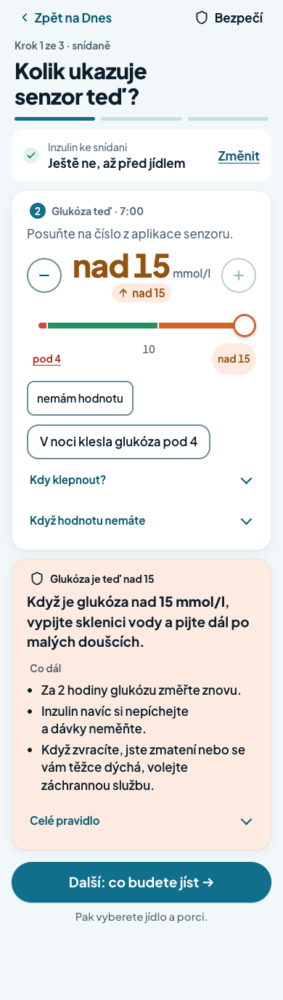

- **Co to je:** po volbě „nad 15“ oranžová karta „Glukóza je teď nad 15“ s pravidlem I-VYSOKA v okamžiku události.
- **K čemu je pacientovi:** ví, co dělat při vysoké glukóze (voda, změřit za 2 h, inzulin navíc nepíchat).
- **Kde v životě a v aplikaci:** P29 s volbou „nad 15“; zápis pokračuje.
- **Co se na ní počítá:** akce `mealBefore` → `NF.noteHigh(S, 'now')`; `highCard`.
- **Pravidla:** I-VYSOKA (klinická, `v` 15), Z-GLUKOZA.
- **Stavy a hraniční případy:** zamítnutá I-VYSOKA → oznámení; spouštěčem je čip, aplikace živou glukózu ani „déle než 3 hodiny“ nevidí.
- **Co jde do stopy:** `pravidlo.vysoka` (kde, zda se pravidlo ukázalo, položka I-VYSOKA).
- **Pozor při programování:** pohyb při vysoké glukóze se neradí; žádná výzva volat ordinaci.
- **Testy:** `kontrola2-obsah.test.cjs` „A6, B1, B3: I-HYPO, I-VYSOKA a I-MENE mají úplné znění bez výzvy volat…“.

## P32 · Krok 1 – nejvyšší hodnota po minulém jídle

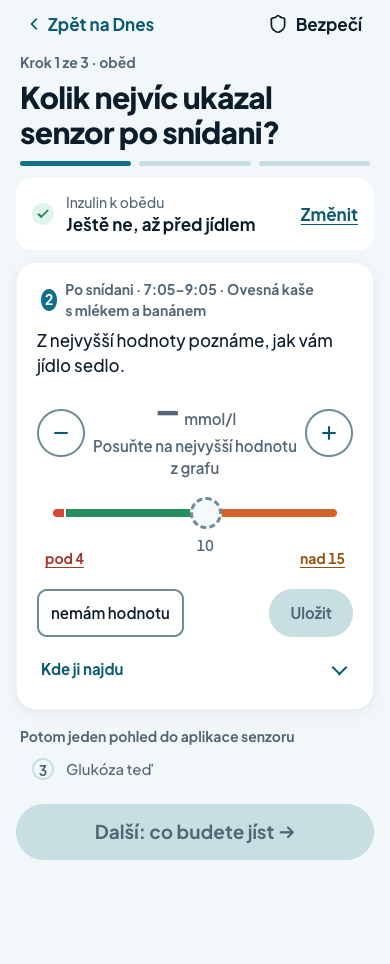

- **Co to je:** otázka 2 „Po snídani · 7:00–9:00 · název jídla“: posuvník nejvyšší hodnoty s tlačítkem „Uložit · N mmol/l“ a „Kde ji najdu“.
- **K čemu je pacientovi:** při jednom pohledu do senzoru doplní vrchol po předchozím jídle; z něj aplikace pozná, jak mu jídlo sedlo.
- **Kde v životě a v aplikaci:** v kroku 1 dalšího jídla, když předchozí zápis nemá nejvyšší hodnotu a od jídla uplynuly aspoň 2 h a nejvýš 24 h (`NF.pendingPeakAsk`, Z-GLUKOZA `pripominka_min` 120). Nejvýš dva zápisy. Večer se totéž zeptá Dnes u bazálu.
- **Co se na ní počítá:** akce `vsPick` (podrží volbu) a `peakChip` → `NF.setManualPeak`; „pod 4“ = pokles (otázka na pokles se už neptá) a P17; „nad 15“ = pravidlo I-VYSOKA v minulé podobě. Uložení přepočítá štítek reakce (`NF.settleLabels`) a karta „Jak to dopadlo“ je hned na Dnes.
- **Pravidla:** Z-GLUKOZA (klinická), R-REAKCE (okno 120 min, klinická).
- **Stavy a hraniční případy:** „nemám hodnotu“ nastaví `manual.skipped`; zápis s exportem se neptá.
- **Co jde do stopy:** `glukoza.nejvyssi` (nebo `glukoza.nejvyssi.neznama`), při „nad 15“ `pravidlo.vysoka`, při „pod 4“ `pravidlo.nizka` (`where: 'nejvyssi'`; od SCHEMA 87).
- **Pozor při programování:** uložení hned mění otázku na pokles, proto potvrzení tlačítkem; věta, jak vrchol v grafu najít, nesmí jmenovat výrobce.
- **Testy:** hlavní sada „Reakce těla podle podílu v cíli; rozmezí se s daty upřesňuje (od 8 zápisů percentily)“; `zaverecne80.test.cjs` „82 B1, C4, C5: … krok s hodnotou míří na sbalený řádek“.

## P33 · Krok 1 – pokles po minulém jídle

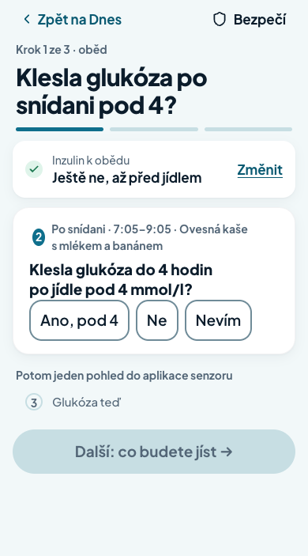

- **Co to je:** otázka „Klesla glukóza do 4 hodin po jídle pod 4 mmol/l?“ (u zápisu mladšího než 4 h „Klesla glukóza od jídla zatím pod 4 mmol/l?“) s volbami Ano, pod 4 · Ne · Nevím.
- **K čemu je pacientovi:** zapíše pokles, který by jinak nikdo neviděl.
- **Kde v životě a v aplikaci:** hned po uložení nejvyšší hodnoty (P32). Pak otázka na glukózu teď.
- **Co se na ní počítá:** akce `lowChip` → `NF.setManualLow`; „Ano“ → `S.lowNotice` (P17).
- **Pravidla:** B-HYPO (klinická).
- **Stavy a hraniční případy:** se zamítnutou B-HYPO se otázka neptá, místo ní oznámení.
- **Co jde do stopy:** `glukoza.nejnizsi`.
- **Pozor při programování:** stejné znění v živém i zpětném zápisu.
- **Testy:** `faze2-jadro.test.cjs` „A24 otázka na pokles všude stejně“; `kontrola2-obsah.test.cjs` „B15…“.

## P34 · Krok 1 – noční pokles u snídaně

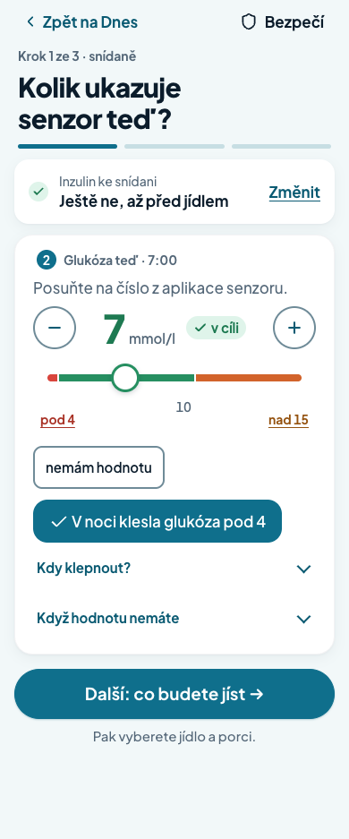

- **Co to je:** u snídaně pod posuvníkem nepovinný čip „V noci klesla glukóza pod 4“ s vysvětlením pod „Kdy klepnout?“.
- **K čemu je pacientovi:** zapíše noční pokles bez další otázky nebo připomínky.
- **Kde v životě a v aplikaci:** jen u snídaně; ne pro noc, na kterou se už ptá otázka po menší nebo vynechané večeři (`NF.nightAsked`).
- **Co se na ní počítá:** akce `mealNightLow`; při uložení `ep.manual.nightLow`, `NF.nightLows` (pokles patří k noci před snídaní a počítá se do poklesů za 7 dní) a `S.lowNotice` s příznakem `night`.
- **Pravidla:** B-HYPO (klinická; `nocCip`, `nocCipPomoc`).
- **Stavy a hraniční případy:** se zamítnutou B-HYPO čip není, na jeho místě oznámení.
- **Co jde do stopy:** `hypo.noc`.
- **Pozor při programování:** noční pokles se nepočítá dvakrát; lékař ho vidí u návrhu k bazálu.
- **Testy:** `zaverecne80.test.cjs` „81 bod 8: noční poklesy zapsané pacientem se počítají do návrhu k bazálu i bez exportu…“.

---

# D. Zpětný zápis – krok 1

Zpětný zápis (`mealStep1Retro`) se otevře z „Snídaně už byla“, „Ano, byla“, uzlu „chybí“ v pásu dne nebo „Doplnit“ u včerejšího jídla. Hlavička „Krok 1 ze 3 · snídaně zpětně“ (u včerejška „včera · …“). Čtyři otázky: inzulin → čas jídla a inzulinu → glukóza při jídle → nejvyšší po jídle a pokles.

## P35 · Zpětně – Byl inzulin?

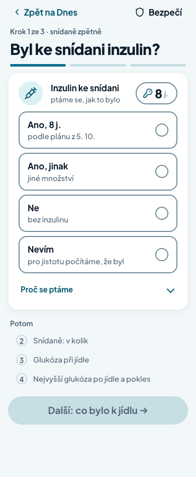

- **Co to je:** „Byl ke snídani inzulin?“ s volbami Ano, 8 j. · Ano, jinak · Ne · Nevím.
- **K čemu je pacientovi:** doplní inzulin k jídlu, které už snědl.
- **Kde v životě a v aplikaci:** první otázka zpětného zápisu; pak čas (P36).
- **Co se na ní počítá:** `mealBolus`; místo „Ještě ne“ je „Ne“ (bez inzulinu).
- **Pravidla:** S-DAVKA, D-CISTA (zpětný zápis jde jen do učení, ne do návrhu k dávce – `NF.usableForDose`).
- **Stavy a hraniční případy:** „Ne“ a „Nevím“ – zápis se uloží, do hodnocení jídla nejde (v kroku 3 věta proč).
- **Co jde do stopy:** v `jidlo.zapsano` (`retro: true`).
- **Pozor při programování:** zpětný zápis má stejnou bezpečnostní větev jako živý.
- **Testy:** hlavní sada „Čistá data pro dávku 6. 10. 2026: … zpětný zápis … jen do učení…“.

## P36 · Zpětně – V kolik bylo jídlo?

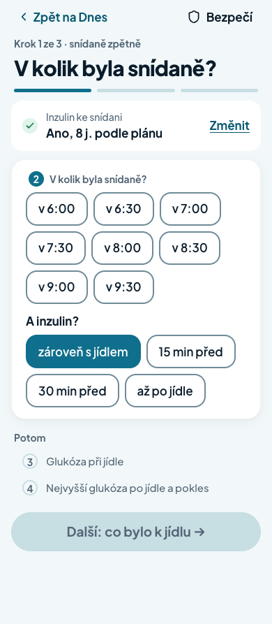

- **Co to je:** volba času jídla po půlhodinách (od začátku denní doby slotu, jen časy, které už minuly) a u podaného inzulinu „A inzulin?“ (zároveň s jídlem · 15 min před · 30 min před · až po jídle).
- **K čemu je pacientovi:** bez psaní zadá, kdy jedl a kdy si píchl.
- **Kde v životě a v aplikaci:** P35 → P36 → „Pokračovat“ → P37.
- **Co se na ní počítá:** `mealAt`, `mealTime`; `NF.retroAt` (čas nikdy v budoucnosti; zápis po půlnoci patří k včerejšku).
- **Pravidla:** D-CISTA (tolerance času pro učení).
- **Stavy a hraniční případy:** neplatná hodina se nepřijme.
- **Co jde do stopy:** v `jidlo.zapsano` (`at`, `insulin.time`).
- **Pozor při programování:** čas je odhad, proto zpětný zápis nevstupuje do návrhu k dávce.
- **Testy:** `robustnost.test.cjs` „Zpětný zápis: neplatná hodina (−1, 25,5, NaN, 7,999)…“.

## P37 · Zpětně – glukóza při jídle

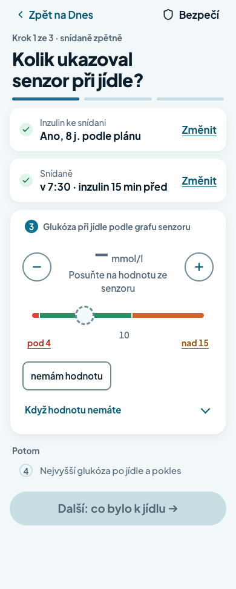

- **Co to je:** „Glukóza při jídle podle grafu senzoru“ – stejný posuvník jako P29 a „Pokračovat“.
- **K čemu je pacientovi:** opíše hodnotu z grafu v čase jídla.
- **Kde v životě a v aplikaci:** P36 → P37 → P38. U zpětné snídaně může nad ní být noční otázka (`hypoWatchCard(S, true)`).
- **Co se na ní počítá:** `mealBefore`; „pod 4“ → pravidlo I-HYPO; „nad 15“ → I-VYSOKA v minulé podobě („Při jídle byla glukóza nad 15“).
- **Pravidla:** Z-GLUKOZA, I-HYPO, I-VYSOKA, B-HYPO.
- **Stavy a hraniční případy:** jako P29.
- **Co jde do stopy:** v `jidlo.zapsano`; „nad 15“ `pravidlo.vysoka`.
- **Pozor při programování:** u hodnoty z minulosti nesmí pravidlo znít jako poplach teď.
- **Testy:** `kontrola74-obsah.test.cjs` „B2, B4: zpětná snídaně s čipem „nad 15“ ukáže pravidlo I-VYSOKA a otázku při rozchodu“.

## P38 · Zpětně – nejvyšší po jídle nad 15

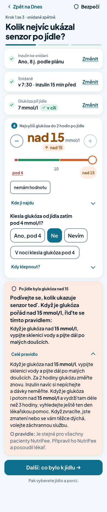

- **Co to je:** otázka 4 „Nejvyšší glukóza do 2 hodin po jídle“ s posuvníkem, otázkou na pokles a – po volbě „nad 15“ – kartou „Po jídle byla glukóza nad 15“, která začíná „Podívejte se, kolik ukazuje senzor teď…“.
- **K čemu je pacientovi:** doplní vrchol a pokles z grafu; při vysoké hodnotě ví, že má zkontrolovat glukózu teď.
- **Kde v životě a v aplikaci:** poslední otázka zpětného kroku 1; „Další: co bylo k jídlu →“.
- **Co se na ní počítá:** `mealPeak`, `mealLow`; „pod 4“ jako nejvyšší = pokles; `NF.noteHigh(S, 'peak')`; `highCard(…, past = true)` s textem I-VYSOKA `minula`.
- **Pravidla:** Z-GLUKOZA, B-HYPO, I-VYSOKA (klinické).
- **Stavy a hraniční případy:** u snídaně i noční čip.
- **Co jde do stopy:** `pravidlo.vysoka`; hodnoty v `jidlo.zapsano`.
- **Pozor při programování:** P8 – minulá hodnota začíná „Podívejte se…“; na Dnes večer se už neukazuje.
- **Testy:** `kontrola2-obsah.test.cjs` „B2: nejvyšší hodnota „nad 15“ z minulosti začíná „Podívejte se, kolik ukazuje senzor teď“ “.

---

# E. Zápis jídla – krok 2

## P39 · Krok 2 – co budete jíst a porce

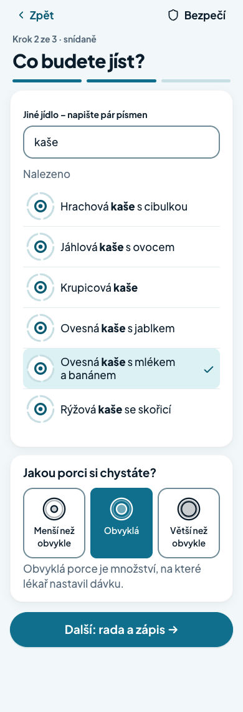

- **Co to je:** hledání jídla psaním, mřížka „Naposledy“ (nebo „Nalezeno“) s prstencem učení a stavem jídla, a volba porce menší · obvyklá · větší.
- **K čemu je pacientovi:** vybere jídlo bez počítání a řekne, jak velkou porci si chystá.
- **Kde v životě a v aplikaci:** po kroku 1. „Další: rada a zápis →“ je aktivní s jídlem i porcí.
- **Co se na ní počítá:** `NF.searchFoods` (bez ohledu na diakritiku), `NF.recentFoods`, `NF.confidence` pro štítek každého jídla, `NF.slotStates` (stav po jídlech dne při rozdílné dávce); `mealFood`, `mealPortion`.
- **Pravidla:** J-DATABAZE (provozní, seznam jídel), R-REAKCE, R-SKORE, R-PODOBNOST (klinické).
- **Stavy a hraniční případy:** podobný název → „Je to stejné jídlo jako „X“…?“ (`NF.likeName`); nic nenalezeno → „Přidat „…“ do seznamu“ (P40).
- **Co jde do stopy:** nic hned; výběr je v `jidlo.zapsano`.
- **Pozor při programování:** zásada 2 – žádná čísla, makra ani složení; „Obvyklá porce je množství, na které lékař nastavil dávku.“
- **Testy:** `robustnost.test.cjs` „Hledání jídla nezávisí na diakritice“; hlavní sada „Závěrečná kontrola 23. 10. (01 #1): podobný název nesmí spojit jídla…“; hlavní sada „Učení podle jídla dne pacientovi (25. 10. 2026)…“.

## P40 · Krok 2 – nové jídlo jen názvem

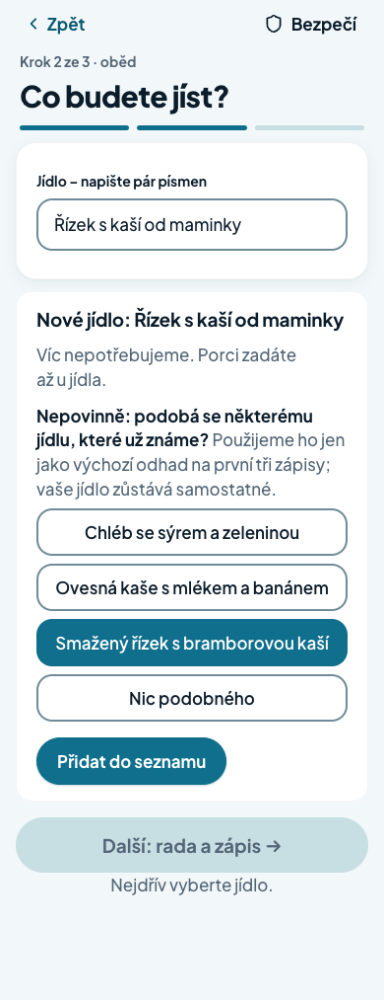

- **Co to je:** karta „Nové jídlo: název“ s nepovinnou otázkou „Podobá se některému jídlu, které už známe?“ a „Přidat do seznamu“.
- **K čemu je pacientovi:** zapíše jídlo, které v seznamu není, bez zadávání složení.
- **Kde v životě a v aplikaci:** P39 → „Přidat …“ → P40 → porce.
- **Co se na ní počítá:** `NF.likeCandidates`, `NF.addFood(S, name, { like })` (podobné jídlo předá údaje pro šablonu rad: bílkovina, jednolité, skupina doplňku; váha 2 virtuálních zápisů do odhadu); duplicitní název → „Myslíte X?“.
- **Pravidla:** J-STITKY (provozní), R-PODOBNOST (klinická).
- **Stavy a hraniční případy:** zamítnutá R-PODOBNOST → bez otázky na podobné, s oznámením.
- **Co jde do stopy:** `jidlo.pridano`.
- **Pozor při programování:** na složení se aplikace nikdy neptá (`15` odst. 6 a 18).
- **Testy:** `kontrola4-obsah.test.cjs` „02 B7, B8: … nové jídlo „jako X“ převezme údaje X“; `robustnost.test.cjs` (duplicitní jídlo v hlavní sadě „Robustnost: osekaný stav…“).

## P41 · Krok 2 – svačina

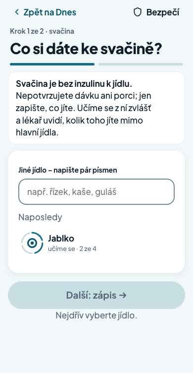

- **Co to je:** „Krok 1 ze 2 · svačina“ s větou „Svačina je bez inzulinu k jídlu…“ a hledáním jídla, bez porce.
- **K čemu je pacientovi:** zapíše jídlo mimo hlavní jídla; lékař uvidí, kolik toho jí mimo ně.
- **Kde v životě a v aplikaci:** „Zapsat svačinu“ na Dnes; pak krok 3 a „Uložit svačinu“.
- **Co se na ní počítá:** `NF.isSnack`; při uložení `insulin.confirmed = 'snack'`; svačina se učí zvlášť a nevstupuje do slotů ani návrhů k dávce; svačina do 120 min po hlavním jídle vyřadí to jídlo z učení (D-CISTA `svacina_min`).
- **Pravidla:** D-CISTA (klinická).
- **Stavy a hraniční případy:** krok 3 svačiny nemá stupnici.
- **Co jde do stopy:** `jidlo.zapsano`.
- **Pozor při programování:** svačina nemá krok 1, tedy ani hodnotu glukózy před jídlem, a z opsaných čísel se do učení nezapočítá (`NF.complete` chce obě hodnoty); učí se až z exportu. Na nejvyšší hodnotu po svačině se krok 1 dalšího jídla přesto ptá, protože odpověď slouží dvakrát: ukáže kartu „Jak to dopadlo“ ke svačině (`NF.lastResult`, `NF.readyAt`) a vstupuje do shody opsaných hodnot s exportem (Z-IMPORT), která je dokladem pro studii. Ověřeno ve SCHEMA 87, chování beze změny (`15` odst. 7a).
- **Testy:** hlavní sada „Svačina: bez inzulinu a bez porce, mimo sloty a návrhy k dávce, učí se zvlášť…“, „Svačina se nepočítá do návyků…“.

---

# F. Zápis jídla – krok 3

Krok 3 (`V.meal`, `m.step === 3`) nahoře ukazuje jídlo se stavem slovem a ikonou a jednou větou; stupnice a čísla jsou pod „Podrobnosti“ (P7). Pak bezpečnostní pravidlo v okamžiku události, rady a uložení. Při vstupu do kroku 3 se zapíše `rada.zobrazena` (úroveň jídla, nabídnuté a blokované rady, inzulin, porce, brána rad).

Rady počítá `NF.advise(S, foodId, portion, bolusState, meal)`:

- **Brána** `NF.adviceGate`: aktivní účast, převzatý plán, schválená R-REAKCE.
- **Pod 4 teď** → žádná rada (P46).
- **Porce** (R-PORCE): před píchnutím oběma směry k obvyklé; po píchnutí a při „nevím“ jen z větší; z menší po píchnutí žádná rada, jen pravidlo I-MENE. Při nemoci ne.
- **Doplněk, pořadí, procházka** (R-DOPLNEK, R-PORADI, R-PROCHAZKA): nabídnou se, když podíl zápisů v cíli je pod R-SKORE `mirna` 0,5 (známé jídlo z vlastních zápisů, učené z odhadu podobných), nebo u známého jídla ty, které pacient už zkoušel. Doplněk jen před píchnutím; pořadí ne u jednolitého jídla; doplněk ne u jídla s bílkovinou a po 3 přijetích bez jediného výsledku v cíli se stáhne (`stahnout_po`); procházka ne při riziku nízké glukózy. Lékař může radu vypnout nebo doporučit (`NF.planAdvice`).
- **Text rady** skládá šablona položky (`fill`): `{addon}` ze seznamu povolených doplňků, `{first}` jen ze složek, které jídlo má, `{minut}` z R-PROCHAZKA. Text, který mluví o množství (`NF.talksAmount`), se v riziku nízké glukózy nenabídne.
- **Rutina:** po 3 odpovědích na tutéž radu u téhož jídla je rada jeden řádek „Jako minule: …“ se „Změnit“ (`NF.lastAnswers`).

## P42 · Krok 3 – neznámé jídlo (první zápis)

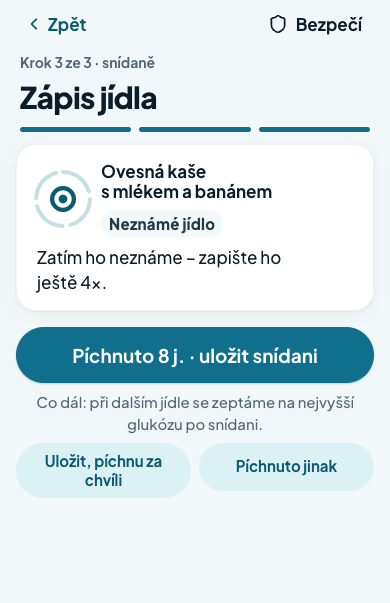

- **Co to je:** „Zápis jídla“ s kartou jídla „Neznámé jídlo · Zatím ho neznáme – zapište ho ještě 4×.“ a tlačítkem uložení.
- **K čemu je pacientovi:** zapíše jídlo; ví, kolik zápisů chybí, než ho aplikace pozná.
- **Kde v životě a v aplikaci:** první zápis jídla. Uložení → Dnes s poděkováním (R-DIKY) a řádkem „Co dál: při dalším jídle se zeptáme na nejvyšší glukózu po snídani.“
- **Co se na ní počítá:** `NF.confidence` (úroveň `unknown`/`learning`/`similar`/`known`/`unstable`); bez rad, protože o jídle nic nevíme; `NF.saveEpisode`, `NF.thanks`, `NF.checkMilestones`.
- **Pravidla:** R-REAKCE (`minKnown` 4, `maxUceni` 6, `shoda_mmol` 2,5), R-DIKY (provozní).
- **Stavy a hraniční případy:** v příběhu je v tomto zápisu inzulin „Ještě ne“, proto tlačítko „Píchnuto 8 j. · uložit snídani“ (viz P43).
- **Co jde do stopy:** `rada.zobrazena`, `jidlo.zapsano` (včetně `usable` a `whyNot`), případně `milnik`.
- **Pozor při programování:** jídlo je známé, až když se aspoň 4 započítané zápisy z posledních 6 shodují; prstenec učení má 4 segmenty.
- **Testy:** hlavní sada „Učení: známé od 4 započítaných (R-REAKCE minKnown); nezapočítá se nevím, nemoc, jiná porce, jiná dávka“ (název opravený ve SCHEMA 87).

## P43 · Krok 3 – před píchnutím: porce zpět k obvyklé, doplněk a procházka

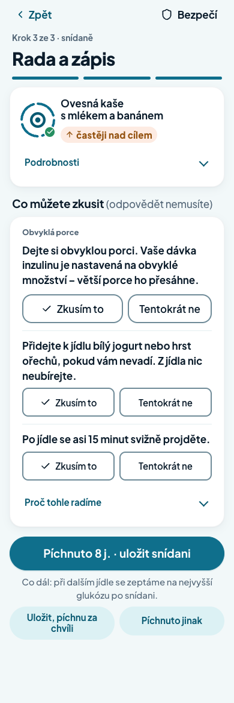

- **Co to je:** „Rada a zápis“: karta jídla, „Co můžete zkusit (odpovědět nemusíte)“ s hlavní radou (porce) a dalšími radami (doplněk, procházka) jako řádky v téže kartě, „Zkusím to“ / „Tentokrát ne“, „Proč tohle radíme“; tlačítko „Píchnuto 8 j. · uložit snídani“, řádek „Co dál“ a vedlejší „Uložit, píchnu za chvíli“ / „Píchnuto jinak“.
- **K čemu je pacientovi:** dokud inzulin není v těle, může porci vrátit k obvyklé a přidat doplněk.
- **Kde v životě a v aplikaci:** krok 1 s odpovědí „Ještě ne“ a větší (nebo menší) porcí. „Uložit, píchnu za chvíli“ → P24.
- **Co se na ní počítá:** `NF.advise` s `effective = 'before'`; přijetí rady k porci uloží porci jako obvyklou (`portionPlanned` zůstane), „Tentokrát ne“ otevře důvody (`NF.reasonsFor`; „V jídle to není“ radu u jídla trvale vypne – `food.leverOff`).
- **Pravidla:** R-PORCE, R-DOPLNEK, R-PORADI, R-PROCHAZKA, R-SKORE, R-REAKCE (klinické), R-ZMIZELA (provozní věta o zmizelé radě).
- **Stavy a hraniční případy:** u menší porce před píchnutím rada „Dejte si obvyklou porci…“ s větou o chuti k jídlu; když ji pacient odmítne, ukáže se pravidlo I-MENE („Až si píchnete, platí toto pravidlo.“).
- **Co jde do stopy:** `rada.zobrazena`; odpovědi na rady v `jidlo.zapsano` (`advice[]`); `rada.vypnuta` u „V jídle to není“.
- **Pozor při programování:** jediné primární tlačítko je uložení (P1); odpovědi nejsou primární; doplňky nikdy neubírají z jídla.
- **Testy:** hlavní sada „Porce: před píchnutím oběma směry; po píchnutí jen z větší; nikdy „sněz víc“ “, „Texty doplňků nic z jídla neubírají…“; `kontrola3-obsah.test.cjs` „A2: …“ (čtyři testy šablon).

## P44 · Krok 3 – po píchnutí

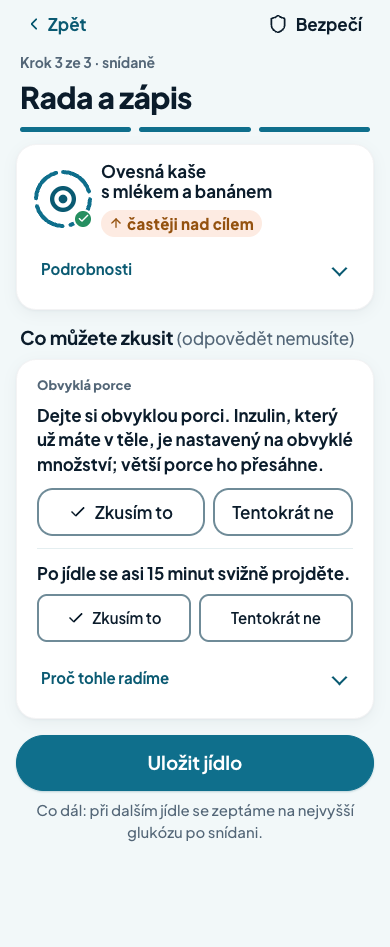

- **Co to je:** „Rada a zápis“ po odpovědi „Ano, 8 j.“: jen rady, které po píchnutí smí přijít (porce z větší zpět k obvyklé, pořadí, procházka), a „Uložit jídlo“.
- **K čemu je pacientovi:** dostane jen bezpečné rady pro chvíli, kdy je inzulin už v těle.
- **Kde v životě a v aplikaci:** běžný zápis s inzulinem podaným před jídlem.
- **Co se na ní počítá:** `NF.advise` s `effective = 'after'`: doplněk se nenabízí (`beforeOnly`), porce jen z větší; „Proč teď neradíme“ vypíše blokované rady (`res.blocked`).
- **Pravidla:** R-PORCE, R-PORADI, R-PROCHAZKA (klinické).
- **Stavy a hraniční případy:** u kaše (jednolité jídlo) se pořadí nenabízí; dvě přijaté rady v jednom zápisu se počítají ke každé se značkou „spolu s další radou“.
- **Co jde do stopy:** `rada.zobrazena`, `jidlo.zapsano`.
- **Pozor při programování:** zásada 3 – po píchnutí nikdy „sněz víc“.
- **Testy:** `faze2-pribeh.test.cjs` „C05, C06: scéna 11 bez pořadí u kaše, dvě rady…“; `faze2-jadro.test.cjs` „A16 zápis se dvěma přijatými radami se počítá ke každé se značkou“.

## P45 · Krok 3 – menší porce po píchnutí

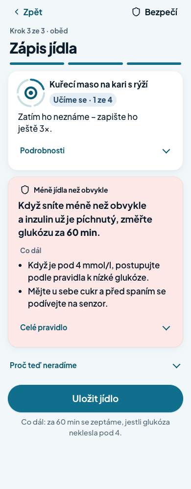

- **Co to je:** „Zápis jídla“ s červenou kartou „Méně jídla než obvykle“ – pravidlo I-MENE v okamžiku události – a řádkem „Co dál: za 60 min se zeptáme, jestli glukóza neklesla pod 4.“
- **K čemu je pacientovi:** po menší porci s inzulinem v těle ví, co hlídat; nedostane radu jíst víc.
- **Kde v životě a v aplikaci:** menší porce a inzulin podaný nebo „nevím“. Po uložení P15 na Dnes, za 60 min P16.
- **Co se na ní počítá:** `NF.advise`: `smallerInBody`, rada k porci blokovaná (`reason: 'bolus'`), procházka blokovaná (`reason: 'low'`); při uložení `NF.addHypoWatch(S, 'smaller', …)`.
- **Pravidla:** I-MENE, B-HYPO, R-PORCE (klinické).
- **Stavy a hraniční případy:** bezpečnostní větev nezávisí na bráně rad – pravidlo se ukáže i se zamítnutou R-REAKCE nebo před převzetím plánu.
- **Co jde do stopy:** při vstupu do kroku 3 `pravidlo.mene` (`where: 'krok3'`, položka I-MENE; od SCHEMA 87), dále `rada.zobrazena` (s blokovanými radami), `jidlo.zapsano`, `hypo.sledovani`. `pravidlo.mene` se zapíše i tehdy, když pacient před píchnutím s menší porcí odmítne radu k porci (`where: 'odmitnuta'`).
- **Pozor při programování:** zásada 3 a P8 (okamžik události: první krok velkým písmem).
- **Testy:** hlavní sada „SCHEMA 87 (bod 1): pravidla pod 4, nevím a menší porce jdou do stopy jako pravidlo.vysoka; události výpočtu nesou verzi a otisk položek; krácení stopy je omezení makety“; `kontrola2-obsah.test.cjs` „A1: … rada mluvící o množství se po píchnutí / „nevím“ s menší porcí nenabídne“, „A2: zamítnutá R-REAKCE ani nepřevzatý plán neskryjí I-MENE…“.

## P46 · Krok 3 – glukóza pod 4 před jídlem

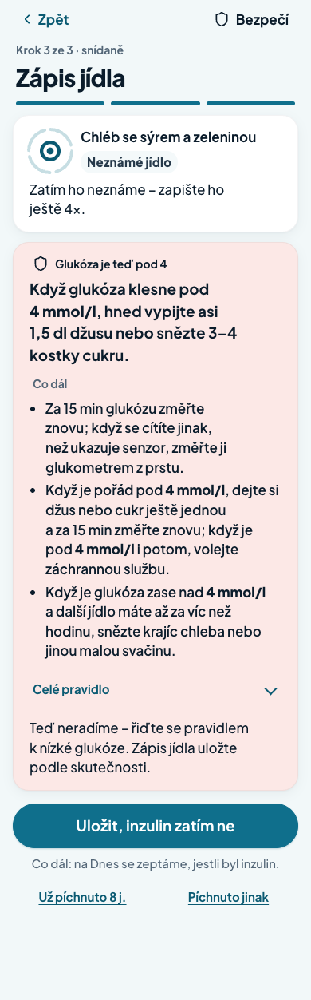

- **Co to je:** „Zápis jídla“ bez rad: karta jídla, pravidlo I-HYPO v okamžiku události a „Teď neradíme – řiďte se pravidlem k nízké glukóze. Zápis jídla uložte podle skutečnosti.“ Při odpovědi „Ještě ne“ je hlavní tlačítko **„Uložit, inzulin zatím ne“** s řádkem „Co dál: na Dnes se zeptáme, jestli byl inzulin.“ a pod ním vedlejší obrysové volby „Už píchnuto 8 j.“ a „Píchnuto jinak“.
- **K čemu je pacientovi:** nejdřív léčí nízkou glukózu; jídlo jen zapíše.
- **Kde v životě a v aplikaci:** krok 1 s glukózou teď „pod 4“ (P30). Snímek je pořízený s odpovědí „Ještě ne“. „Uložit, inzulin zatím ne“ uloží jídlo podle skutečnosti a inzulin nechá „čekat na potvrzení“ jako „Uložit, píchnu za chvíli“ (P43) – na Dnes pak karta P24. „Už píchnuto 8 j.“ uloží jídlo s inzulinem podle plánu; „Píchnuto jinak“ otevře posuvník jednotek.
- **Co se na ní počítá:** `NF.advise` → `lowNow`, brána `{ ok: false, low: true }`; žádná rada k pořadí, doplňku, porci ani procházce.
- **Pravidla:** I-HYPO, B-HYPO (klinické).
- **Stavy a hraniční případy:** totéž u zpětného zápisu (`NF.adviseAfter`). S odpovědí „Ano“ v kroku 1 je hlavní tlačítko běžné uložení; větev „Uložit, inzulin zatím ne“ je jen pro „Ještě ne“ (od SCHEMA 87, rozhodnutí vlastníka 6. 11. 2026, bod 1; zvoleno bez dotazu jako nejopatrnější varianta, `15` odst. 7.3).
- **Co jde do stopy:** při vstupu do kroku 3 `pravidlo.nizka` (`where: 'krok3'`, živě i zpětně; od SCHEMA 87), `rada.zobrazena` (brána `low`), `jidlo.zapsano`; u „Uložit, inzulin zatím ne“ později `jidlo.inzulin.potvrzen` z karty P24.
- **Pozor při programování:** pořadí „nejdřív maso“ by šlo proti pravidlu „rychlé sacharidy hned“ – proto žádná rada. Hlavní tlačítko nesmí navádět k potvrzení píchnutí, které ještě nebylo; aplikace neříká, kdy ani zda píchnout – platí pravidlo I-HYPO nad tlačítky.
- **Testy:** hlavní sada „SCHEMA 87 (body 3, 7): čísla pacienta posuvníkem 1–60 j. z jednoho místa; čas inzulinu „jiný čas“ posuvníkem; ordinace má týž rozsah“; hlavní sada „Rozhodnutí vlastníka 25. 10. 2026: při glukóze pod 4 před jídlem krok 3 neradí vůbec…“.

## P47 · Krok 3 – zpětný zápis

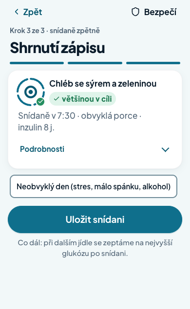

- **Co to je:** „Shrnutí zápisu“ (nebo „Zápis a co pomůže teď“): karta jídla s řádkem „Snídaně v 7:00 · obvyklá porce · inzulin 8 j.“, případně jediná rada – procházka –, volba „Neobvyklý den (stres, málo spánku, alkohol)“ a „Uložit snídani“.
- **K čemu je pacientovi:** zápis dokončí a, je-li to do hodiny od jídla, dostane radu, která ještě pomůže.
- **Kde v životě a v aplikaci:** po zpětném kroku 2. Uložení → Dnes s poděkováním „i zpětný zápis se počítá“.
- **Co se na ní počítá:** `NF.adviseAfter`: procházka jen do 60 min od jídla (R-PROCHAZKA `okno_min`), ne při nemoci, ne po poklesu ani při menší porci s inzulinem; `NF.retroAt`.
- **Pravidla:** R-PROCHAZKA, I-MENE, I-HYPO, R-REAKCE (klinické), R-DIKY (provozní).
- **Stavy a hraniční případy:** inzulin „ne“ nebo „nevím“ → upozornění „do hodnocení jídla ho nepočítáme“ s tlačítkem Bezpečí; neobvyklý den → mimo hodnocení.
- **Co jde do stopy:** `rada.zobrazena` („zpětně“), `jidlo.zapsano` (`retro: true`).
- **Pozor při programování:** zpětný zápis jde do učení, ne do návrhu k dávce.
- **Testy:** `faze2-jadro.test.cjs` „A06 procházka ve zpětném zápisu jen do R-PROCHAZKA.okno_min…“; hlavní sada „Zpětný zápis (27. 10. 2026): rada k procházce má dosazené minuty…“.

## P48 · Krok 3 – při nemoci

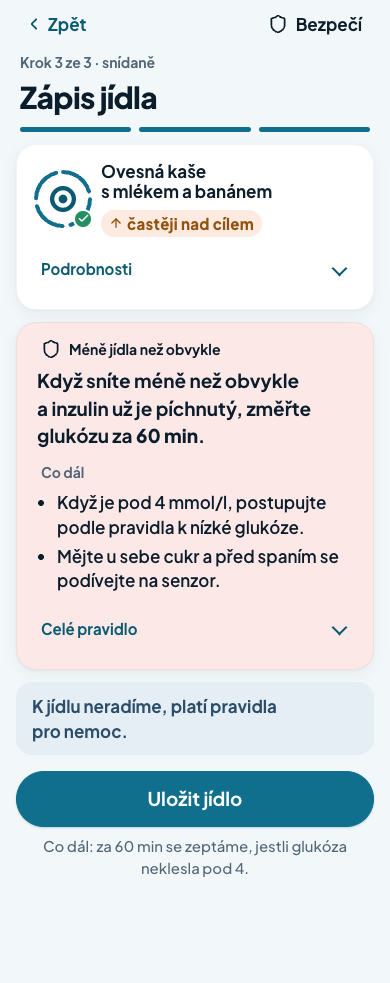

- **Co to je:** „Zápis jídla“ v režimu nemoci: věta „K jídlu neradíme, platí pravidla pro nemoc.“ a žádné rady; na snímku navíc pravidlo I-MENE (menší porce s inzulinem).
- **K čemu je pacientovi:** zapisuje dál, ale nic ho nezatěžuje.
- **Kde v životě a v aplikaci:** zápis během nemoci (P19).
- **Co se na ní počítá:** `NF.advise` s `res.illness`; zápis dostane `context: 'illness'` a nejde do učení.
- **Pravidla:** P-NEMOC, I-MENE (klinické).
- **Stavy a hraniční případy:** bezpečnostní pravidla platí i při nemoci.
- **Co jde do stopy:** `rada.zobrazena`, `jidlo.zapsano` (`context: 'illness'`).
- **Pozor při programování:** při nemoci ani doplněk a pořadí (žádná rada není `illnessSafe`).
- **Testy:** `robustnost.test.cjs` „Nemoc: žádná .advice v kroku 3 ani u zpětného zápisu“; `kontrola74-obsah.test.cjs` „C5: při nemoci jedna věta…“.

---

# G. Jídla

## P49 · Vaše jídla

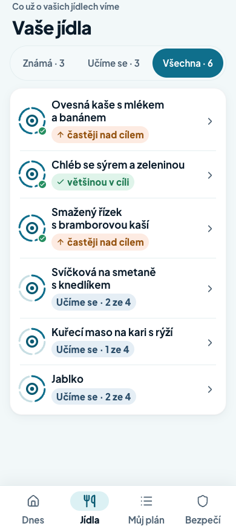

- **Co to je:** seznam jídel, která pacient jedl, s přepínačem Známá · Učíme se · Všechna; řádek = prstenec učení · název · štítek reakce · šipka.
- **K čemu je pacientovi:** vidí, co o jeho jídlech už víme.
- **Kde v životě a v aplikaci:** záložka Jídla; z Můj plán řádek „Známe už N vašich jídel“. Řádek → P50.
- **Co se na ní počítá:** `NF.foodStats`, `NF.confidence`, `NF.reactionLabel` (dva stupně: „většinou v cíli“ při podílu v cíli ≥ 0,5, jinak „častěji nad cílem“; od 4 započítaných zápisů, okno posledních 8, s hysterezí), `NF.slotStates`.
- **Pravidla:** R-REAKCE, R-SKORE (`mirna` 0,5, `odKolika` 4, `oknoZapisu` 8, `ustaleneOd` 8), R-PODOBNOST (klinické).
- **Stavy a hraniční případy:** prázdný seznam: „Zatím tu nic není…“; žádné známé jídlo: věta, po kolika zápisech jídlo poznáme; vlastní jídlo nese štítek „moje jídlo“.
- **Co jde do stopy:** nic.
- **Pozor při programování:** „v cíli“ = vrchol ≤ horní cíl pacienta – jedna míra všude (`15` odst. 6); „známé“ má hysterezi (zůstane, dokud shoda neselže ve dvou oknech po sobě).
- **Testy:** `faze2-jadro.test.cjs` „A32 R-SKORE jen dva stupně“; `obsah-pacienta.test.cjs` (Jídla v pokrytých obrazovkách).

## P50 · Detail jídla

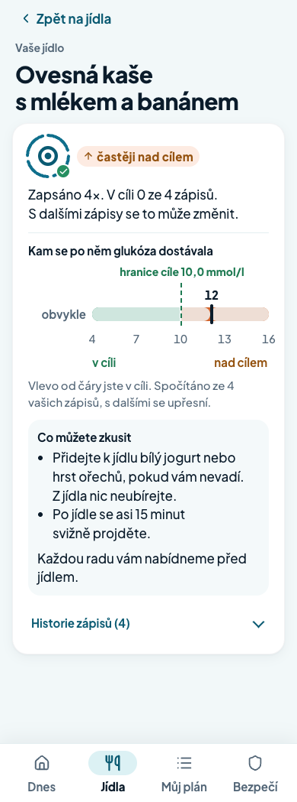

- **Co to je:** samostatná obrazovka jídla se „Zpět na jídla“: štítek, souhrnná věta, stupnice „Kam se po něm glukóza dostávala“ (řádek bez rady a s radou, čárkovaná hranice cíle), „S čím u vás bývalo v cíli“, „Co můžete zkusit“ a sbalená „Historie zápisů“.
- **K čemu je pacientovi:** podrobně vidí, jak na jídlo reaguje a co mu u něj pomáhá.
- **Kde v životě a v aplikaci:** z P49 nebo „Zobrazit jídlo“ v P14.
- **Co se na ní počítá:** `peakBlock` (rozmezí: do 7 zápisů nejnižší–nejvyšší, od 8 10.–90. percentil, R-REAKCE `minQuantile` 8), `NF.leverStats`, `NF.baseStats`, `NF.unstable`, `tipLevers` (stejná funkce textu jako krok 3), `NF.slotWhyText`, `NF.whyNotUsable` v tabulce historie.
- **Pravidla:** R-REAKCE, R-SKORE, R-PODOBNOST, R-DOPLNEK, R-PORADI, R-PROCHAZKA (klinické).
- **Stavy a hraniční případy:** podobné jídlo jen směrem slovem a ikonou, bez čísla; nestálé jídlo (po 6 zápisech bez shody) s vysvětlením; stažený doplněk se neukazuje.
- **Co jde do stopy:** nic.
- **Pozor při programování:** stupnice popisuje minulost; žádný graf tří křivek; hodnota „před jídlem“ se pacientovi neukazuje.
- **Testy:** hlavní sada „Rozhodnutí 20. 10. 2026 (SCHEMA 62): … detail jídla jako obrazovka“; `faze2-jadro.test.cjs` „A07 pořadí u jednolitých jídel nenabízet; detail bere text ze stejné funkce jako krok 3“, „A15 podobné jídlo jen směrem, bez čísla“.

---

# H. Můj plán, Co uvidí lékař, nový plán

## P51 · Můj plán


- **Co to je:** záložka „Můj plán“: nahoře „Jak si vedu“ (věta, plnění plánu za 7 dní, známá jídla, poslední týden), „Cesta ke kontrole“ s tkaninou zápisů a „Co uvidí lékař“, pak dávky, návyky, rady, připomínky v telefonu, cíle glukózy a co lékař změnil.
- **K čemu je pacientovi:** všechno „moje“ na jednom místě: jak si vede, kdy je kontrola, co platí.
- **Kde v životě a v aplikaci:** záložka nebo řádek „Můj plán“ z Dnes.
- **Co se na ní počítá:** `NF.howAmI` (započítané zápisy posledních 7 dní po jídlech dne proti hornímu cíli; jídlo dne se hodnotí od 3 zápisů), `weekPlanBlock` (inzulin potvrzený, obvyklá porce, návyky po dnech), `NF.pathStats`, `NF.weave` (den = sloupec, snídaně · oběd · večeře · bazál; jen činy), `NF.weekSummary(S, { all: true })`, `NF.reminderSettings`.
- **Pravidla:** R-SKORE (klinická, texty `vedu*`), S-CESTA, S-TYDEN, S-PRIPOMINKY (provozní; nejvýš 4 denně), C-CILE (klinická), R-NAVYKY.
- **Stavy a hraniční případy:** připomínky jde vypnout přepínačem (časy vybrala sestra); po změně plánu „Starší plány“.
- **Co jde do stopy:** `pripominka.vypnuta` / `pripominka.zapnuta`.
- **Pozor při programování:** pacient vidí „Známe už N vašich jídel“ bez jmenovatele; „Mezery nejsou chyba“; žádné série; pacient vidí cíl „4–10 mmol/l“ (hranice 4 z pravidel), lékař dolní cíl 3,9.
- **Testy:** `obsah-pacienta.test.cjs` P6/P7; hlavní sada „Milníky: … Cesta ke kontrole počítá X z N“; `kontrola4-obsah.test.cjs` „Bod 4: připomínky v telefonu…“.

## P52 · Co uvidí lékař (přehled před kontrolou)


- **Co to je:** přehled před kontrolou: připomínka exportu, „Díky za N dní zapisování“ s počty, sbalené „Podrobnosti v číslech“ (dlaždice s vysvětlením), návyky, tři navržené otázky na lékaře k zaklepnutí a vlastní otázka.
- **K čemu je pacientovi:** připraví se na kontrolu a vybere otázky.
- **Kde v životě a v aplikaci:** z Můj plán kdykoli, z Dnes 7 dní před kontrolou.
- **Co se na ní počítá:** `NF.summary`, `NF.periodInfo`, `NF.semafor` (prahy dlaždic S-SEMAFOR), `NF.leverStats` (věcně „s radou X z N v cíli“, srovnání bez rady až od 4 + 4), `NF.lowEvents` (první navržená otázka o poklesech).
- **Pravidla:** S-SOUHRN (provozní), S-SEMAFOR, C-CILE (klinické), S-VYSLEDEK `min_n`, Z-IMPORT.
- **Stavy a hraniční případy:** vlastní otázka je jediné místo, kde pacient píše; otázky uvidí lékař až v ordinaci.
- **Co jde do stopy:** `otazka.lekari` při vybrání i odebrání navržené otázky a při vlastní otázce (text otázky, `on`, `suggested`; od SCHEMA 87). Otázky dál leží ve stavu `S.questions`.
- **Pozor při programování:** bez slova „pomohl“ a bez hodnocení; zásada 5 – otázky nikdo mezi kontrolami nečte.
- **Testy:** hlavní sada „SCHEMA 87 (bod 1): odpovědi pacienta, podmínky zařazení, výchozí hodnoty, ověření dávek a ověřovací body lékaře jdou do stopy“; hlavní sada „Report pro pacienta: pochvala, dlaždice s vysvětlením, navržené otázky“; `faze2-pribeh.test.cjs` „C19: lékař v reportu vidí otázku, kterou pacient vybral“.

## P53 · Nový plán: co se změnilo


- **Co to je:** po kontrole „Co se změnilo“: dávky (nová označená „nová“, dřívější přeškrtnutá), otázka „Souhlasí s tím, co vám řekl lékař?“ u změněné dávky, návyky a rady, „Proč lékař rozhodl takto“ a „Rozumím, pokračuji“.
- **K čemu je pacientovi:** pozná změny a zkontroluje novou dávku.
- **Kde v životě a v aplikaci:** po vydání druhého a dalšího plánu, dokud ho nepřevezme. Pak Dnes.
- **Co se na ní počítá:** porovnání `p` a `p.previousId` (dávky, návyky, `NF.planAdvice`, pravidla a cíle); `NF.confirmUnderstanding`. Učení k radám u jídel s novou dávkou začíná znovu (`NF.sameDoseNow`).
- **Pravidla:** zásada 1; R-NAVYKY, R-POKYNY.
- **Stavy a hraniční případy:** bez změny dávky se otázka neptá; „Ne, něco nesedí“ zamkne převzetí.
- **Co jde do stopy:** `plan.davky.overeni` u odpovědi na nové dávky (od SCHEMA 87) a `plan.prevzat`.
- **Pozor při programování:** token dávky ukazuje jen čísla, nikdy rozdíl „+2“; staré milníky se nevystavují.
- **Testy:** hlavní sada „Vydání P2 z rozhodnutí; historie P1 zůstává; učení po změně dávky znovu“; `kontrola74-obsah.test.cjs` „B14, B16: nový plán říká proč…“; `faze2-jadro.test.cjs` „A29…“.

---

# I. Bezpečí

## P54 · Bezpečí


- **Co to je:** záložka „Bezpečí“: „Kam se obrátit“ (zdravotní potíže, ohrožení života, nefunguje senzor, nefunguje NutriFee, „Napsat podpoře“), seznam názvů bezpečnostních pravidel, „O pravidlech“, věta o tom, kdy NutriFee přestává platit, a přepínač „Není mi dobře“.
- **K čemu je pacientovi:** kdykoli najde, co dělat a kam se obrátit.
- **Kde v životě a v aplikaci:** záložka; „Platí vždy, i bez připojení“.
- **Co se na ní počítá:** `instructionsList(S, p, false, SAFETY_ORDER)` (pořadí nízká · vysoká · menší porce · nevím · nemoc ×2; I-KONTAKT je jen u kontaktů); `NF.hasInstruction(S, 'I-KONTAKT')`.
- **Pravidla:** R-POKYNY, I-HYPO, I-VYSOKA, I-MENE, I-NEVIM, I-NEMOC-BAZAL, I-NEMOC-JIDLO, I-KONTAKT, K-KRITERIA (text `bezpeci`), P-NEMOC (klinické); S-PODPORA (provozní).
- **Stavy a hraniční případy:** zamítnutá I-KONTAKT → zdravotní cesty nahradí oznámení, technické zůstanou; zamítnutý pokyn → oznámení na jeho místě.
- **Co jde do stopy:** přepínač nemoci `nemoc.zacatek` / `nemoc.konec`.
- **Pozor při programování:** pravidla bez uvozovek a bez podpisu lékaře; „Tato pravidla připravil NutriFee a posoudil je lékař.“; kontakty jsou informace, žádná karta na ně neposílá; aplikace nikam nevolá. Čísla kontaktů v maketě dodává slot ukázky (`demoText('cisla')`).
- **Testy:** `kontrola3-obsah.test.cjs` „B4: zamítnutá I-KONTAKT…“; `kontrola4-obsah.test.cjs` „Bod 10 a 02 B9…“; `obsah-pacienta.test.cjs` P8, P11.

## P55 · Bezpečí – celé pravidlo


- **Co to je:** rozbalené pravidlo „Nízká glukóza“ v Bezpečí s celým zněním a „O pravidle“.
- **K čemu je pacientovi:** přečte si celé pravidlo, když potřebuje.
- **Kde v životě a v aplikaci:** klepnutí na název pravidla v P54 (jedna úroveň rozbalení).
- **Co se na ní počítá:** `NF.instrHtml(NF.instrTextOf(S, c), value)` – dosazení hodnot `{v}` (nebo výjimky u pacienta z plánu).
- **Pravidla:** I-* (klinické).
- **Stavy a hraniční případy:** hodnota pravidla může být u pacienta výjimečně jiná (lékař ji změnil při vydání plánu).
- **Co jde do stopy:** nic.
- **Pozor při programování:** celé znění je doslova schválený text; krátké podoby nesmí přidávat nová slova.
- **Testy:** `obsah-pacienta.test.cjs` „P8: … krátké věty jsou doslova ze schváleného znění“; `kontrola2-obsah.test.cjs` „A6, B1, B3…“.

## P56 · Bezpečí z kroku jídla


- **Co to je:** list přes obrazovku se stejným obsahem jako Bezpečí, nahoře „Zápis jídla zůstává rozpracovaný“, dole „Zpět k zápisu“.
- **K čemu je pacientovi:** během zápisu jídla se jedním klepnutím dostane k pravidlům a kontaktům, aniž by zápis ztratil.
- **Kde v životě a v aplikaci:** tlačítko „Bezpečí“ v hlavičce kroků jídla a převzetí (akce `safetyOpen`, `V.safetySheet`). „Zpět“ zavře list (`closeDrawer`).
- **Co se na ní počítá:** jako P54.
- **Pravidla:** jako P54.
- **Stavy a hraniční případy:** mimo zápis eyebrow „Platí vždy, i bez připojení“.
- **Co jde do stopy:** nic.
- **Pozor při programování:** list je dialog (`role="dialog"`, `aria-modal`), fokus se po zavření vrací na tlačítko.
- **Testy:** hlavní sada „Prověrka sedmi pohledů (19. 10. 2026)…“ (Bezpečí jedním klepnutím).

## P57 · Napsat podpoře


- **Co to je:** kontaktní formulář technické podpory: „Jen k NutriFee“, výběr potíže, nepovinný popis, „Odeslat podpoře“.
- **K čemu je pacientovi:** nahlásí technickou potíž s aplikací.
- **Kde v životě a v aplikaci:** „Napsat podpoře“ v Bezpečí; po odeslání „Odesláno podpoře“ a „Zpět do Bezpečí“.
- **Co se na ní počítá:** `NF.SUPPORT_ISSUES` (Nejde zapsat jídlo · Nechodí připomínka inzulinu · Nejde zapsat hodnotu ze senzoru · NutriFee nejde otevřít nebo padá · Něco jiného); akce `supportIssue`, `supportSend`.
- **Pravidla:** S-PODPORA (provozní).
- **Stavy a hraniční případy:** „Odeslat“ je zamčené bez výběru potíže. V maketě se nic neposílá.
- **Co jde do stopy:** `podpora.odeslano` jen s druhem potíže (`issue`, položka S-PODPORA; od SCHEMA 87); text zprávy se do stopy nezapisuje.
- **Pozor při programování:** zdravotní potíže sem nepatří (obrazovka to říká); posílá se jen to, co pacient vybral a napsal. V ostré aplikaci je potřeba skutečný kanál podpory a záznam.
- **Testy:** hlavní sada „SCHEMA 87 (bod 1, R7): karta „Jiná dávka než v plánu“ (S-DAVKA) a formulář podpory (S-PODPORA)“.

---

# Stavy, které atlas neukazuje snímkem

- **Oznámení telefonu** (`V.phoneNotice`, `NF.notifications`): připomínky jídel a bazálu v časech vybraných se sestrou (nejvýš 4 denně), k zapsanému jídlu nepřijdou; plus otázka „pod 4?“ 60 min po menší porci. Klepnutí otevře Dnes. Komponenta je v jádře, v maketě ji vykresluje prezentační vrstva v příběhu; v ostré aplikaci jde o systémová oznámení telefonu (test `kontrola4-obsah.test.cjs` „Bod 4…“).
- **„Vítejte zpět, pokračujeme tam, kde jste skončili.“** – na Dnes po ≥ 7 dnech bez zápisu (`NF.returnAfterGap`), zmizí s prvním zápisem.
- **„Nemoc trvá už N dní“** – po 3 dnech nemoci (P-NEMOC `dny`).
- **„Byl včera večer bazál?“** – chybí včerejší bazál; po poledni sbalený řádek.
- **Otázka k minulému jídlu večer na Dnes** – když se den nezapsal dalším jídlem, ptá se Dnes v čase bazálu (`prevAskBlock`).
- **Rutinní rada sbalená** „Jako minule: zkusím to · Změnit“ (P43 po třech stejných odpovědích).
- **Bez plánu** („Zatím nemáte plán“) a **ukončená účast** („Účast je ukončená“) na Dnes.

---

# Rozpory k rozhodnutí

Body, které zdroj pravdy neurčuje a rozhodne vlastník. Do rozhodnutí platí chování makety. Rozpory společné celé předávce (denní doby slotů jako klinická položka, otisk katalogu po přidání mezí) jsou v `00-postup.md` odd. 5.

- **R10 – Přepínač nemoci na dvou místech.** `15` odst. 15b přesunul „Není mi dobře“ na Dnes jako malé tlačítko („přebíjí 8 – karta nemoci s přepínačem“). Bezpečí (P54) dál nese kartu s přepínačem nemoci. Odst. 15b to výslovně neruší ani nepotvrzuje. Rozhodnout, zda přepínač v Bezpečí zůstane, nebo bude jen na Dnes.

# Vyřešeno v SCHEMA 87

Body R1–R9, které atlas ve SCHEMA 86 našel, vyřešila SCHEMA 87 (rozhodnutí vlastníka 6. 11. 2026, bod 1). Popisy obrazovek výše odpovídají novému stavu.

- **R1 – Zamítnutá položka bez prezentační vrstvy:** jádro ukáže neutrální „Tato část teď není k dispozici.“ (`NF.OFF_TEXT`); u záznamů nesouhlasu a P-LEKAR nic.
- **R2 – Posuvník místo −/+:** jednotky inzulinu na všech čtyřech místech posuvníkem 1–60 j. (`V.unitsSlider`, `NF.DOSE_RANGE`; P10, P22, P27, krok 3).
- **R3 – Čas inzulinu „jiný“:** pátá volba „jiný čas“ s posuvníkem 0–120 min po 5 min (`NF.INS_AGO_MAX`, P27).
- **R4 – Svačina a hodnoty ze senzoru:** chování beze změny; opsaná nejvyšší hodnota slouží kartě „Jak to dopadlo“ a shodě s exportem, do učení svačina jde až z exportu (P41, `15` odst. 7a).
- **R5 – Stopa bezpečnostních pravidel:** `pravidlo.nizka`, `pravidlo.mene`, `pravidlo.nevim` (`NF.noteRule`; P12, P16, P17, P28, P30, P32, P45, P46).
- **R6 – Odpovědi jen ve stavu:** `plan.davky.overeni` (P02, P53), `plan.kontrolni.otazka` (P06), `nemoc.dotaz` (P20), `otazka.lekari` (P52), `podpora.odeslano` (P57).
- **R7 – Chybějící testy:** S-DAVKA a S-PODPORA mají test v hlavní sadě („SCHEMA 87 (bod 1, R7) …“).
- **R8 – Název testu:** „Učení: známé od 4 započítaných (R-REAKCE minKnown)…“; věta prázdného stavu Jídel zůstává.
- **R9 – Krok 3 při glukóze pod 4 a „Ještě ne“:** hlavní tlačítko „Uložit, inzulin zatím ne“, píchnutí jen vedlejší volbou (P46, `15` odst. 7.3).
