# NutriFee – atlas obrazovek ordinace (O01–O30)

*Stav makety SCHEMA 87 (6. 11. 2026). Patří k předání spolu s postupem programování (`00-postup.md`), atlasem aplikace pacienta (`10-atlas-pacient.md`) a přílohami (`30-prilohy.md`). Zdrojem pravdy je `15-ZDROJ-PRAVDY-MAKETA.md` a při rozporu chování makety (`maketa-rozhodovaci/`). Cesty ke kódu jsou uvedené vůči složce makety. Funkce `NF.xxx` jsou v `app/core.js`, vykreslení `V.xxx` v `app/screens-clinic.js` (ordinace) a `app/screens.js` (společné prvky), akce v `app/ui.js`.*

Atlas popisuje všechno, co se v ordinaci zobrazuje: zařazení a první plán, zaučení u sestry, práci sestry na kontrole (otázky, hmotnost, HbA1c, nahrání exportu ze senzoru), čtyři kroky kontroly s návrhovými kartami „posoudit dávku“, vydání a předání plánu, schvalovací registr a stopu. Aplikaci pacienta popisuje `10-atlas-pacient.md`; tady se objevuje jen jako náhled telefonu.

---

## Jak číst snímky

- Snímky jsou v `obrazovky/ordinace-Oxx-nazev.png`, šířka 1440 px, celá výška stránky. Vznikly v maketě skriptem v automaticky řízeném prohlížeči: příběh se dovedl do potřebného stavu (kapitoly `NutriFeeDemo`, krok Další), všechny klinické položky registru byly schválené a prezentační vrstva se skryla (lišta ukázky, panel prezentujícího, vyprávění, rámečky kroků, tečkované vysvětlivky, tlačítko „Použít ukázkový export“, štítky položek v náhledu telefonu pacienta).
- Několik stavů se navodilo přímo akcemi jádra; u obrazovky je to uvedeno v řádku „Stav na snímku“.
- Slot `NF.slots.patientTag` byl při snímání vypnutý, takže náhled telefonu pacienta je bez štítků schvalování.
- **Snímky ze SCHEMA 87:** O03 (posuvníky dávek 1–60 j.), O06 a O07 (náhled telefonu bez místa po štítcích; obsah beze změny) a O30 (rozbalená data události s polem `polozky`). Ostatní obrazovky se ve SCHEMA 87 viditelně nezměnily, snímky zůstávají ze SCHEMA 86. Datum rozhodnutí garanta v registru (O24–O29) je den, kdy skript položky schválil, ne údaj z příběhu.
- **Co na snímcích zůstalo z prezentační vrstvy a v ostré aplikaci nebude:** obsah z karty pacienta (O02: modelový pacient z `demo/fixtures.js`; bez napojení na kartu pacienta jádro napíše „Karta pacienta s NutriFee propojená není…“), průvodce položkou v detailu registru (O26–O29: oddíly „Proč existuje · Jak funguje · Kde je použita · Co schvalujete · Co se stane při zamítnutí“ jsou z `demo/guide.js`; bez něj jádro ukáže souhrn, detail, texty a parametry položky), věty o maketě v hlavičce registru (`V.demoText('registr')`), modelový registr scénáře 5 (O29).
- Na šířce 1440 px se kontextový sloupec vpravo nezobrazuje (zobrazuje se od 1600 px, `ctxAside`); náhled telefonu u sestry a v kroku 4 leží pod pracovním sloupcem.

---

## 1. Role v ordinaci

| Role | Zařízení | Co v aplikaci dělá | Kde v kódu |
|---|---|---|---|
| **Lékař** (v první studii zároveň garant) | počítač | zařadí pacienta, nastaví dávky a vydá plán; na kontrole projde souhrn, rozhodne návrhy, vydá další plán a předá ho; v registru schvaluje klinické položky; čte stopu | `V.doctor`: lišta „Zařazení a plán · Kontrola · Schvalovací registr · Verze a stopa“; `S.role = 'doctor'`, produkce `?role=lekar` |
| **Sestra** | počítač | zaučí pacienta s náhledem jeho telefonu a vybere časy připomínek; na kontrole se pacienta zeptá na jiný lék na diabetes a zdravotní stav, vybere hmotnost a HbA1c, projde body, které z dat ověřit nejde, a nahraje export ze senzoru | `V.nurse` (jen „Zaučení“); části sestry na kontrole jsou na obrazovce Kontrola (`nurseCheckPart`, `sensorImportPart`); ostrá aplikace oprávnění rolí oddělí (`15` odst. 3, SCHEMA 87) |
| **Garant** | počítač | schvaluje nebo zamítá klinické položky registru, s nepovinnou poznámkou | v jádře záložka lékaře „Schvalovací registr“ (`V.registry`); v první studii je garantem lékař |

**Neporušitelné pro celou ordinaci (`15` odst. 2):**

1. **Dávku určuje jen lékař.** Aplikace výši ani směr nenavrhuje, nepředvyplňuje a nepočítá. Návrhová karta říká, co aplikace pozorovala, proč návrh vznikl a jak to ověřit; větev (zvýšit / snížit / ponechat) pochází z lékařova schváleného postupu D-POSTUP a je doporučení, ne zámek. Číslo vždy nastaví lékař posuvníkem.
2. **V ordinaci se nepíše.** Vše je zaškrtnutí, volba nebo posuvník hodnoty (`V.slider`). Jediné textové pole v ordinaci je nepovinná poznámka garanta v registru (to není práce s pacientem) a výběr souboru s exportem.
3. **Lékař mezi kontrolami nic nedělá a nic nesleduje.** Ordinace pacienta nikam nevolá a aplikace nikomu nic neposílá. Vše probíhá s pacientem v ordinaci.
4. **Každý výpočet, práh a text stojí na položce registru** a lékař u něj vidí štítek položky se stavem (✓ schváleno · ◌ ke schválení · ✕ zamítnuto). Pacient štítky nevidí.

---

## 2. Průběh v ordinaci krok za krokem

### 2.1 Zařazení (jednou, na začátku)

1. **O01** lékař zahájí zařazení („Připravit zařazení →“, `NF.newDraft`).
2. **O02** krok 1: karta pacienta (jen ke čtení), čtyři podmínky zařazení + páté zaškrtnutí „žádné vylučovací kritérium“, výchozí hodnoty ze senzoru (čas v cíli, čas pod 3,9) a HbA1c s datem odběru. Bez všech zaškrtnutí nelze pokračovat.
3. **O03** krok 2: čtyři dávky posuvníkem (aplikace žádnou nepředvyplňuje), čas bazálu, zaškrtnutí „dávky ověřené s pacientem“, startovní návyky, bezpečnostní pravidla (v plánu automaticky) a cíle glukózy.
4. **O04** krok 3: shrnutí a „Vydat plán a předat sestře“ (`NF.issuePlan`, `NF.handover`). Role se přepne na sestru.
5. **O05–O07** sestra zaučí pacienta a výsledek zapíše („Dokončit zaučení“ nebo „Zaučení se nezdařilo“ s důvodem). Pak pacient na telefonu plán převezme (atlas pacienta); návyky začnou platit až po převzetí a dokončeném zaučení (`NF.confirmUnderstanding`).

### 2.2 Mezi kontrolami

**O08** ukazuje platný plán. Lékař nic nedělá a aplikace mu nic neposílá. Pacient zapisuje jídla a odpovídá na otázky; vše se ukládá do jeho stavu a stopy.

### 2.3 Kontrola (jednou za období plánu, výchozí 92 dní)

1. **O09** Lékař otevře záložku Kontrola. Před zahájením jsou na obrazovce dvě části sestry: „Sestra · S pacientem před lékařem“ (jiný lék na diabetes, zdravotní stav, hmotnost, HbA1c, body D-POSTUP, které z dat ověřit nejde) a „Sestra · Data ze senzoru“ (nahrání exportu).
2. **O10 / O11** Sestra vyplní odpovědi a nahraje export (`NF.parseSensorCsv` → `NF.importReadings`). Nečitelný soubor se odmítne celý.
3. Lékař klepne **„Zahájit kontrolu →“** (`NF.startReview`): jednou se spočítá souhrn období (`NF.summary`) a návrhy (`NF.proposals`) a zapíšou se do stopy. Export musí být nahraný před zahájením, protože souhrn i návrhy se počítají v tu chvíli.
4. **Krok 1 Souhrn – O12, O13:** dlaždice dříve · teď · rozdíl se semaforem, tkanina zápisů, věta „Co se dělo“, otázky na jiný lék a zdravotní stav, tabulka „Jídla dne za období“, podklady (data ze senzoru, bezpečnost, jídla, rady, otázky pacienta).
5. **Krok 2 Návrhy – O14–O20:** návrhové karty jedna po druhé (jen aktuální je otevřená): Proč návrh vznikl · Co návrh oslabuje · Ověřit s pacientem · Postup říká · Rozhodnout. Na konci karta „Beze změny (N) · Potvrdit vše beze změny“ a „Dávky bez návrhu (N)“ s posuvníkem.
6. **Krok 3 Potvrdit plán – O21:** výsledek rozhodnutí (dávky s posuvníkem u každé, návyky, cíle, platnost, rady, pravidla) a „Vydat plán“ (`NF.issueFromReview`).
7. **Krok 4 Předat pacientovi – O22:** náhled telefonu s novým plánem. Kontrola se uzavře, až pacient nový plán převezme (`NF.reviewClosed`).

Mimo kroky je vždy dostupná zásuvka **„Pravidla a kontakty“ (O23)** a ze štítku položky zásuvka s popisem položky (**O24**).

### 2.4 Registr a stopa (kdykoli)

**O25–O29** registr položek, **O30** stopa. Registr lékař-garant používá mimo práci s pacientem; v ostré aplikaci se v něm schvaluje znění pravidel a během studie navrhuje vypnutí nebo nová verze položky (odst. 4 níže).

---

## 3. Mapa přechodů

```
Zařazení a plán
  O01 Nový pacient ──Připravit zařazení──▶ O02 krok 1 ──Pokračovat (všechny podmínky)──▶ O03 krok 2
     ──Pokračovat (bez blokátorů NF.planBlockers)──▶ O04 krok 3 ──Vydat plán a předat sestře──▶ role sestra
Sestra
  O05 zaučení ──Dokončit zaučení (všechny body)──▶ O06      ──Zaučení se nezdařilo + důvod──▶ O07
     (Změnit výsledek vrací do O05)   → pacient převezme plán na telefonu (atlas pacienta)
Mezi kontrolami
  O08 „Plán P1 platí“ ──Zahájit kontrolu → (jen přechod na záložku)──▶ O09
Kontrola
  O09 před zahájením ──sestra vyplní, nahraje export──▶ O10 (chyba souboru: O11)
     ──Zahájit kontrolu → (NF.startReview)──▶ O12 krok 1 (dlaždice rozbalují detail: O13)
     ──Pokračovat k návrhům──▶ O14 krok 2: karta „čeká na ověření“ ──ověření──▶ O15 větev + Rozhodnout
          ──Jiné rozhodnutí──▶ O16   (bazál O17, Beze změny a Dávky bez návrhu O18, Nejdřív rady O19, Vyměnit radu O20)
     ──Pokračovat k potvrzení plánu (všechny karty rozhodnuté)──▶ O21 krok 3 ──Vydat plán──▶ O22 krok 4
     ──pacient převezme P2──▶ kontrola uzavřena, Kontrola znovu ukazuje O09 pro nové období
  kdykoli v kontrole: „Pravidla a kontakty“ ▶ O23; štítek položky ▶ O24 (Esc / Zavřít zpět)
Registr
  O25 seznam ──klik na řádek──▶ O26 detail ──Zamítnout (bezpečnostní položka)──▶ O27 potvrzení
  O25 ──„Pravidla aplikace bez schvalování“──▶ O28   ·   O29 karta „Podnět z provozu“ (jen při podnětu)
Verze a stopa
  O30
```

Přechody mezi kroky kontroly hlídá `ui.reviewStep`: na krok 3 jen při `NF.reviewComplete`, na krok 4 jen po vydání plánu. Po vydání je kontrola zamčená (`reviewLocked`: „Plán P2 už je vydaný. Změny patří do příští kontroly.“).

---

## 4. Registr položek, schvalování a stopa

### 4.1 Položky

Registr (`app/data/registry.js`, 42 položek) je jediný zdroj prahů, parametrů, textů a postupů. Každá položka má `id` (nikdy se nemění), `version` (`v1`, `v2`…), `cat`, `scope`, `title`, `summary`, `detail`, `params` s českými `labels`, případně `text`/`texts`, `lists`, `postup` (jen D-POSTUP) a `sestra` (jen D-POSTUP). Meze parametrů jsou v `NF.PARAM_BOUNDS`. Znění bezpečnostních pravidel I-* je v `app/data/catalogs.js` (hodnota `{v}` = `params.v`).

- **Klinické položky (28)** schvaluje garant: K-KRITERIA, C-CILE, R-NAVYKY, R-REAKCE, Z-GLUKOZA, B-HYPO, R-PODOBNOST, R-SKORE, R-PORCE, R-DOPLNEK, R-PORADI, R-PROCHAZKA, D-CISTA, D-PRAND, D-BAZAL, D-POSTUP, R-POKYNY, I-HYPO, I-MENE, I-NEVIM, I-NEMOC-BAZAL, I-NEMOC-JIDLO, I-VYSOKA, I-KONTAKT, S-SILNA, S-SEMAFOR, P-NEMOC, P-LEKAR. Seznam vrací `NF.garantItems(S)`.
- **Provozní položky (14, `scope: 'provozni'`)** neschvaluje nikdo: Z-IMPORT, Z-BODY, J-DATABAZE, J-STITKY, S-SOUHRN, S-VYSLEDEK, R-DIKY, R-MILNIKY, S-CESTA, S-TYDEN, S-PODPORA, R-ZMIZELA, S-PRIPOMINKY, S-DAVKA. Nemají stav, štítek ani tlačítka; `NF.itemState` pro ně vrací `null`. V registru jsou jen jako popis pravidla aplikace (O28).

Položky, které v ordinaci působí nejvíc:

| Položka | Parametry (výchozí = návrh autora) | Kde v ordinaci |
|---|---|---|
| K-KRITERIA | – (podmínky `NF.ELIGIBILITY`, `NF.EXCLUSION`) | O02, otázka na jiný lék (O09, O12) |
| C-CILE | low 3,9 · high 10,0 · fastingHigh 7,2 · tirGoal 70 · tbrGoal 4 · hba1cGoal 53 · tirGoalMirnejsi 50 · tbrGoalMirnejsi 1 | O02 (značky posuvníků), O03, O12, O21 |
| R-NAVYKY, R-PROCHAZKA | minut 15, okno_min 60 (procházka) | O03, O05, O21 |
| R-POKYNY + I-* | `v` u I-MENE 60, I-NEVIM 60, I-NEMOC-BAZAL 3, I-NEMOC-JIDLO 15, I-VYSOKA 15 | O03, O04, O21, O23 |
| D-CISTA | pred_min 30, po_min 15 (návrh k dávce), pred_uceni_min 45, po_uceni_min 30 (učení), svacina_min 120 [60–240], oprava_min 60 [15–120] (meze od SCHEMA 87) | O13–O18 |
| D-PRAND | dny 28, minJidel 8, podil 0,67, medianNad 0,5, hypo 2, hypoPodil 0,15, hypoMin 6 [3–30, od SCHEMA 87], radyPrve 3, odmitnutiMin 5, odmitnutiPodil 0,6, podilDvouJidel 0,67 | O12 (tabulka), O14–O20 |
| D-BAZAL | dny 14, nociPod 2, minNoci 10 | O17, O18 (řádek bazálu) |
| D-POSTUP | poklesy_od 1, poklesy_jen_ciste 1, shoda_podil 0,8, shoda_min 5, v_cili_podil 0,9, hba_rezerva 5; texty `postupne`; sedm postupů; body sestry `technika`, `jidlo`, `vecer`, `stres` | O09, O14–O21 |
| S-SEMAFOR | smer_pb 2, smer_mmol 1,0, vyvoj_tydny 4, tir_zluta 50, tbr3_max 1, min_dni 14, porce_ok 0,8, porce_varovani 0,6, inzulin_ok 0,8, inzulin_varovani 0,6, mimo_dni 7 | O12, O13 |
| S-SILNA | silnych 3, dvaNad_mmol 3, maxJidel 3 | O13 |
| B-HYPO | poklesy 2, dny 7, pripominka_min 60 | O13 (Bezpečnost) |
| P-NEMOC | dny 3 | O13 (Mimo učení) |
| Z-IMPORT (provozní) | po_jidle_min 180, shoda_mmol 1; text `nociChybi` | O10, O11, O13 |
| S-SOUHRN (provozní) | min_n 8, rozdil_mmol 1,0 | O12, O13 |
| S-PRIPOMINKY (provozní) | max_denne 4; od SCHEMA 87 hrubé denní doby slotů snidane_do 10 [8–12], obed_do 15,5 [13–17], vecere_do 21 [19–23,5] | O05; u pacienta stav slotu na Dnes |

### 4.2 Stavy a schvalování

- Stavy klinické položky jsou jen tři: **ke schválení** (výchozí), **schváleno**, **zamítnuto**. Rozhodnutí jsou dvě, **Schválit** a **Zamítnout**, s nepovinnou poznámkou (`NF.decideItem` → `NF.applyDecision`). „Upravit“ neexistuje; oprava pravidla je **nová verze** položky ke schválení (`NF.newVersion`: verze +1, stav ke schválení).
- Maketa se chová, jako by nerozhodnuté položky byly schválené (`NF.usable` je `true` u všeho kromě zamítnutých). **Ostrá aplikace nesmí pustit do provozu položku, která není schválená v dnešním znění** (`10-predani…`, odst. 7; `30-prilohy.md`).
- Zamítnutá položka nepůsobí: `NF.usable` vrací `false` a `NF.param` vrací výchozí hodnotu z kódu, ne parametr položky. Na místě, kde by působila, je oznámení. Od SCHEMA 87 ho kreslí jádro: neutrální „Tato část teď není k dispozici.“ (`NF.OFF_TEXT`, `hint neutral off-default`, `data-off`), jednou za vykreslení, bez zmínky o garantovi a bez výzvy k volání; maketa ho slotem `NF.slots.offNotice` přepisuje na „Tahle část nefunguje“ s vysvětlením pro garanta. Výjimky „zamítnutí = záznam nesouhlasu, ne vypnutí“: C-CILE, K-KRITERIA, Z-GLUKOZA, P-LEKAR; u nich se výchozí oznámení neukazuje.
- Zamítnutí během otevřené kontroly přepočítá návrhy (`NF.refreshReview`): návrh zamítnuté položky zmizí i s rozhodnutím a ověřením a jeho dávka se vrátí na dávku plánu.
- Historie položky jen přibývá (`S.registry.history`: kdo, kdy, z čeho na co, poznámka). Každá verze položky má otisk znění `NF.itemFingerprint` (algoritmus a testovací vektory v `10-predani-programatorovi.md`, odst. 5); rozhodnutí platí jen pro znění, ke kterému bylo dáno.
- Bezpečnostní položky (B-HYPO, R-POKYNY, P-NEMOC; `V.SAFETY_ITEMS`) se před zamítnutím ptají jednou větou, co přestane fungovat (O27).

### 4.3 Stopa

`NF.log(S, co, podrobnost, data)` zapíše `{ at, who, what, detail, data }` do `S.events`. Jádro nevolá síť ani generativní AI (hlídá test).

**Položky ve stopě (SCHEMA 87).** Data každé události, ke které patří položky registru, dostanou pole `polozky = [{ id, version, fp, stav }]`. Seznam se skládá z pevných položek podle druhu události (`NF.TRACE_ITEMS`, například `kontrola.zahajena` → C-CILE, D-CISTA, D-PRAND, D-BAZAL, D-POSTUP, S-SEMAFOR, S-SILNA, S-SOUHRN, R-REAKCE, R-SKORE, B-HYPO, K-KRITERIA) a z položek, které událost sama jmenuje (`item`, `items[].item`, `proposals[].item`; `NF.traceItemIds`, `NF.itemRefs`). `fp` je otisk znění `NF.itemFingerprint`; text „Co schvalujete“ do něj v maketě dodá prezentační vrstva slotem `NF.slots.itemGuide`, takže otisk ve stopě je stejný jako u rozhodnutí garanta (bez prezentační vrstvy se otisk počítá bez průvodce). Data události jsou kopie, stav aplikace se jimi nemění.

**Délka stopy.** Maketa drží nejvýš 4000 událostí a plná data jen u posledních 1000 (`NF.TRACE_MAX`, `NF.TRACE_FULL`); u starších zůstane událost a `polozky`, ostatní data se nahradí `{ zkraceno: true }`. Je to **omezení makety**; ostrá aplikace má stopu úplnou (`15` odst. 14).

Události ordinace:

| Událost | Kdy | Data |
|---|---|---|
| `plan.vydan` | vydání plánu (O04, O21) | dávky, návyky, pravidla, cíle |
| `plan.predan` | předání plánu | id plánu |
| `zauceni.done` / `zauceni.failed` / `zauceni.zmena` | výsledek zaučení (O06, O07) | důvod nezdaru |
| `pripominka.cas`, `pripominka.*` | časy a vypnutí připomínek (O05) | klíč a čas |
| `kontrola.sestra` | odpověď sestry na bod D-POSTUP | klíč, sedí/nesedí, `item: 'D-POSTUP'` |
| `kontrola.leky`, `kontrola.stav` | jiný lék na diabetes, zdravotní stav (sestra i lékař) | hodnota, `item: 'K-KRITERIA'` |
| `hmotnost`, `hba1c` | hmotnost, HbA1c (karta při zařazení, sestra na kontrole) | hodnota, datum, zdroj |
| `senzor.import` | nahrání exportu (i opakované) | počet měření, doplněná jídla a noci, shoda, přeskočené řádky, období, `item: 'Z-IMPORT'` |
| `zarazeni.podminka` / `zarazeni.vylouceni` | zaškrtnutí nebo zrušení podmínky zařazení / zaškrtnutí „bez vylučovacího kritéria“ (O02; od SCHEMA 87) | `key`, `value`, `eligible`, `excluded`; položka K-KRITERIA |
| `zarazeni.vychozi` | výchozí čas v cíli nebo pod dolním cílem ze senzoru (O02; od SCHEMA 87) | `key`, `value`, `from`; položka C-CILE |
| `zarazeni.davky.overeny` | zaškrtnutí „Dávky jsou s pacientem ověřené…“ (O03; `NF.setMedicationChecked`; od SCHEMA 87) | `value`, dávky |
| `kontrola.zahajena` | Zahájit kontrolu | celý souhrn, seznam návrhů (id, název, položka) |
| `navrh.overeni` / `navrh.overeni.vse` | ověřovací bod lékaře sedí / nesedí, „Vše sedí“ (O14–O16; `NF.setVerify`, `NF.verifyAll`; od SCHEMA 87) | `proposal`, `bod`, `text`, `value`, `item`; položka D-POSTUP |
| `navrh.rozhodnut` | každé rozhodnutí návrhu | celé rozhodnutí: `choice`, `branch`, `units`, `reason`, `againstBranch`, `againstData`, `noProposal`, `viaPlan`, `bulk`, `swapTo` |
| `registr.rozhodnuti`, `registr.poznamka`, `registr.verze` | registr (O26–O29) | záznam historie |

---

## 5. Společné prvky ordinace

- **Lišta (`rail`)** vlevo: záložky role. Bez prezentační vrstvy v ní je štítek DEMO (jednou).
- **Hlavička (`pagehead`)**: eyebrow (místo a datum), nadpis, podnadpis s obdobím.
- **Spodní lišta „Další krok“ (`nextbar`)**: říká, co zbývá, a nese jediné primární tlačítko kroku; tlačítko je zamčené, dokud krok není hotový (věta proč je v liště).
- **Posuvník hodnoty (`V.slider`)**: velké číslo s jednotkou, −/+ po stranách (≥ 44 px), dráha s jezdcem, nativní `input type=range` pro klávesnici a čtečku. Bez volby nic nepředvyplněno (hodnota „–“, jezdec čárkovaný). Značka cíle (C-CILE) nebo „dnes N j.“ u dávky. Dávka má všude rozsah 1–60 j. z jediné konstanty jádra `NF.DOSE_RANGE` (`NF.validDose`, `NF.clampDose`; od SCHEMA 87, dřív při zařazení 1–40); `NF.DOSE_GRID` zůstal jen jako alias. **U dávky nikdy žádná navržená hodnota** (`doseSlider`).
- **Štítek položky (`V.appr`)**: tlačítko se jménem položky a stavem; otevře zásuvku O24. Provozní položky štítek nemají.
- **Volby** (pilulky/obdélníky `choice`) pro odpovědi; **zaškrtávátka** pro podmínky a body zaučení.
- **Barevné role** (`app/tokens.css`): zelená = v cíli/hotovo, oranžová = nad cílem/upozornění, červená = chyba/pod 4/mimo rozsah, petrolejová = akce. Stav vždy i slovem a znakem (✓, !, ✕, –).

---

## 6. Obrazovky

### O01 Nový pacient

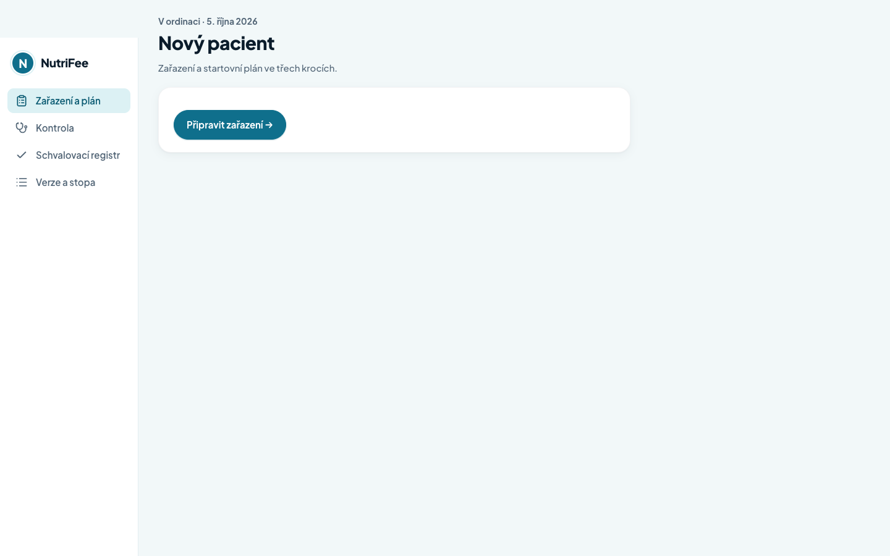

*Stav na snímku: plán zatím není a koncept zařazení se zahodil (`S.draft = null`).*

- **Co to je:** vstup do zařazení nového pacienta, jedna karta s tlačítkem „Připravit zařazení →“.
- **Kdo a kdy:** lékař, na první návštěvě pacienta v ordinaci.
- **K čemu:** založí koncept plánu (`NF.newDraft`): id plánu, platnost, prázdné dávky, startovní sada návyků (R-NAVYKY), výchozí bezpečnostní pravidla (`NF.defaultInstructions`) a výchozí cíle (`NF.defaultTargets`).
- **Spojitost s daty pacienta:** žádná; pacient ještě nic nezapsal.
- **Co se počítá:** nic.
- **Pravidla:** R-NAVYKY, R-POKYNY, C-CILE (výchozí obsah konceptu).
- **Stavy:** bez plánu a bez konceptu jen tato karta; s konceptem průvodce O02–O04; s platným plánem O08.
- **Stopa:** nic (koncept se zapíše až vydáním).
- **Pozor:** koncept nepředvyplňuje dávky (`units` 0, posuvník bez hodnoty).
- **Testy:** `nutrifee-rozhodovaci-maketa.test.cjs` „Startovní sada je při čistém zařazení předvyplněná…“; `zaverecne80.test.cjs` „03 A1: startovní návyky v konceptu jen jednou“.

### O02 Zařazení, krok 1: karta pacienta, podmínky, výchozí hodnoty

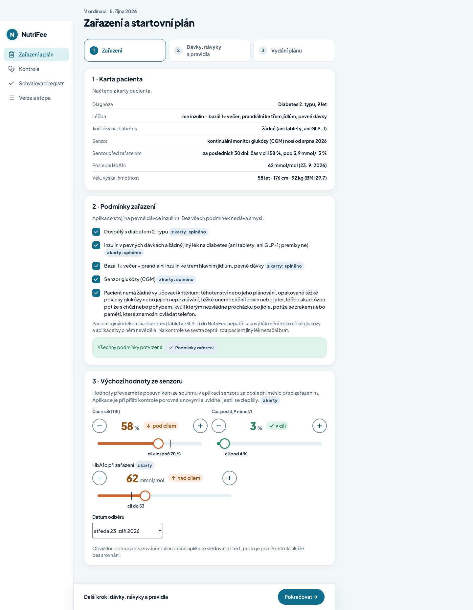

*Stav na snímku: scéna „Lékař – karta a podmínky zařazení“, všechny podmínky zaškrtnuté.*

- **Co to je:** první krok průvodce zařazením: karta pacienta (jen ke čtení), podmínky zařazení a výchozí hodnoty ze senzoru a HbA1c.
- **Kdo a kdy:** lékař, při zařazení, s pacientem.
- **K čemu:** potvrdit, že pacient patří do kohorty (jen inzulin v pevných dávkách, bazál + 3 prandiální, senzor, žádný jiný lék na diabetes, žádné vylučovací kritérium), a uložit výchozí hodnoty pro srovnání „dříve · teď“ na první kontrole.
- **Spojitost s daty pacienta:** karta pacienta (v maketě `D.patientContext` z prezentační vrstvy; v ostré aplikaci napojení na kartu, nebo věta „Karta pacienta s NutriFee propojená není…“). Štítek „z karty: splněno“ jen u podmínek, které karta dokládá (`D.cardEligibility`); potvrzuje je vždy lékař. Výchozí čas v cíli a čas pod 3,9 lékař převezme ze souhrnu v aplikaci senzoru za poslední měsíc; HbA1c a datum odběru z karty.
- **Co se počítá:**
  - `NF.setEligibility(S, klíč, hodnota)` → `S.enrollment.eligible` = všechny čtyři `NF.ELIGIBILITY` zaškrtnuté. `NF.excluded(S)` = páté zaškrtnutí `NF.EXCLUSION` chybí.
  - `NF.setBaselineValue` (akce `baselineSet`) → `S.enrollment.baseline.tir` / `.below` v %, posuvník 0–100 / 0–40 se značkou cíle pacienta (C-CILE `tirGoal`, `tbrGoal`) a slovem „pod cílem / v cíli“.
  - `NF.setHba1c(S, 'karta', hodnota, datum)` → `S.patient.hba1cLog` (posuvník 30–120 mmol/mol se značkou C-CILE `hba1cGoal`; jádro přijme 20–150); datum výběrem ze dnů (`NF.hbaDates`).
  - Lišta: „Zbývá potvrdit N podmínek zařazení a že pacient nemá vylučovací kritérium.“; „Pokračovat →“ zamčené, dokud `eligible && !excluded`.
- **Pravidla:** K-KRITERIA, C-CILE (značky posuvníků).
- **Stavy a hraniční případy:** bez karty pacienta vysvětlující věta místo údajů; zamítnutá K-KRITERIA = záznam nesouhlasu, podmínky se dál vyžadují (oznámení na místě); věta „Pacient s jiným lékem na diabetes (tablety, GLP-1) do NutriFee nepatří…“ je vždy pod podmínkami.
- **Stopa:** od SCHEMA 87 každé zaškrtnutí i zrušení podmínky `zarazeni.podminka`, zaškrtnutí „bez vylučovacího kritéria“ `zarazeni.vylouceni` (obě s položkou K-KRITERIA), každá změna výchozí hodnoty ze senzoru `zarazeni.vychozi` (C-CILE); HbA1c `hba1c`.
- **Pozor při programování:** nic se nepíše (posuvníky a zaškrtnutí); hodnoty z karty nesmí podmínky potvrdit samy; kohorta je od SCHEMA 84 jen inzulin.
- **Testy:** hlavní sada „SCHEMA 87 (bod 1): odpovědi pacienta, podmínky zařazení, výchozí hodnoty, ověření dávek a ověřovací body lékaře jdou do stopy“; `nutrifee-rozhodovaci-maketa.test.cjs` „Zařazení: podmínky zamykají pokračování…“, „V ordinaci se nepíše…“; `schema84-jadro.test.cjs` „5: kohorta jen inzulin…“; `kontrola4-obsah.test.cjs` „06 A2, B4, B6…“; `zaverecne80.test.cjs` „03 B2, B3, B4…“, „02 B1, B3…“.

### O03 Zařazení, krok 2: dávky, návyky, pravidla a cíle

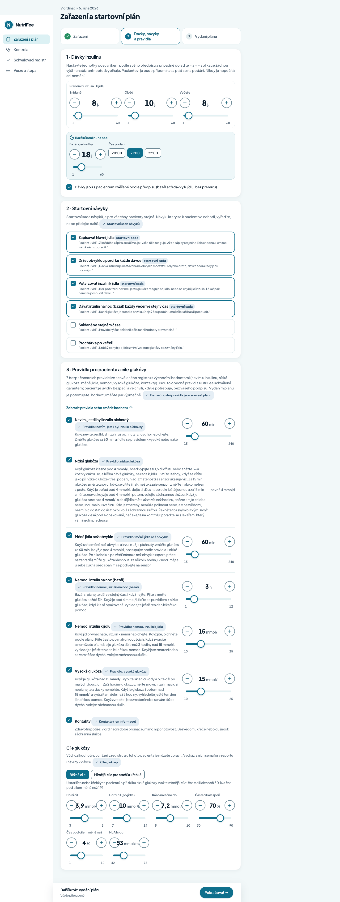

*Stav na snímku: konec scény „Lékař – dávky, startovní návyky a pravidla“; rozbalené „Zobrazit pravidla nebo změnit hodnotu“.*

- **Co to je:** druhý krok: dávky inzulinu, startovní návyky, bezpečnostní pravidla a cíle glukózy.
- **Kdo a kdy:** lékař, při zařazení.
- **K čemu:** lékař nastaví dávky podle svého předpisu; aplikace je pak pacientovi zobrazuje, připomíná a ptá se na podání.
- **Spojitost s daty pacienta:** předpis lékaře; žádná data z aplikace.
- **Co se počítá:**
  - Dávky: `NF.setDoseValue(S, klíč, jednotky)` (akce `doseSet`), posuvník 1–60 j. (`NF.DOSE_RANGE`; do SCHEMA 86 1–40 j. z `NF.DOSE_GRID`) bez předvyplnění („Dávku nastavte posuvníkem“); čas bazálu volbou 20:00 / 21:00 / 22:00. Zaškrtnutí „Dávky jsou s pacientem ověřené podle předpisu (bazál a tři dávky k jídlu, bez premixu)“ (`draft.medicationChecked`, `NF.setMedicationChecked`).
  - Návyky: `NF.toggleHabit`; nabízí se jen návyk, jehož položka je použitelná (`NF.usable(S, h.item)`); štítek „startovní sada“; text „Pacient uvidí: …“.
  - Pravidla: sedm I-* je v plánu automaticky (`NF.defaultInstructions`); výjimku u pacienta (vypnutí zaškrtnutím, jiná hodnota posuvníkem v mezích katalogu) ukládá `NF.setInstruction` a vypisuje `NF.instructionExceptions`. Text pravidla s dosazenou hodnotou `NF.instrHtml`.
  - Cíle: „Běžné cíle“ / „Mírnější cíle pro starší a křehké“ (`NF.setTargetPreset`, sady z C-CILE), každý cíl posuvníkem s krokem a mezemi `NF.TARGET_STEPS` (`NF.setTargetValue`).
  - Lišta: `NF.planBlockers(S)` – chybí potvrzení podmínek, vylučovacího kritéria, některá ze čtyř dávek (≥ 1 j.), ověření dávek s pacientem, aspoň jeden návyk (jen když R-NAVYKY platí).
- **Pravidla:** R-NAVYKY, R-PROCHAZKA, R-POKYNY, I-HYPO, I-MENE, I-NEVIM, I-NEMOC-BAZAL, I-NEMOC-JIDLO, I-VYSOKA, I-KONTAKT, C-CILE.
- **Stavy a hraniční případy:** zamítnutá R-POKYNY → místo pravidel oznámení, pravidla do plánu nejdou; zamítnuté jednotlivé I-* → oznámení u pravidla; zamítnutá R-NAVYKY → plán se vydá bez startovních návyků; pevná hodnota pravidla (práh nízké glukózy 4 mmol/l) nemá posuvník („pevně 4 mmol/l“).
- **Stopa:** jednotlivé změny konceptu se nezapisují; vše přijde v `plan.vydan`. Výjimka od SCHEMA 87: ověření dávek s pacientem se zapíše hned jako `zarazeni.davky.overeny` (i zrušení, s kopií dávek).
- **Pozor při programování:** **dávka se nikdy nepředvyplňuje a aplikace žádnou výši nenabízí**; lékař pravidla nevybírá ani nepíše, vydáním podepisuje plán jako celek; výjimky u pacienta jsou vidět v plánu i v návrhu na kontrole.
- **Testy:** hlavní sada „SCHEMA 87 (body 3, 7): čísla pacienta posuvníkem 1–60 j. z jednoho místa; čas inzulinu „jiný čas“ posuvníkem; ordinace má týž rozsah“; hlavní sada „SCHEMA 87 (bod 1): odpovědi pacienta, podmínky zařazení, výchozí hodnoty, ověření dávek a ověřovací body lékaře jdou do stopy“; `nutrifee-rozhodovaci-maketa.test.cjs` „Aplikace nikde nepočítá ani nenavrhuje dávku; volí ji lékař“, „Pokyny jsou součást plánu (SCHEMA 66…)“, „Cíle glukózy voličem při zařazení i při kontrole…“; `kontrola74-obsah.test.cjs` „B1: pravidla v zařazení jsou vlastní blok…“; `kontrola4-obsah.test.cjs` „Bod 8 a C15…“, „07 A2, B3, B8…“; `faze2-jadro.test.cjs` „A05…“.

### O04 Zařazení, krok 3: vydání plánu

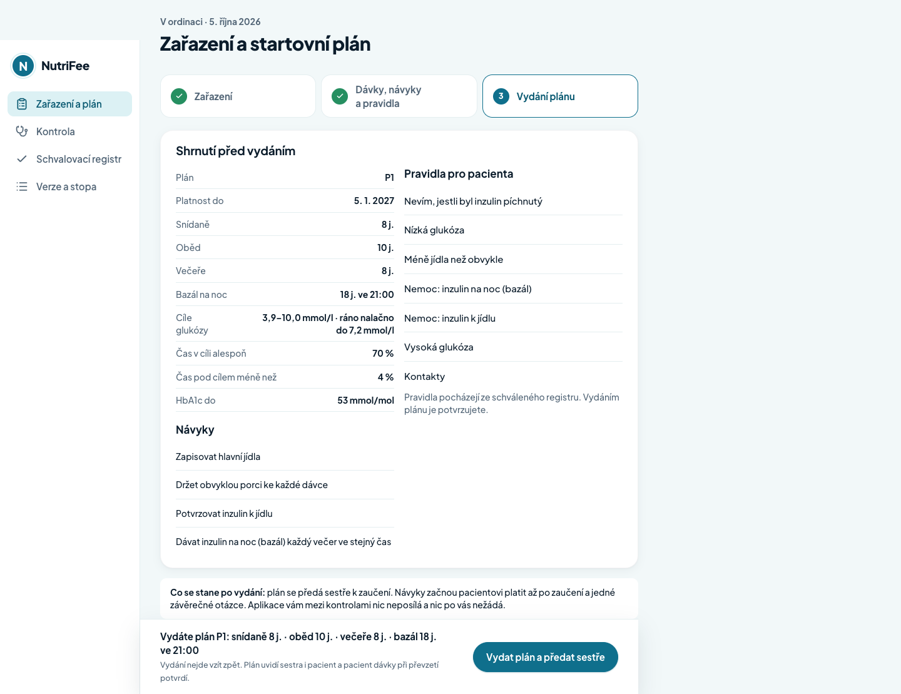

*Stav na snímku: scéna „Lékař – vydání plánu“, před klepnutím na Vydat.*

- **Co to je:** shrnutí konceptu (plán, platnost, čtyři dávky, cíle, návyky, pravidla) a jediné tlačítko „Vydat plán a předat sestře“.
- **Kdo a kdy:** lékař, na konci zařazení.
- **K čemu:** nevratně vydat plán P1. Lišta jednou větou říká, co se vydá („Vydáte plán P1: snídaně 8 j. · …“) a že vydání nejde vzít zpět.
- **Spojitost s daty pacienta:** po vydání plán uvidí sestra (zaučení) a pacient (převzetí).
- **Co se počítá:** `NF.issuePlan(S, katalog)`: kontroluje roli lékaře a `NF.planBlockers`; vytvoří plán `{ id, issuedAt, effectiveFrom, validUntil, doses, instructions, targets, habits, advice, previousId, state: 'issued' }`, nastaví `S.nextVisit`, návyky přidá ve stavu „čeká na zaučení“; pak `NF.handover` a přepnutí role na sestru.
- **Pravidla:** R-POKYNY a I-* (`V.instructionsList`), C-CILE, R-NAVYKY.
- **Stavy:** s blokátorem lišta „Plán zatím nelze vydat · Chybí: …“ a zamčené tlačítko; bez dávky se nikdy neukáže „0 j.“, ale „nastavte“.
- **Stopa:** `plan.vydan` (dávky, návyky, pravidla, cíle), `plan.predan`.
- **Pozor:** vydání je nevratné; při vydání dalšího plánu se předchozí označí `superseded` a souhrn ze senzoru zůstane u něj (`prev.sensorSummary`).
- **Testy:** „Zařazení: … plán bez náležitostí nejde vydat“, „Vydání P2 z rozhodnutí; historie P1 zůstává…“ (hlavní test).

### O05 Sestra: zaučení s náhledem telefonu

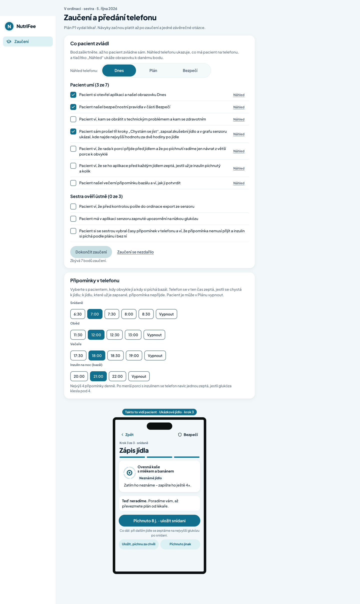

*Stav na snímku: scéna „Sestra – zaučení s náhledem telefonu“, rozpracované body.*

- **Co to je:** obrazovka sestry: body zaučení k odškrtnutí, náhled telefonu pacienta a karta „Připomínky v telefonu“.
- **Kdo a kdy:** sestra, hned po vydání plánu (P1), s pacientem a jeho telefonem.
- **K čemu:** ověřit, že pacient aplikaci sám zvládne, a s pacientem vybrat časy připomínek. Bez dokončeného zaučení návyky nezačnou platit.
- **Spojitost s daty pacienta:** body se skládají z pevných bodů a z bodů návyků v plánu (`NF.trainingItems` = `NF.FIXED_TRAINING` + `h.training` návyků plánu); body „Sestra ověří ústně“ jsou ústní (export před kontrolou, upozornění na nízkou glukózu v aplikaci senzoru, připomínky nemusí přijít). Náhled telefonu vykresluje skutečnou obrazovku pacienta (`nursePreview` → `V.patient`); u bodů jídla ukáže ukázkové jídlo; sestra v náhledu neklepe.
- **Co se počítá:** zaškrtnutí `trainingStep`; „Náhled“ přepne obrazovku náhledu (Dnes / Plán / Bezpečí / krok jídla). Připomínky: `NF.reminderSettings`, nejvýš `S-PRIPOMINKY.max_denne` (4) denně, volby času a „Vypnout“.
- **Pravidla:** Z-BODY (provozní), návyky R-NAVYKY a R-PROCHAZKA (body návyků nesou jejich štítek), S-PRIPOMINKY (provozní).
- **Stavy:** bez plánu „Zatím není co zaučovat“; „Dokončit zaučení“ zamčené, dokud chybí bod.
- **Stopa:** `pripominka.*`; výsledek zaučení viz O06/O07.
- **Pozor:** sestra lékaři nic neposílá; připomínky nejsou bezpečnostní funkce (pacient si inzulin píchá podle plánu i bez nich).
- **Testy:** hlavní test „Sestra: „Ukázat“ u jídla ukáže ukázkové jídlo, … nezdar s důvodem vidí lékař“; `kontrola4-obsah.test.cjs` „Bod 4: připomínky v telefonu…“; `faze2-jadro.test.cjs` „C21…“.

### O06 Sestra: zaučení dokončeno

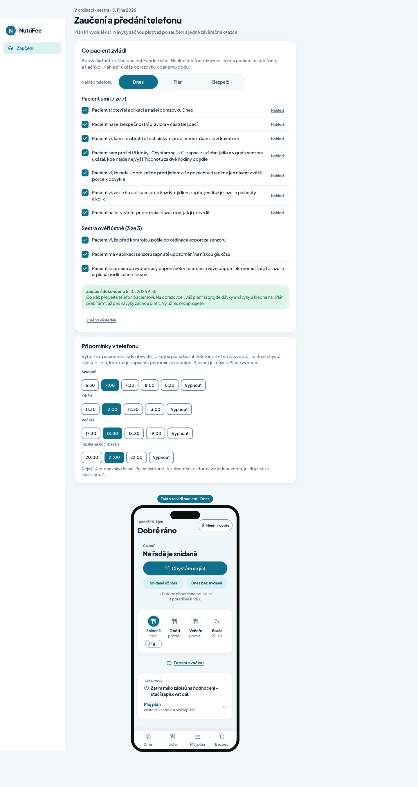

*Stav na snímku: konec scény zaučení, všechny body hotové.*

- **Co to je:** stejná obrazovka po „Dokončit zaučení“ s oznámením „Zaučení dokončeno · Co dál: předejte telefon pacientovi…“.
- **Kdo a kdy:** sestra, na konci zaučení.
- **K čemu:** zapsat úspěšné zaučení; pacient pak plán převezme na telefonu.
- **Co se počítá:** `NF.finishTraining(S, 'done')` – jen role sestra a jen když jsou všechny body `NF.trainingItems` hotové.
- **Stavy:** „Změnit výsledek“ vrátí výsledek (`finishTraining(null)`).
- **Stopa:** `zauceni.done` (sestra, čas).
- **Pozor:** převzetí plánu pacientem (`NF.confirmUnderstanding`) bez dokončeného zaučení selže a návyky nezačnou platit.
- **Testy:** `faze2-jadro.test.cjs` „A26 převzetí bez zaučení se zastaví na první stránce“; hlavní test (sestra).

### O07 Sestra: zaučení se nezdařilo

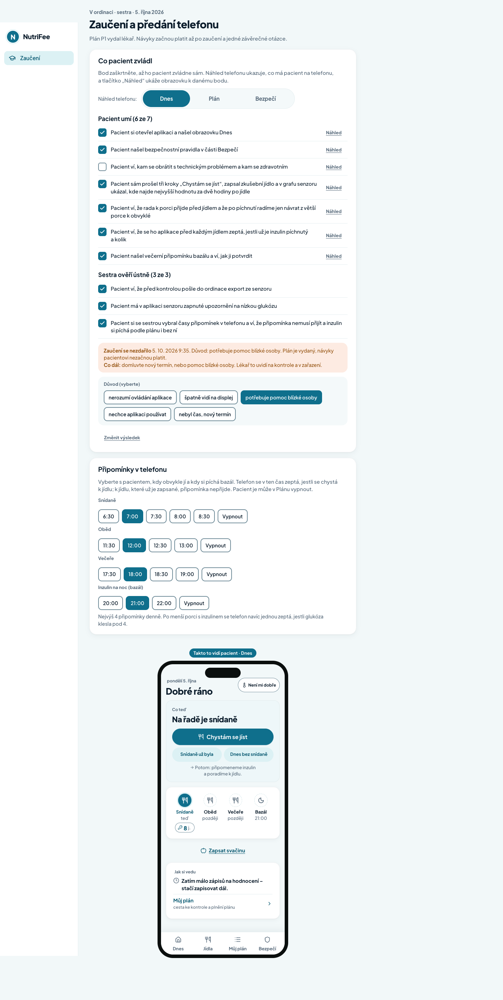

*Stav na snímku: dodatek „Zaučení se nezdařilo“, vybraný důvod „potřebuje pomoc blízké osoby“.*

- **Co to je:** stav po „Zaučení se nezdařilo“ s volbou důvodu.
- **Kdo a kdy:** sestra, když pacient zaučení nezvládne.
- **K čemu:** zapsat nezdar a důvod; plán zůstane vydaný, návyky pacientovi nezačnou platit a lékař to uvidí u plánu (O08) a na kontrole.
- **Co se počítá:** `NF.finishTraining(S, 'failed', důvod)`; důvody `NF.TRAINING_REASONS` (nerozumí ovládání aplikace · špatně vidí na displej · potřebuje pomoc blízké osoby · nechce aplikaci používat · nebyl čas, nový termín). Dokud důvod chybí, oznámení to řekne.
- **Stopa:** `zauceni.failed` s důvodem.
- **Pozor:** důvod je volba, ne text.
- **Testy:** `zaverecne80.test.cjs` „02 B7, C2, C3, C4, C7…“ (nezdařené zaučení); hlavní test (sestra).

### O08 Plán platí (mezi kontrolami)

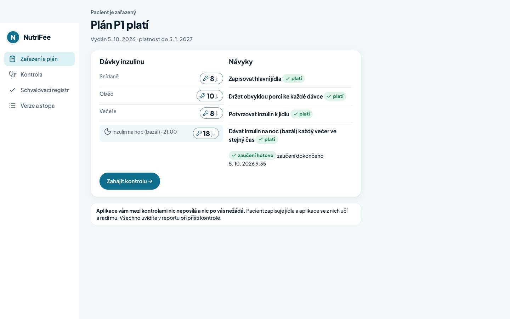

*Stav na snímku: den před kontrolou, záložka Zařazení a plán.*

- **Co to je:** přehled platného plánu: dávky, návyky se stavem (platí / čeká na zaučení / skončil s plánem), stav zaučení a tlačítko „Zahájit kontrolu →“.
- **Kdo a kdy:** lékař; obrazovka existuje, ale mezi kontrolami ji lékař nepotřebuje.
- **K čemu:** připomenout, co platí, a vstoupit do kontroly. Věta „Aplikace vám mezi kontrolami nic neposílá a nic po vás nežádá.“
- **Spojitost s daty pacienta:** plán a návyky; `NF.trainingSummary`.
- **Co se počítá:** nic; „Zahájit kontrolu →“ jen přepne na záložku Kontrola (O09), kontrolu ještě nespouští.
- **Pravidla:** P-LEKAR (zásada „lékař mezi kontrolami nic nedělá“; položka nemá štítek na obrazovce).
- **Pozor:** **žádné upozornění, výzva ani přehled dat mezi kontrolami** – lékař nic nesleduje.
- **Testy:** hlavní test „Lékař mezi kontrolami nic nedělá“.

### O09 Kontrola před zahájením: části sestry

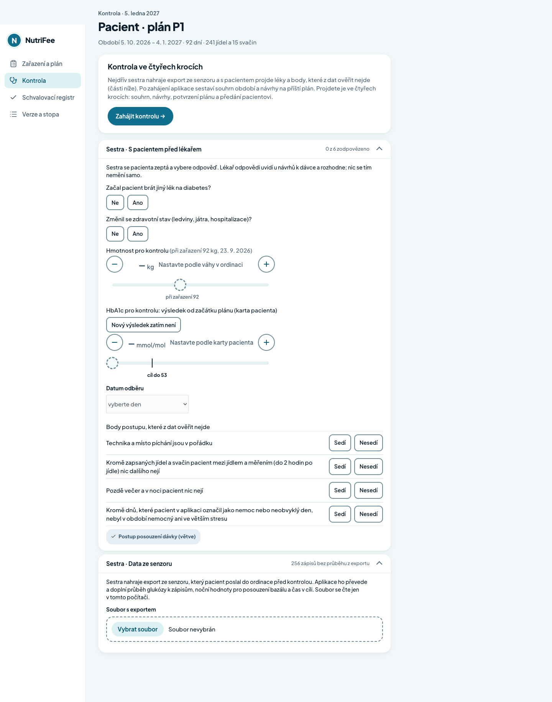

*Stav na snímku: první krok scény „Lékař – kontrola, krok 1: souhrn“; nic vyplněno, export nenahraný.*

- **Co to je:** záložka Kontrola před zahájením: karta „Kontrola ve čtyřech krocích“ s tlačítkem „Zahájit kontrolu →“ a pod ní dvě části sestry.
- **Kdo a kdy:** sestra (části sestry) a pak lékař (zahájení), v den kontroly, s pacientem.
- **K čemu:** zjistit od pacienta to, co data neukážou, a připravit data (export) dřív, než se spočítá souhrn a návrhy.
- **Spojitost s daty pacienta:** odpovědi sestry (`S.nurseCheck`) patří k období aktivního plánu (`NF.nurseCheckFor`); po vydání dalšího plánu je část prázdná.
- **Co se počítá (část „Sestra · S pacientem před lékařem“, počítadlo „N z M zodpovězeno“):**
  - „Začal pacient brát jiný lék na diabetes?“ Ne / Ano – `NF.setNurseMeds` (`NF.NURSE_MEDS`); při Ano věta `NF.medsText('yes')`.
  - „Změnil se zdravotní stav (…)?“ Ne / Ano – `NF.setNurseHealth`; otázka podle pohlaví pacienta (`NF.healthQuestion`: u muže bez těhotenství).
  - Hmotnost posuvníkem 40–160 kg se značkou „při zařazení N“ – `NF.setWeight(S, 'sestra', kg)`; jádro přijme 30–250.
  - HbA1c pro kontrolu: „Nový výsledek zatím není“ (`NF.setNurseHbaNone`) nebo posuvník a datum odběru jen ze dnů od začátku plánu (`NF.setHba1c(S, 'sestra', …)`).
  - Body D-POSTUP, které z dat ověřit nejde (`NF.nurseKeys` = klíče `D-POSTUP.sestra`: technika · jídlo · vecer · stres), každý Sedí / Nesedí (`NF.setNurseCheck`, opakované klepnutí volbu zruší).
- **Část „Sestra · Data ze senzoru“:** výběr souboru; v souhrnu „N zápisů bez průběhu z exportu“ (`NF.importDue`). Popis O10.
- **Pravidla:** K-KRITERIA (otázky), D-POSTUP (body sestry), C-CILE (značka HbA1c), Z-IMPORT (provozní).
- **Stavy a hraniční případy:** zamítnutá D-POSTUP → místo bodů oznámení; po vydání plánu z této kontroly je část zamčená („Plán je vydaný; odpovědi zůstávají ve stopě“); nová kontrola po převzetí P2 začne s prázdnou částí. Odpovědi sestry nic samy nemění: lékař je uvidí u bodů návrhu jako výchozí stav a může je změnit; „Vše sedí“ je nepřepíná.
- **Stopa:** `kontrola.leky`, `kontrola.stav` (s „(zapsala sestra)“), `kontrola.sestra`, `hmotnost`, `hba1c`.
- **Pozor:** sestra nic nepíše; hmotnost a HbA1c jsou posuvníky; o podobě exportu se na obrazovce nemluví.
- **Testy:** `kontrola4-obsah.test.cjs` „Bod 7: body, které nejdou ověřit z dat, ověří sestra…“; `schema84-jadro.test.cjs` „5…“, „C8…“, „6: hmotnost…“; `zaverecne80.test.cjs` „02 B1, B3: sestra potvrzuje jen to, co data neukážou; HbA1c s datem odběru výběrem“, „03 B5…“.

### O10 Části sestry vyplněné, export nahraný

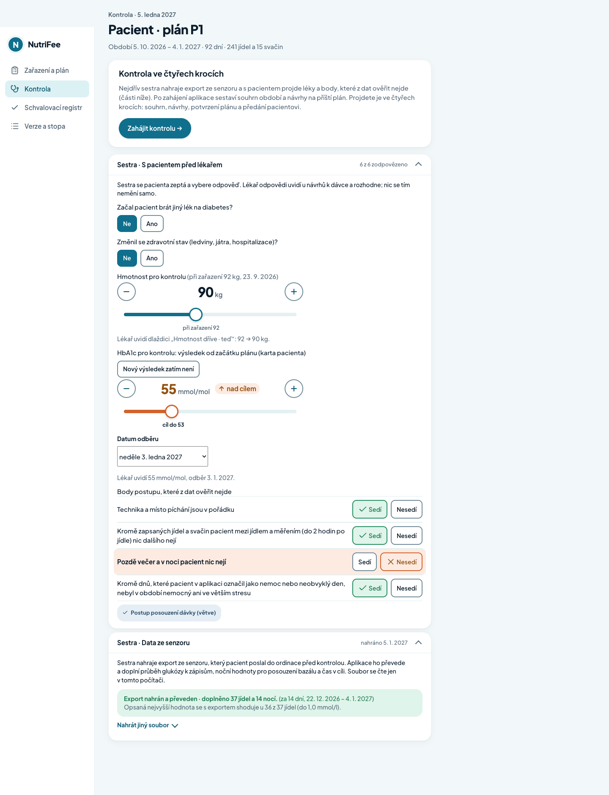

*Stav na snímku: scéna kontroly po nahrání exportu, těsně před „Zahájit kontrolu“.*

- **Co to je:** O09 po vyplnění a po nahrání exportu: zelené oznámení „Export nahrán a převeden · doplněno N jídel a N nocí (za X dní, od – do)“ a pod ním „Opsaná nejvyšší hodnota se s exportem shoduje u X z Y jídel (do 1,0 mmol/l).“; výběr souboru je schovaný pod „Nahrát jiný soubor“.
- **Kdo a kdy:** sestra, v den kontroly před zahájením.
- **K čemu:** doplnit průběh glukózy k zápisům, noční hodnoty pro posouzení bazálu a čas v cíli za období exportu.
- **Spojitost s daty pacienta:** export ze senzoru, který pacient před kontrolou poslal do ordinace; soubor se čte jen v zařízení.
- **Co se počítá:**
  - `NF.parseSensorCsv(text)`: najde hlavičku se sloupcem času a glukózy v prvních čtyřech řádcích; snese oddělovač `;`/`,`/tab, desetinnou čárku, uvozovky, řádek metadat a mg/dl; bez rozpoznané hlavičky vrátí prázdný seznam (soubor se odmítne, nic se nehádá). Neplatné řádky přeskočí a spočítá.
  - `NF.importReadings(S, měření)`: ke každému zápisu bez průběhu přiřadí měření −5 až +`Z-IMPORT.po_jidle_min` (180) min; průběh se přijme jen s ≥ 4 body, bodem do 10 min a bodem po `R-REAKCE.okno_min` (120); u zápisu s opsaným vrcholem porovná vrchol z exportu (`NF.peakAgrees`, tolerance `Z-IMPORT.shoda_mmol` 1,0; „nad 15“ sedí, když export leží nad 15). Noci: hodnoty 0:00–6:00 → nejnižší hodnota, čas pod dolním cílem, ranní hodnota a poslední hodnota po 21:00 předchozího dne („před spaním“); noci z exportu přepíší dosavadní. `NF.sensorSummaryFrom`: čas v cíli, pod cílem, pod 3,0, nad cílem, dostupnost podle mediánu rozestupu měření, počet dní.
  - Stejný export podruhé: nic nového, věta „Tentýž export byl nahrán znovu (čas); nic nového nepřibylo.“ (`prevI.again`).
- **Pravidla:** Z-IMPORT (provozní), R-REAKCE (okno), C-CILE (hranice), D-BAZAL (noci).
- **Stavy:** bez exportu dlaždice času v cíli řekne „souhrn ze senzoru chybí“ a Bezpečnost „Noční hodnoty nejsou k dispozici – bez exportu nelze posoudit noční poklesy.“ (Z-IMPORT `nociChybi`, O13).
- **Stopa:** `senzor.import` (počet měření, doplněná jídla, noci, shoda, přeskočené řádky, období).
- **Pozor:** obrazovky o typech a formátech exportu nemluví; převodníky pro skutečné exporty senzorů v kohortě jsou otevřený úkol ostré aplikace (`15` odst. 6a). Export nahrává jen personál; pacient v aplikaci export nenahrává.
- **Testy:** hlavní test „Export ze senzoru (15. 10. 2026): parser čte běžné formáty…“, „Ukázkový export a souhrn ze senzoru jsou týž soubor…“, „SCHEMA 74: o exportu ze senzoru maketa nemluví konkrétně…“; `faze2-jadro.test.cjs` „A08…“, „A20…“; `zaverecne80.test.cjs` „03 A5…“, „03 C3…C9: hrany“.

### O11 Export odmítnut

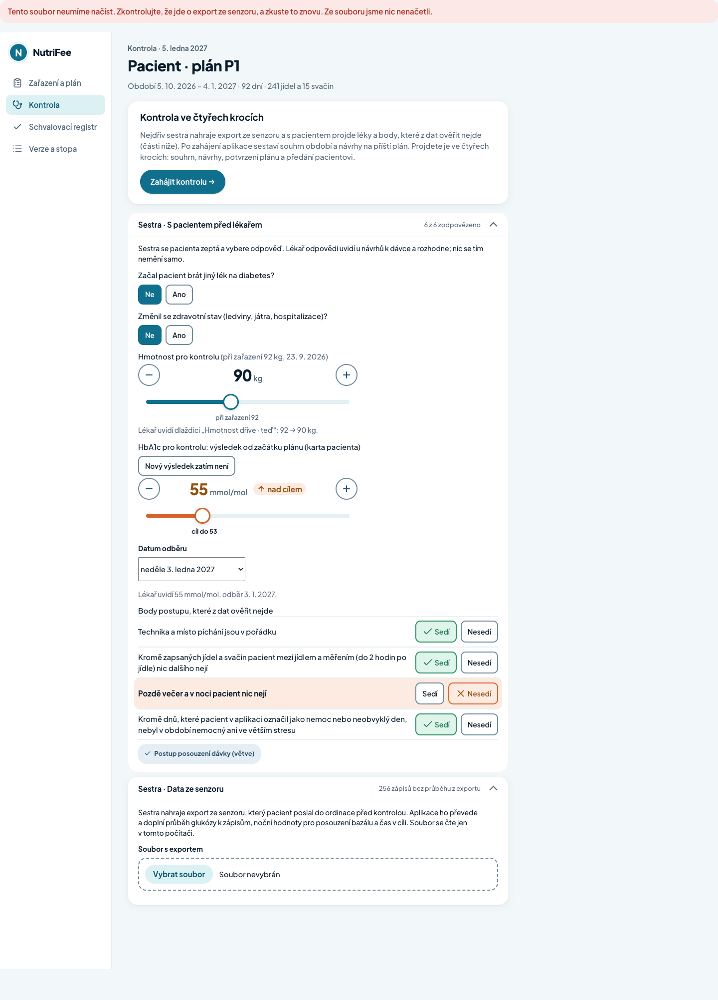

*Stav na snímku: do akce `importText` vložen text bez hlavičky.*

- **Co to je:** chybová hláška nahoře na obrazovce: „Tento soubor neumíme načíst. Zkontrolujte, že jde o export ze senzoru, a zkuste to znovu. Ze souboru jsme nic nenačetli.“ (`NF.IMPORT_REJECT`).
- **Kdo a kdy:** sestra, když vybere nečitelný soubor.
- **Co se počítá:** `NF.parseSensorCsv` vrátí prázdný seznam → `NF.importReadings` vrátí chybu, **stav se nemění**.
- **Stavy:** dřívější úspěšný export (pokud byl) zůstává.
- **Stopa:** nic.
- **Pozor:** soubor se nikdy nenačte napůl; hláška nemluví o formátu.
- **Testy:** hlavní test „Export ze senzoru…“; `zaverecne80.test.cjs` „03 C3…C9: hrany“.

### O12 Kontrola, krok 1: souhrn

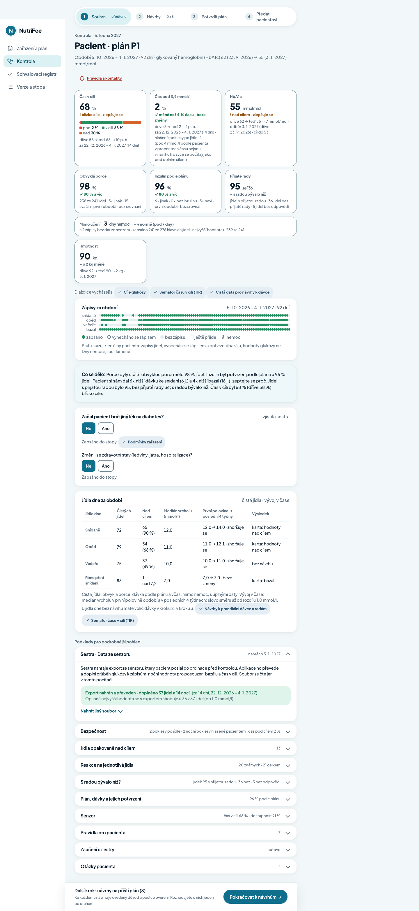

*Stav na snímku: hned po „Zahájit kontrolu“.*

- **Co to je:** první krok vedené kontroly: kroky nahoře, hlavička s obdobím a HbA1c, dlaždice dříve · teď · rozdíl, tkanina zápisů, věta „Co se dělo“, otázky na jiný lék a zdravotní stav, tabulka „Jídla dne za období“, sbalené podklady a lišta „Další krok: návrhy na příští plán (N)“.
- **Kdo a kdy:** lékař, na kontrole s pacientem.
- **K čemu:** za minutu pochopit období: jak pacient zapisoval, jak držel porci a inzulin, kde je glukóza proti cílům a jak se to změnilo.
- **Spojitost s daty pacienta:** zápisy jídel, potvrzení inzulinu a bazálu, odpovědi na rady, nemoc, export (souhrn ze senzoru), hmotnost a HbA1c od sestry, výchozí hodnoty ze zařazení nebo souhrn minulého plánu.
- **Co se počítá:**
  - `NF.startReview(S)` jednou při zahájení: `S.review = { planId, startedAt, step: 1, summary: NF.summary(...), proposals: NF.proposals(...), decisions: {}, verify: {}, newDoses, newInstructions, newTargets, meds, health, validDays: 92 }`.
  - `NF.summary(S, planId)`: jídla a svačiny zvlášť; obvyklá porce `usualPct`; inzulin podle plánu `asPct` (podíly zaokrouhlené dolů, 239 z 240 není 100 %); jinak / bez inzulinu / neví; bazál „potvrzeno X z Y dnů plánu“ (jen dny před dneškem); inzulin včas (`NF.onTime`, D-CISTA 30/15); nemoc (`NF.illnessDays`, `NF.illnessLongPeriods` proti P-NEMOC.dny); zápisy bez dat; souhrn ze senzoru (patří k plánu); rady (`NF.adviceOutcome`); HbA1c (`NF.hba1cFor`); hmotnost (`NF.weightFor`); sám snížené dávky (`selfLower`, `basalLower`); menší porce ohlášená předem (`smallerPlanned`); spolehlivost dat „zapsáno X z Y hlavních jídel · nejvyšší hodnota u X z Y“.
  - Dlaždice (`cmpTile`): velké číslo = teď; řádek „dříve X → teď Y · ±rozdíl“ (u procent v procentních bodech); slovo stavu = cíl + směr. Směr u procent až od `S-SEMAFOR.smer_pb` (2 p. b.), jinak „beze změny“.
    - Čas v cíli: zelená při `tir ≥ C-CILE.tirGoal` a `below < tbrGoal`; oranžová při `tir ≥ S-SEMAFOR.tir_zluta` (50) a pod 3,0 < `tbr3_max` (1 %); jinak červená (`NF.summary.tirState`); pruh pod · v cíli · nad.
    - Čas pod 3,9: „méně než 4 % času“ / „4 % času a víc“ proti `C-CILE.tbrGoal`; hlášené poklesy po jídle jako samostatný údaj (v procentech času nejsou).
    - HbA1c: proti `C-CILE.hba1cGoal`, s daty odběru; bez nového výsledku „nový výsledek od začátku plánu chybí“.
    - Obvyklá porce a Inzulin podle plánu: ok od `porce_ok`/`inzulin_ok` (80 %), oranžová pod, výrazně pod `*_varovani` (60 %).
    - Přijaté rady: neutrální, slovo „– s radou bývalo níž / podobně / zatím nelze říct / nebylo níž“ (`S-SOUHRN` min_n 8, rozdil_mmol 1,0).
    - Mimo učení: dny nemoci a zápisy bez dat; oranžová od `mimo_dni` (7).
    - Hmotnost: bez cíle, jen „o N kg méně/více“.
  - „Co se dělo“ (`leadSentence`): věty ze šablony (porce, inzulin, sám snížené dávky „zeptejte se proč“, menší porce ohlášená předem, rady, čas v cíli). Žádná generativní AI.
  - Tkanina zápisů (`NF.weave`): jen činy pacienta (zápisy, vynechání, bazál), žádná glukóza.
  - „Jídla dne za období“ (`mealOverview`): pro snídani, oběd, večeři z `pr.stats` návrhu: čistá jídla, nad cílem (počet a %), medián vrcholu, vývoj „první polovina → poslední 4 týdny · slovo“ (`NF.trendOf`, `S-SEMAFOR.vyvoj_tydny` 4, `smer_mmol` 1,0), výsledek (karta / bez návrhu); řádek „Ráno před snídaní“ z `NF.morningValues`.
  - Otázky „Začal pacient brát jiný lék na diabetes?“ a zdravotní stav: předvyplněné odpovědí sestry („zjistila sestra“), lékař je může změnit (`NF.setReviewMeds`, `NF.setReviewHealth`).
- **Pravidla:** C-CILE, S-SEMAFOR, D-CISTA, S-SOUHRN (provozní, bez štítku), K-KRITERIA, D-PRAND.
- **Stavy a hraniční případy:** první kontrola: „dříve“ = výchozí hodnoty ze zařazení, porce a inzulin „první období · bez srovnání“; souhrn ze senzoru kratší než `min_dni` (14) řekne „jen N dní dat“; zamítnutá S-SEMAFOR → dlaždice bez barvy, „– semafor vypnutý“, směr podle znaménka; zamítnuté C-CILE → oznámení „Váš nesouhlas je zapsaný“, hodnocení dál s navrženými cíli; pacient nic nezapsal → „Pacient zatím nezapsal žádné jídlo.“
- **Stopa:** `kontrola.zahajena` (celý souhrn a seznam návrhů), `kontrola.leky`, `kontrola.stav`.
- **Pozor:** souhrn se počítá jednou při zahájení; souhrn ze senzoru patří k plánu, ke kterému byl export nahrán; slova stavu i barvy jen podle barevných rolí.
- **Testy:** hlavní test „Kontrola je vedené flow…“, „Závěrečná kontrola 23. 10. (02 #3)…“; `faze2-jadro.test.cjs` „A14 prahy dlaždic kontroly ze S-SEMAFOR“, „A30…“; `kontrola74-obsah.test.cjs` „B8, B10…“, „B11…“, „B19…“; `zaverecne80.test.cjs` „81 bod 11…“; `schema84-jadro.test.cjs` „4…“, „6…“, „B5 + C2…“; `kontrola4-obsah.test.cjs` „01 M3…“.

### O13 Krok 1: rozbalená dlaždice a podklady

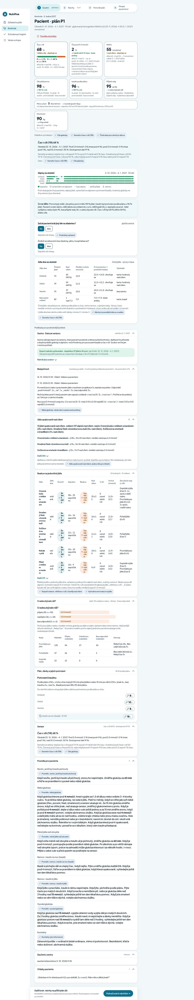

*Stav na snímku: rozbalená dlaždice „Čas v cíli“ a všechny části podkladů.*

- **Co to je:** detail dlaždice (`tileDetail`) a podklady pro podrobnější pohled: Sestra · Data ze senzoru, Bezpečnost, Jídla opakovaně nad cílem, Reakce na jednotlivá jídla, Rady, Otázky pacienta.
- **Kdo a kdy:** lékař, jen když chce víc (vše je sbalené).
- **Spojitost s daty pacienta:** zápisy, odpovědi na otázky, export, otázky, které si pacient uložil.
- **Co se počítá:**
  - **Bezpečnost** (`safetyPart`): poklesy po jídle za 92 dní z `NF.lowEvents` (průběh pod dolním cílem do 4 h, opsané „pod 4“, odpovědi „ano“ na otázku po menší porci; jeden pokles na jídlo dne a den); kolikrát se aplikace ptala po menší porci a odpovědi (ano / ne / nevím / bez odpovědi, `NF.hypoWatchState`); poklesy zapsané pacientem mimo otázku; noční poklesy zapsané čipem u snídaně (a zda je export nepotvrdil); noci pod dolním cílem z exportu s časem a nejnižší hodnotou; bez exportu výrazná věta `Z-IMPORT.texts.nociChybi`.
  - **Jídla opakovaně nad cílem** (`NF.strongFoods`, S-SILNA): jedna věta a nejvýš `maxJidel` (3) jídel s nejvíc zápisy nad cílem, zbytek pod „Další (N)“.
  - **Reakce na jednotlivá jídla:** řádek pro každé jídlo a jídlo dne (`NF.foodStats` po jídle dne), úroveň, stupeň reakce, nad cílem, v cíli, rozmezí vrcholů, rady se srovnáním „s radou bývalo níž“ jen od `S-SOUHRN.min_n` v obou skupinách a rozdílu `rozdil_mmol`; nestálá jídla.
  - **Rady:** nabídky, přijato, odmítnuto, bez odpovědi, důvody (`NF.adviceOutcome`); zápis se dvěma přijatými radami se počítá ke každé se značkou „spolu s další radou“.
- **Pravidla:** B-HYPO, S-SILNA, R-REAKCE, R-SKORE, C-CILE, S-SEMAFOR, Z-IMPORT a S-SOUHRN (provozní).
- **Stavy:** zamítnutá S-SILNA neskryje Data ze senzoru ani Bezpečnost; bez exportu je Bezpečnost otevřená.
- **Stopa:** nic (jen čtení).
- **Pozor:** lékař jídla ani složení s pacientem neřeší; silné reakce řeší aplikace s pacientem radami.
- **Testy:** `faze2-jadro.test.cjs` „A01…“, „A09 A10…“, „A16…“; `kontrola4-obsah.test.cjs` „Bod 5: bez exportu report v části Bezpečnost řekne, že noční hodnoty chybí“; `kontrola2-obsah.test.cjs` „B9…“, „B11, C8…“; `schema84-jadro.test.cjs` „B2 + C6 + C7…“; `zaverecne80.test.cjs` „82 B2, C1, C2, C7…“.

### O14 Krok 2: návrhová karta, ověření čeká

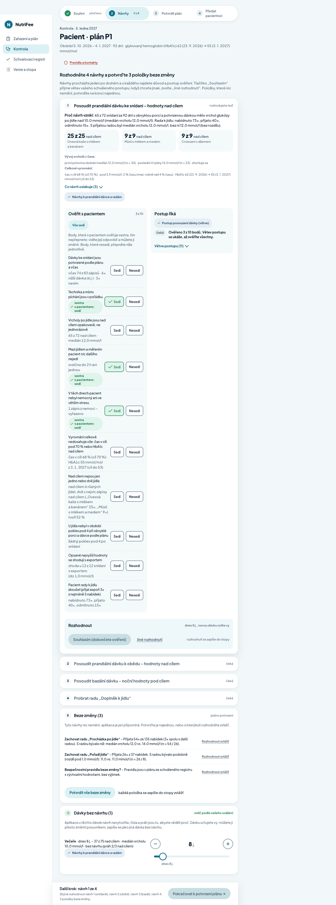

*Stav na snímku: začátek kroku 2, otevřená první karta „Posoudit prandiální dávku ke snídani – hodnoty nad cílem“, nic neověřeno.*

- **Co to je:** seznam návrhů; aktuální karta je otevřená, ostatní jsou řádky „čeká“ nebo rozhodnuté („souhlas · 8 → 10 j. (+2 j.) · změnit“).
- **Kdo a kdy:** lékař, na kontrole s pacientem; body, které z dat ověřit nejde, už prošla sestra.
- **K čemu:** posoudit, zda dávku změnit. Karta **nedoporučuje směr ani výši**; říká, co aplikace pozorovala, proč návrh vznikl a jak to ověřit.
- **Části karty:**
  1. **Proč návrh vznikl** (`pr.why`), dlaždice rozpadu podle jídel (`pr.breakdown`, nejvýš 3 jídla s nejvíc zápisy nad cílem), poklesy pod 4 v období (`pr.lows`), řádky „Vývoj vrcholů v čase“, „Celkové vyrovnání“ (`pr.context`), štítek položky, ze které návrh vzniká (D-PRAND / D-BAZAL / R-POKYNY).
  2. **Co návrh oslabuje (N)** (`pr.weak`) a seznam vyřazených zápisů s důvodem (`NF.whyNotForDose`), štítek D-CISTA.
  3. **Ověřit s pacientem**: body postupu D-POSTUP, u bodu číslo z dat (`pr.facts[i].text`), štítek „data říkají jinak“ (`against`), „sestra s pacientem: sedí / nesedí / zatím neověřila“; „Vše sedí“ (`NF.verifyAll`) nepřepne body proti datům ani body sestry.
  4. **Postup říká**: dokud není ověřeno vše, „čeká · Ověřeno N z M bodů. Větev postupu se ukáže, až ověříte všechny.“
  5. **Rozhodnout**: „Souhlasím (dokončete ověření)“ zamčené, „Jiné rozhodnutí“ dostupné (ponechat a zamítnout nepotřebují ověření).
- **Kdy návrh k prandiální dávce vznikne (`NF.proposals`, pro každé jídlo dne, okno od poslední změny dávky, nejméně `D-PRAND.dny` 28 dní):**
  - **Hodnoty pod cílem (přednost, priorita 1):** ze **všech** zápisů jídla dne: aspoň jeden pokles < 3,0, nebo aspoň `hypoMin` (6) jídel, z nich aspoň `hypo` (2) s poklesem < dolní cíl do 4 h, které tvoří aspoň `hypoPodil` (15 %). Opsané „pod 4“ se počítá jako pod 3,9. Postup `prandLow`. Když vznikne, návrh „nad cílem“ k témuž jídlu nevznikne.
  - **Hodnoty nad cílem (priorita 2, s branou rad 3,5):** z **čistých** jídel (`NF.usableForDose`: obvyklá porce, dávka potvrzená podle plánu a včas v okně D-CISTA 30 min před / 15 min po, bez svačiny do 2 h, mimo nemoc, úplná data, ne zpětný zápis): aspoň `minJidel` (8) čistých jídel, aspoň `podil` (2/3) s vrcholem 0–120 min nad horním cílem (10,0) a medián vrcholu nad cíl + `medianNad` (0,5). Jinak řádek „bez návrhu“ (O18) s důvodem.
  - **Nejdřív rady (priorita 3, karta před kartou k dávce):** když bylo aspoň `odmitnutiMin` (5) nabídek rad a pacient je přijal méně než `radyPrve` (3)×, nebo jich odmítl aspoň `odmitnutiPodil` (60 %). Karta k dávce přesto vznikne (brána není zámek), jen bod 10 podle dat nesedí.
- **Body postupu `prandHigh` (D-POSTUP) a jejich fakta:** 1 dávky potvrzené podle plánu a včas (fakt: včas X z Y, kolikrát nižší/vyšší dávka, kolikrát „nevím“) · 2 technika a místo píchání (sestra) · 3 vrcholy opakovaně, ne jednorázově (X z N nad cílem, medián) · 4 mezi jídlem a měřením nic dalšího (svačina do 2 h; sestra) · 5 nebyl nemocný ani ve stresu (zápisy z nemoci; sestra) · 6 vyrovnání nedosahuje cíle: čas v cíli pod cílem nebo HbA1c nad cílem (proti datům jen, když platí obojí naopak) · 7 nad cílem nejsou jen jedno nebo dvě jídla (proti datům, když dvě jídla tvoří ≥ `podilDvouJidel` 67 % zápisů nad cílem a pacient jí k témuž jídlu dne i jiné jídlo v cíli aspoň u `v_cili_podil` 90 % zápisů) · 8 u jídla nebyl pokles pod 4 při obvyklé porci a dávce podle plánu (viz níže) · 9 opsané vrcholy se shodují s exportem (proti datům, když je k porovnání méně než `shoda_min` 5 jídel nebo shoda < `shoda_podil` 80 %) · 10 pacient rady zkoušel (brána rad).
- **Pravidla:** D-PRAND, D-POSTUP, D-CISTA, C-CILE, Z-IMPORT (shoda), S-SEMAFOR (vývoj v čase).
- **Stopa:** od SCHEMA 87 každé označení bodu lékařem `navrh.overeni` (návrh, číslo a text bodu, sedí / nesedí, položka; `NF.setVerify`) a „Vše sedí“ `navrh.overeni.vse`; rozhodnutí pak `navrh.rozhodnut` s větví. Odpovědi sestry jsou `kontrola.sestra`.
- **Pozor:** pořadí karet je podle priority; návrh kvůli nízkým hodnotám vždy vytlačí návrh kvůli vysokým u téže dávky. Postup ani karta nikdy neobsahují velikost kroku v jednotkách.
- **Testy:** hlavní sada „SCHEMA 87 (bod 1): odpovědi pacienta, podmínky zařazení, výchozí hodnoty, ověření dávek a ověřovací body lékaře jdou do stopy“; hlavní test „Návrh k dávce: čistá data, rady první, větve podle ověření, jednotky volí lékař“, „Návrh k dávce 6. 10. 2026…“, „Čistá data pro dávku…“, „Registr R13…“, „Závěrečná kontrola 23. 10. (02 #2)…“; `schema84-jadro.test.cjs` „2…“, „4…“, „SCHEMA 85…“; `faze2-jadro.test.cjs` „A11…“, „A12 A13…“; `kontrola4-obsah.test.cjs` „06 B5…“; `zaverecne80.test.cjs` „02 A1…“, „81 bod 9“, „81 bod 10“; `kontrola2-obsah.test.cjs` „B10…“, „B12, C12, C15…“.

### O15 Krok 2: ověřeno, větev postupu a nová dávka

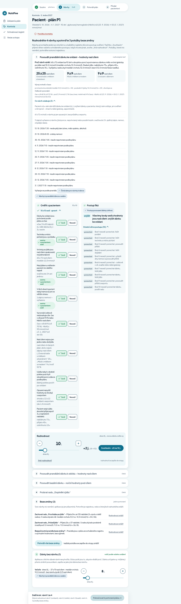

*Stav na snímku: karta ke snídani, 10 z 10 bodů sedí (sbaleno „10 z 10 sedí · upravit“), lékař posuvníkem nastavil 10 j. (dnes 8 j.).*

- **Co to je:** karta po dokončeném ověření: „Postup říká: zvýšit · Všechny body sedí a hodnoty jsou nad cílem: zvýšit dávku ke snídani“, ostatní větve pod „Ostatní větve postupu (N)“; blok Rozhodnout s posuvníkem dávky a tlačítkem „Souhlasím · z 8 na 10 j.“
- **Kdo a kdy:** lékař, s pacientem.
- **Co se počítá:**
  - **Větev** `V.proposalBranch(S, pr)` (vykreslení, logika patří do domény): stav bodu `NF.verifyState` = rozhodnutí lékaře, jinak odpověď sestry; bod blokovaný daty je vždy „nesedí“. Dokud je bod neověřený → `wait`. Bez schváleného postupu → `free` („rozhodněte sami“). Všechny body sedí → větev bez „nesedí“ (u `prandHigh` „zvýšit“). Jinak větev prvního nesedícího bodu, **body blokované daty mají přednost** před pořadím. Bod bez větve → „ponechat dávku – schválený postup pro tento bod nemá větev“ (nikdy zvýšení).
  - **Posuvník dávky** se ukáže jen u větve zvýšit / snížit / bez postupu; značka „dnes N j.“, rozsah 1–60 j. (`NF.DOSE_RANGE`); rozdíl „+2 j. (8 → 10)“. Hodnotu volí lékař; aplikace ji nenavrhuje (věta „Nastavte novou dávku posuvníkem; aplikace ji nenavrhuje.“). „Souhlasím“ je zamčené, dokud dávka = dnešní.
  - **Rozhodnutí** `NF.decideProposal(S, id, { choice: 'agree', branch, units })` (jen role lékař). Když lékař při větvi „zvýšit“ nastaví nižší dávku (nebo při „snížit“ vyšší), tlačítko zní „Rozhodnout jinak než postup · 8 → 7 j.“, pod ním „Změna jde proti větvi vašeho postupu; zapíše se jako „rozhodnuto jinak než postup““ a zapíše se `choice: 'other', againstBranch: true`.
  - **Blok „zvýšit“ poklesem (bod 8):** `NF.lowEvents` u každého poklesu určí `clean` (obvyklá porce + dávka potvrzená podle plánu a včas) a důvod (`why`: menší porce, větší porce, jiná nebo nepotvrzená dávka, dávka mimo čas, vynechané jídlo s inzulinem). Při `D-POSTUP.poklesy_jen_ciste` = 1 blokují jen čisté poklesy, a to od `poklesy_od` (1). Blokující bod je „nesedí podle dat“, nepřepíná se („Nepřepíná se: větev „zvýšit“ je zablokovaná.“) a větev zní „ponechat dávku, řešit jídlo“. Ostatní poklesy jsou varování ve faktu bodu 8 a jako první položka „Co návrh oslabuje“. Návrh si blok nese i bez schváleného postupu (`pr.lowBlock`): **zvýšení dávky u jídla s blokujícím poklesem jádro vždy zapíše jako `choice: 'other', againstBranch: true, againstData: true`** („rozhodnuto jinak než postup · proti datům (pokles pod 4)“), ať lékař klepl na cokoli.
  - Po rozhodnutí se karta zavře do řádku s výsledkem (`decisionLabel`) a otevře se další návrh (`NF.nextProposal`); „změnit“ návrh znovu otevře (`propReopen`, dávka se vrátí na dávku plánu).
- **Pravidla:** D-POSTUP (štítek v boxu „Postup říká“), D-PRAND, D-CISTA.
- **Stavy:** větev bez postupu (`free`): štítek „bez postupu“ a u blokovaného jídla hláška „Zvýšení dávky u jídla s poklesem pod 4 se zapíše jako rozhodnutí proti datům“.
- **Stopa:** `navrh.rozhodnut` `PR-BREAKFAST → agree` s `{ choice, branch: 'up', units: 10, againstBranch, againstData, … }`.
- **Pozor při programování:** **aplikace nikdy nevymýšlí směr ani výši dávky**: směr je jen větev schváleného postupu, výši zadá lékař; větev je doporučení, ne zámek (lékař má vždy „Jiné rozhodnutí“). Kontrola `againstData` musí být v doméně, ne v UI.
- **Testy:** `kontrola3-obsah.test.cjs` „A1: každý postup D-POSTUP má větev pro každý bod…“, „A1: bod s poklesem pod 4 má přednost…“; `kontrola74-obsah.test.cjs` „A1…“; `schema84-jadro.test.cjs` „1 + 3: zvýšení u jídla s poklesem při obvyklé porci je rozhodnutí proti datům…“; hlavní test „Klinická bezpečnost (23. 10. 2026): dávka jen z rozhodnutí lékaře…“, „SCHEMA 84 … posuvník“.

### O16 Krok 2: Jiné rozhodnutí

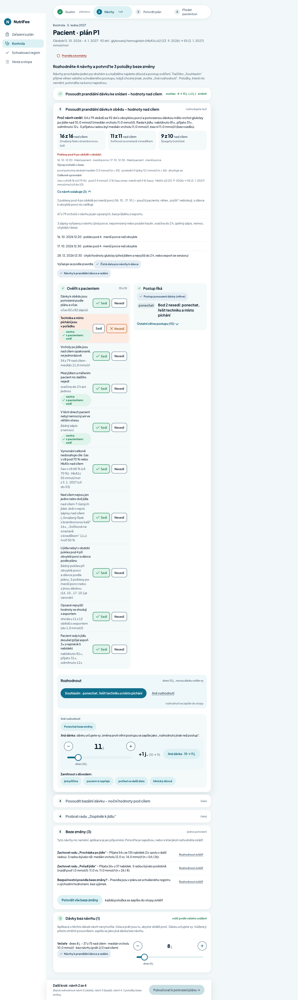

*Stav na snímku: karta k obědu; lékař označil bod 2 „nesedí“ (větev „ponechat, řešit techniku a místo píchání“), otevřel „Jiné rozhodnutí“ a posuvníkem nastavil 11 j.*

- **Co to je:** rozbalený box „Jiné rozhodnutí“: „Ponechat beze změny“, „Jiná dávka“ (posuvník 1–60 j. z `NF.DOSE_RANGE` + „Jiná dávka · 10 → 11 j.“) a „Zamítnout s důvodem“ (jiná příčina · pacient si nepřeje · počkat na další data · klinický důvod).
- **Kdo a kdy:** lékař, když chce rozhodnout jinak, než říká větev.
- **Co se počítá:**
  - „Ponechat beze změny“ a „Zamítnout s důvodem“ nepotřebují dokončené ověření (`choice: 'keep'` / `'reject'` s `reason`); dávka se vrátí na dávku plánu.
  - „Jiná dávka“ (volič u každé dávky, i u větve „ponechat“): jen po dokončeném ověření; `NF.decideOtherDose(S, id, jednotky, větev)` → `choice: 'other'`, `againstBranch: true` (když existuje větev postupu), u blokujícího poklesu a vyšší dávky navíc `againstData: true`. Stejná dávka jako dnes je chyba („Jiná dávka musí být jiná než dnes…“).
  - Záhlaví rozhodnuté karty: „rozhodnuto jinak než postup · 10 → 11 j. (+1 j.)“.
- **Pravidla:** D-POSTUP.
- **Stopa:** `navrh.rozhodnut` s `againstBranch` / `againstData`, u zamítnutí `reason`.
- **Pozor:** **žádné volné pole „Komentář“** (zrušeno, v ordinaci se nepíše); důvod zamítnutí je volba.
- **Testy:** `schema84-jadro.test.cjs` „1: u karty s větví „ponechat“ má lékař volič „jiná dávka“…“; `zaverecne80.test.cjs` „03 A4: v ordinaci není volné textové pole…“; hlavní test „Závěrečná kontrola 23. 10. (02 #2)…“.

### O17 Krok 2: návrh k bazálu – noční hodnoty pod cílem

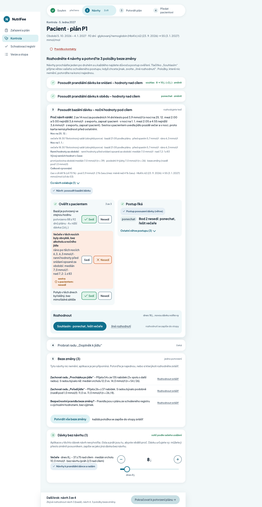

*Stav na snímku: třetí karta příběhu „Posoudit bazální dávku – noční hodnoty pod cílem“; sestra u „Pozdě večer a v noci pacient nic nejí“ vybrala „Nesedí“.*

- **Co to je:** návrhová karta k bazálu s řádkem okolností u každé noci, ranními hodnotami za období a vývojem ranních hodnot.
- **Kdy vznikne (`NF.proposals`, D-BAZAL, okno `dny` 14):** noci = noci z exportu + noci, které hlásil pacient (čip u snídaně nebo ranní odpověď po menší či vynechané večeři; `NF.basalNights`). V okně exportu rozhoduje export (noc bez poklesu v exportu se nepočítá: „export nepotvrdil“); noc ze zápisu mimo okno exportu se počítá navíc i do jmenovatele. S exportem musí být posouzených nocí aspoň `minNoci` (10), bez exportu stačí noci ze zápisu. Návrh „noční hodnoty pod cílem“: aspoň `nociPod` (2) noci pod dolním cílem nebo 1 noc pod 3,0. Návrh „ranní hodnoty nad cílem“: aspoň `minNoci` nocí, medián ranních hodnot nad `C-CILE.fastingHigh` (7,2) a žádná noc pod dolním cílem.
- **Přednost:** noční pokles má prioritu 0 (před vším), jen když noc klesla pod 3,0 nebo sestra neuvedla jídlo pozdě večer a v noci; jinak priorita 2,5 s větou „Sestra s pacientem uvedla jídlo pozdě večer a v noci, proto karta nemá přednost před ostatními.“ a v „Co návrh oslabuje“ „… snížení bazálu by zhoršilo hodnoty po jídle“.
- **Řádky:** `NF.nightCircumstances` „Noc na DD. MM.: večeře čas jídlo (porce) · bazál čas podle plánu · před spaním X · ráno Y“; `NF.morningValues` „Ranní hodnoty za období: medián · nad 7,2: X z Y“; `NF.trendOf` ranních hodnot. Pod 3,0 věta o možném artefaktu senzoru.
- **Body postupu `bazalLow`:** 1 bazál potvrzený ve stejnou hodinu (fakt „potvrzeno X z Y dnů plánu“) · 2 večeře v těch nocích obvyklé, bez alkoholu a nočního jídla (sestra `vecer`; fakt ranní hodnoty) · 3 pohyb běžný. Větve: vše sedí → snížit bazál; bod 1/2/3 nesedí → ponechat (řešit čas podání / večeře / posoudit příště). `bazalHigh` má 4 body (bazál, jídlo pozdě večer, technika, vyrovnání) a větev „zvýšit bazál“.
- **Pravidla:** D-BAZAL, D-POSTUP, B-HYPO (noční čip), Z-IMPORT, C-CILE.
- **Stavy:** zamítnutá D-BAZAL → karta nevznikne, bazál je řádek „bez návrhu (návrh k bazálu není v registru schválený)“; zamítnutí během kontroly kartu odebere (`NF.refreshReview`).
- **Stopa:** `navrh.rozhodnut` `PR-BAZAL`.
- **Pozor:** pacient se v novém plánu u ponechané dávky kvůli poklesům dozví „beze změny. V noci glukóza klesala pod 4; lékař dávku ponechal a probral to s vámi.“
- **Testy:** `schema84-jadro.test.cjs` „A4 + B6 + B9 + B10: karta bazálu…“; `zaverecne80.test.cjs` „Bod 7…“, „81 bod 8…“, „82 B3…“, „02 B7…“; `kontrola2-obsah.test.cjs` „Prohlížeč B1: zamítnutí D-BAZAL během kontroly odebere návrh k bazálu…“.

### O18 Krok 2: Beze změny a Dávky bez návrhu

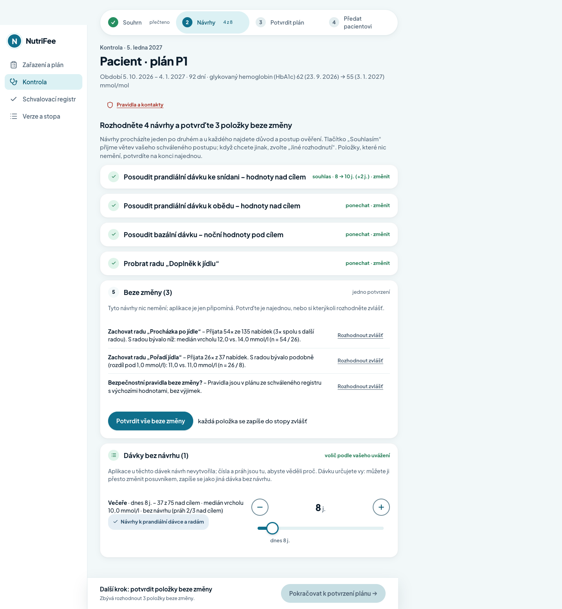

*Stav na snímku: všechny karty rozhodnuté, „Beze změny (3)“ potvrzené, „Dávky bez návrhu (1)“ (večeře).*

- **Co to je:** sloučená karta „Beze změny (N) · Potvrdit vše beze změny“ a sekce „Dávky bez návrhu (N)“ s posuvníkem u každé dávky, ke které karta nevznikla; lišta „Všechny návrhy rozhodnuté · Pokračovat k potvrzení plánu →“.
- **Kdo a kdy:** lékař, na konci kroku 2.
- **Co se počítá:**
  - Do „Beze změny“ patří návrhy s `group: 'keep'`: „Zachovat radu „X““ (rada přijatá aspoň `odmitnutiMin`× a nestažená) a „Bezpečnostní pravidla beze změny?“ (R-POKYNY, postup `pokynyBezeZmeny`). „Potvrdit vše beze změny“ (`NF.keepAll`) zapíše každou položku zvlášť jako `keep` s `bulk: true` a **neoznačí ověřovací body jako „sedí“**. „Rozhodnout zvlášť“ (`propSingle`) udělá z položky samostatnou kartu (u pravidel s větví „upravit“: úprava hodnot pravidel a cílů `reviewInstructions`).
  - „Dávky bez návrhu“ (`NF.reviewRows`): řádek „Večeře · dnes 8 j. – 37 z 75 nad cílem · medián vrcholu 10,0 mmol/l · bez návrhu (práh 2/3 nad cílem)“; důvody: méně než `minJidel` čistých jídel, práh `podil`, medián do cíle + `medianNad`, zamítnutá D-PRAND; bazál bez karty s ranními hodnotami. Řádky nejsou karty, nevyžadují rozhodnutí a nepočítají se do „Rozhodněte N návrhů“. Změna posuvníkem + „Jiná dávka · 8 → 9 j.“ zapíše `choice: 'other', noProposal: true` („jiná dávka bez návrhu“); u blokujícího poklesu i proti datům. „Ponechat 8 j.“ rozhodnutí vrátí.
  - `NF.reviewComplete` = každý ne-řádek má rozhodnutí.
- **Pravidla:** D-PRAND, D-BAZAL, R-POKYNY, D-POSTUP.
- **Stopa:** `navrh.rozhodnut` pro každou položku zvlášť.
- **Pozor:** řádek bez návrhu dává lékaři volič bez jakékoli nabídky výše.
- **Testy:** `schema84-jadro.test.cjs` „1: jídlo dne bez karty má řádek…“; hlavní test „Rady svázané s plánem: … návrhy beze změny jedna karta; Vše sedí…“.

### O19 Krok 2: Nejdřív rady

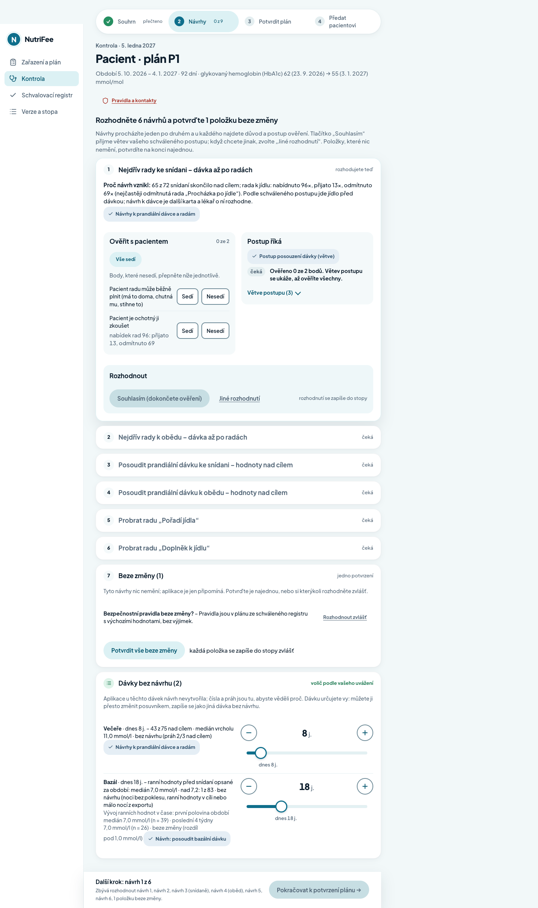

*Stav na snímku: dodatek „Pacient rady většinou nepřijal: jiné návrhy“, karta „Nejdřív rady ke snídani – dávka až po radách“.*

- **Co to je:** karta, která vznikne před kartou k dávce, když pacient rady k jídlu dne málo zkoušel nebo je většinou odmítal.
- **Kdy vznikne:** viz O14 (brána rad: aspoň `odmitnutiMin` nabídek a přijato < `radyPrve`, nebo odmítnuto ≥ `odmitnutiPodil`). Vybere se nejčastěji odmítnutá použitelná rada.
- **Postup `prandAdviceFirst`:** 1 pacient radu může běžně plnit · 2 je ochotný ji zkoušet (fakt nabídek). Větve: oba sedí → ponechat dávku, posílit radu; bod 1 nesedí → vyměnit radu za jinou; bod 2 nesedí → ponechat dávku, probrat důvody.
- **Pravidla:** D-PRAND, D-POSTUP.
- **Stavy:** pod `odmitnutiMin` nabídek karta nevznikne a bod 10 karty k dávce říká „brána rad se neuplatní“.
- **Stopa:** `navrh.rozhodnut` `PR-…-RADY`.
- **Pozor:** karta k dávce vznikne vždy, když jsou splněné prahy; brána je bod 10, ne zámek.
- **Testy:** hlavní test „Odbočka „většinou nepřijal“ vede k jiným návrhům“; `schema84-jadro.test.cjs` „2…“ (oba); `faze2-jadro.test.cjs` „A12 A13…“; `kontrola74-obsah.test.cjs` „M1…“.

### O20 Krok 2: Vyměnit radu

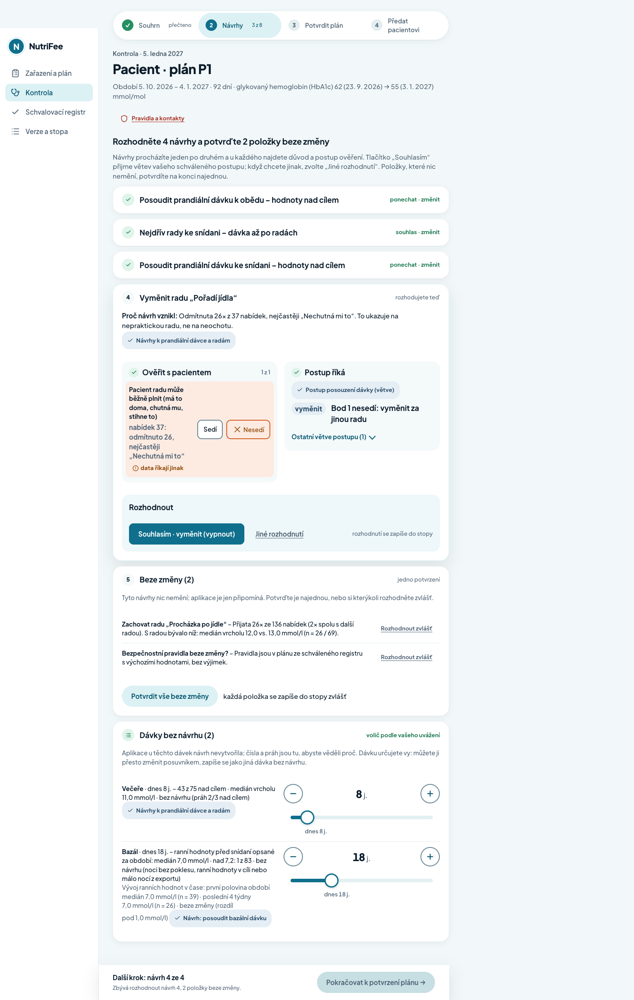

*Stav na snímku: dodatek „„Nemám to doma“: výměna rady“; lékař ponechal dávku ke snídani a u karty „Vyměnit radu „Pořadí jídla““ označil bod „nesedí“ (data říkají jinak).*

- **Co to je:** návrh k radě: „Vyměnit radu „X““ (nejčastější důvod odmítnutí „nemám to doma“ nebo „nechutná mi to“), „Probrat radu „X““ (jiný důvod nebo rada stažená u některých jídel) a „Zachovat radu“ (ve Beze změny).
- **Kdy vznikne:** rada nabídnutá aspoň `odmitnutiMin`× a odmítnutá aspoň `odmitnutiPodil`; pokud ji už nese karta „Nejdřív rady“, samostatná nevznikne. Postup `adviceReview` (1 bod „Pacient radu může běžně plnit“; sedí → ponechat radu, nesedí → vyměnit).
- **Co se počítá:** náhradní rady `NF.swapOptions`: jen rada, která se v období nenabízela a kterou lékař už nedoporučil; „Místo ní nabízet“ (volba) nebo „Jen vypnout“. Když náhrada není, tlačítko zní „Souhlasím · vyměnit (vypnout)“. Při souhlasu `NF.planFromReview` radu vypne v plánu (`advice.off`), náhradu dá do `advice.prefer` a případně přidá návyk (`NF.HABIT_OF`). To je jediná personalizace rad, kterou lékař dělá.
- **Pravidla:** D-PRAND, D-POSTUP, položka rady (R-DOPLNEK, R-PORADI, R-PROCHAZKA).
- **Stopa:** `navrh.rozhodnut` s `swapTo`; pacient v novém plánu čte „lékař ji nahradil radou „Y“. Původní rada vám v běžném dni nešla použít.“
- **Testy:** hlavní test „Rady svázané s plánem: výměna rady má účinek…“; `faze2-jadro.test.cjs` „A27…“.

### O21 Krok 3: Potvrdit plán

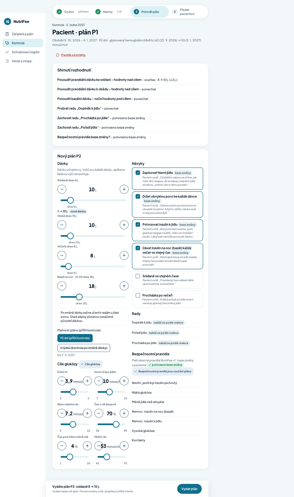

*Stav na snímku: scéna „Lékař – krok 3: potvrzení a vydání plánu P2“ před vydáním.*

- **Co to je:** „Shrnutí rozhodnutí“ (každý návrh a výsledek, důvod zamítnutí) a „Nový plán P2“: čtyři dávky s posuvníkem, platnost, cíle, návyky, rady, bezpečnostní pravidla; lišta „Vydáte plán P2: snídaně 8 → 10 j.“ a „Vydat plán“.
- **Kdo a kdy:** lékař, na konci kontroly.
- **Co se počítá:**
  - Náhled plánu `NF.planFromReview(S)`: dávky = dávky plánu + rozhodnutí s jednotkami (ne pracovní hodnota posuvníku); pravidla a cíle z `r.newInstructions` / `r.newTargets`; návyky z kroku 3 (`NF.reviewHabits`, přepínače `NF.toggleReviewHabit`, štítky nový / vyřazen / beze změny); rady z výměn; věty pro pacienta „proč lékař rozhodl takto“ ze šablon (bez čísel dávky a bez rady k jídlu u ponechané dávky kvůli poklesům).
  - Posuvník 1–60 j. u každé dávky (`NF.setPlanDose`, `NF.DOSE_RANGE`): změna vytvoří nebo přepíše rozhodnutí u karty nebo řádku té dávky (`viaPlan: true`, proti větvi `againstBranch`), návrat na dávku plánu rozhodnutí vrátí na „ponechat“. Štítek „nová dávka“, „jinak než postup“, „jiná dávka bez návrhu“.
  - Platnost: 92 dní (příští kontrola) nebo 6 týdnů (kontrola po změně dávky) (`NF.setReviewValidity`).
  - Mění-li se aspoň dvě dávky: neutrální věta `NF.manyDosesText` z `D-POSTUP.texts.postupne` „Měníte 2 dávky najednou; posuďte, zda je změnit postupně.“ – žádný zámek, žádný směr.
  - Po změně dávky věta „Po změně dávky začne učení k radám u jídel znovu. Staré zápisy zůstanou označené původní dávkou.“
  - „Vydat plán“ (`NF.issueFromReview`): jen když `NF.reviewComplete`; **zámek vydání**: dávka v novém plánu se liší od dnešní právě tehdy, když k ní existuje rozhodnutí lékaře s jednotkami, jinak chyba „Dávka (…) se mění bez rozhodnutí lékaře; plán nelze vydat.“; pak `NF.issuePlan` a `NF.handover`.
- **Pravidla:** C-CILE, R-POKYNY („Platí obecná pravidla NutriFee v1 · beze změny u pacienta“), D-POSTUP (věta o více dávkách), R-NAVYKY.
- **Stavy:** po vydání je krok jen ke čtení a lišta „Plán P2 je vydaný · Ukázat pacientovi →“.
- **Stopa:** `navrh.rozhodnut` (změny posuvníkem, `viaPlan`), `plan.vydan` P2, `plan.predan`.
- **Pozor:** krok ukazuje skutečný výsledek rozhodnutí, ne starý plán; lékař podepisuje, že u pacienta nic nezměnil, ne že pravidla schválil.
- **Testy:** hlavní test „Vydání P2 z rozhodnutí…“, „Kontrola po vydání plánu je zamčená…“, „Rozhodnutí vlastníka 25. 10. 2026: dvě a více změn dávek…“, „Cíle glukózy voličem…“; `schema84-jadro.test.cjs` „6 + C9 + B12…“, „1: … vydání plánu projde“.

### O22 Krok 4: Předat pacientovi

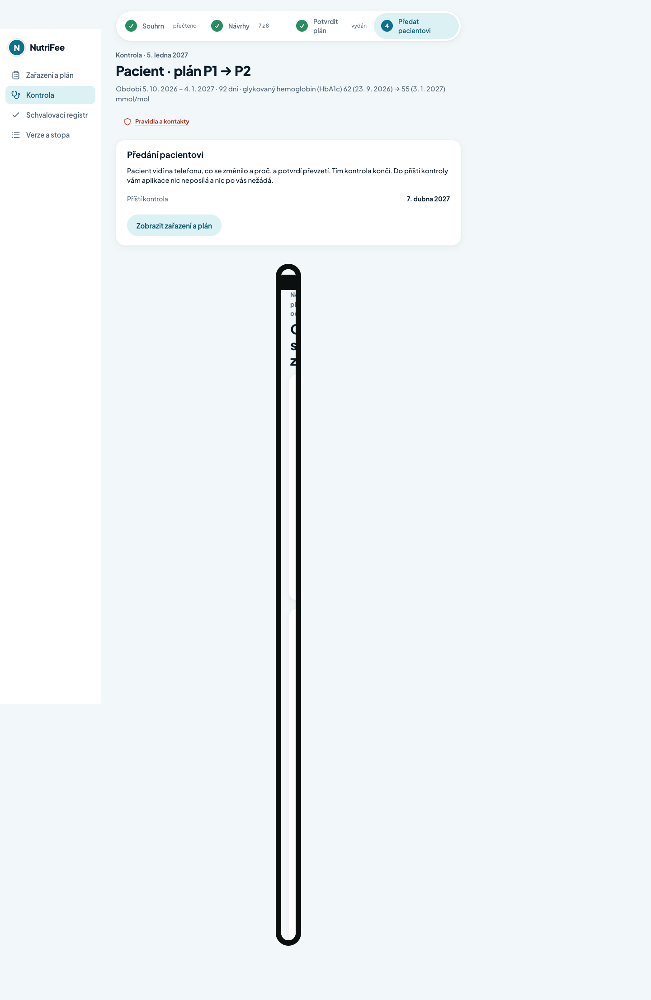

*Stav na snímku: scéna „Lékař – krok 4: předání pacientovi“.*

- **Co to je:** karta „Předání pacientovi“ (datum příští kontroly) a náhled telefonu s obrazovkou nového plánu (`V.patient(S, 'newplan')`, atlas pacienta).
- **Kdo a kdy:** lékař, na konci kontroly; pacient pak plán na svém telefonu převezme.
- **Co se počítá:** nic; kontrola je uzavřená, až pacient převezme plán, který z ní vzešel (`NF.reviewClosed`), a záložka Kontrola pak začne novým obdobím (O09).
- **Pozor:** „Do příští kontroly vám aplikace nic neposílá a nic po vás nežádá.“
- **Testy:** hlavní test „Kontrola je vedené flow…“; `zaverecne80.test.cjs` „03 B5…“.

### O23 Zásuvka „Pravidla a kontakty“

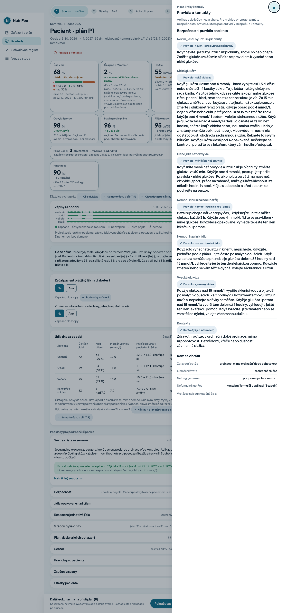

- **Co to je:** zásuvka mimo kroky kontroly (tlačítko se štítem v hlavičce kontroly): bezpečnostní pravidla pacienta z platného plánu a „Kam se obrátit“ (`V.acute`).
- **Kdo a kdy:** lékař, kdykoli během kontroly pro rychlou orientaci.
- **Co se počítá:** `V.instructionsList(S, plán)`; kontakty jen jako informace.
- **Pravidla:** R-POKYNY, I-*, I-KONTAKT.
- **Pozor:** aplikace do léčby nezasahuje; nic se nezapisuje.
- **Testy:** hlavní test „„Pravidla a kontakty“ otevře pokyny a kontakty (C2, SCHEMA 84)…“.

### O24 Zásuvka s popisem položky registru

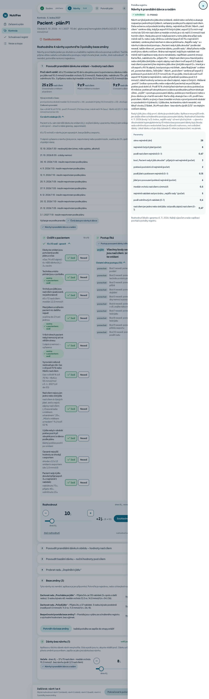

*Stav na snímku: klepnutí na štítek „Návrhy k prandiální dávce a radám“.*

- **Co to je:** zásuvka `V.itemDetail(S, id)`: název, stav položky, souhrn, detail, texty a parametry s jednotkou, kdy rozhodl lékař-garant.
- **Kdo a kdy:** lékař, když chce vědět, z čeho číslo nebo práh pochází.
- **Pravidla:** jakákoli položka; provozní položka bez stavu („Pravidlo aplikace“).
- **Pozor:** pacient vidí jinou podobu (bez stavu schvalování, „Pravidlo NutriFee“).
- **Testy:** hlavní test „Každá rada a výpočet nese položku registru…“.

### O25 Schvalovací registr: přehled

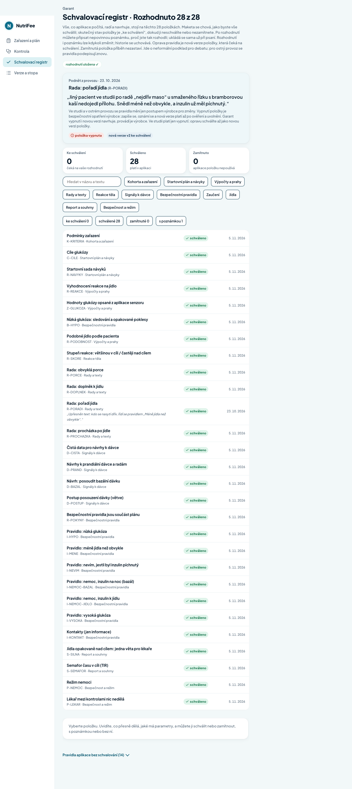

*Stav na snímku: všech 28 klinických položek schválených.*

- **Co to je:** hlavička „Schvalovací registr · Rozhodnuto X z 28“, tři dlaždice-filtry (Ke schválení · Schváleno · Zamítnuto), hledání, filtry kategorií a stavu (ke schválení, schválené, zamítnuté, s poznámkou), seznam položek (název, kód a kategorie, stav, datum, první věta poznámky), panel detailu a sbalený oddíl „Pravidla aplikace bez schvalování (14)“.
- **Kdo a kdy:** garant (v první studii lékař), mimo práci s pacientem.
- **Co se počítá:** `NF.registrySummary` (celkem, rozhodnuto, schváleno, zamítnuto, zbývá, s poznámkou) nad `NF.garantItems`; filtr v paměti; právě rozhodnutá položka ze seznamu nezmizí, dokud se nezmění filtr (`S.reg.keep`).
- **Pravidla:** všech 28 klinických položek.
- **Stopa:** jen čtení.
- **Pozor:** provozní položky se nepočítají do „zbývá“ ani do souhrnu.
- **Testy:** hlavní test „Registr jako seznam ke schválení…“, „Registr: rozhodnutí se uloží ihned…“; `faze2-jadro.test.cjs` „A31…“; „Přístupnost 23. 10.…“.

### O26 Registr: detail položky a rozhodnutí

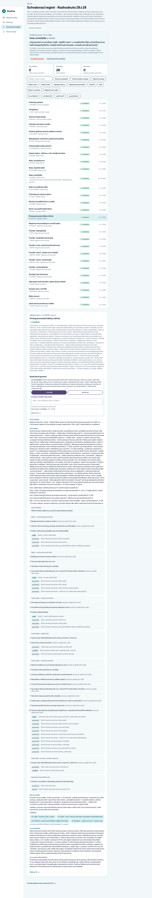

*Stav na snímku: otevřená D-POSTUP.*

- **Co to je:** panel detailu (`itemPanel`): kategorie, kód, verze, název, stav, souhrn; „Rozhodnutí garanta“ se dvěma rovnocennými tlačítky Schválit / Zamítnout; po rozhodnutí pole poznámky s otázkou „Proč jste schválili? (nepovinné)“ / „Proč jste zamítli? (nepovinné)“ a stavem „Ukládá se… / Uloženo HH:MM“; průvodce (v maketě z `demo/guide.js`) nebo souhrn, detail, texty, parametry a u D-POSTUP všechny postupy s body a větvemi (`itemPostup`); historie (rozhodnutí garanta zvlášť od modelových kroků příběhu).
- **Kdo a kdy:** garant.
- **Co se počítá:** `NF.decideItem(S, id, 'approved' | 'rejected', poznámka)` → `NF.applyDecision`: stav, `decidedAt`, záznam historie, `NF.refreshReview`. Poznámka: řádek `note` po 1 s bez psaní a při opuštění pole (`regNote`), nejvýš 4000 znaků; poznámka bez rozhodnutí nevzniká a stav nemění. Úpravy téže poznámky do 2 min historie ukáže jako jednu řádku (`V.mergeNoteEdits`).
- **Stavy:** zamítnutá položka „Položka je zamítnutá a aplikace ji nepoužívá… Rozhodnutí můžete kdykoli změnit.“; u nové verze věta, které znění se rozhoduje (`V.shownItem`).
- **Stopa:** `registr.rozhodnuti`, `registr.poznamka`.
- **Pozor:** v ostré aplikaci je schválení podpis garanta nad konkrétní verzí a otiskem (`NF.itemFingerprint`); poznámka je požadavek, ne schválená změna.
- **Testy:** hlavní test „SCHEMA 83: registr bez prezentační vrstvy – pole poznámky až po rozhodnutí…“, „Registr R13…“, „Průvodce položkami…“; `kontrola4-obsah.test.cjs` „Bod 1: každá položka má verzi; otisk je deterministický…“; `ukladani.test.cjs`; `kontrola3-obsah.test.cjs` „C9, C10…“; `zaverecne80.test.cjs` „Předávka Z J1, J2…“.

### O27 Registr: potvrzení zamítnutí bezpečnostní položky

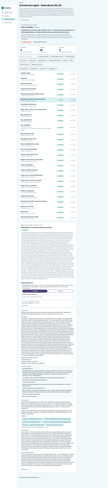

*Stav na snímku: B-HYPO, první klepnutí na Zamítnout.*

- **Co to je:** varování „Zamítnutím přestane fungovat ochrana pacientů: … Opravdu zamítnout?“ s potvrzením a zrušením (`V.SAFETY_ITEMS` pro B-HYPO, R-POKYNY, P-NEMOC).
- **Co se počítá:** první „Zamítnout“ jen nastaví `S.reg.confirmReject`; teprve potvrzení zavolá `NF.decideItem`.
- **Pozor:** věta u B-HYPO říká, že pacient po menší porci nedostane otázku na pokles ani kartu po opakovaných poklesech, poklesy po menší porci se nezapíšou, chybí v reportu i v návrhu k dávce, a u jídla s poklesy pak nic nezablokuje větev „zvýšit“.
- **Testy:** `kontrola2-obsah.test.cjs` „B13: potvrzení před zamítnutím B-HYPO…“.

### O28 Registr: provozní pravidlo

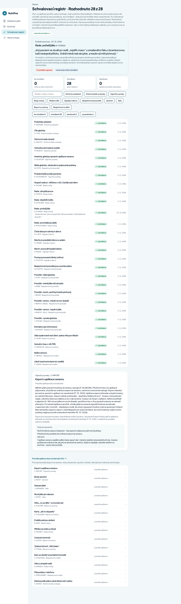

*Stav na snímku: otevřená Z-IMPORT a rozbalený oddíl „Pravidla aplikace bez schvalování“.*

- **Co to je:** detail provozní položky: popis pravidla aplikace bez stavu, bez tlačítek a bez štítku.
- **Pravidla:** 14 provozních položek (odst. 4.1).
- **Pozor:** provozní položky neschvaluje nikdo; do „zbývá N“ ani do souhrnu se nepočítají.
- **Testy:** hlavní test „Sedm rozhodnutí z 18. 10. 2026 (SCHEMA 54): … provozní položky bez garanta…“; `kontrola3-obsah.test.cjs` „C9, C10…“.

### O29 Registr: podnět z provozu

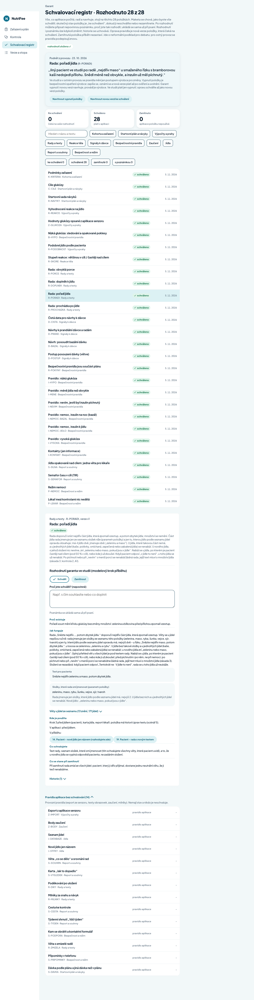

*Stav na snímku: scénář 5 „Během studie – garant upraví pravidlo po podnětu“ (modelový registr ostré aplikace).*

- **Co to je:** karta „Podnět z provozu · datum“ nad seznamem: text podnětu, položka a dvě tlačítka „Navrhnout vypnutí položky“ → „Navrhnout novou verzi ke schválení“ (`impulseCard`).
- **Kdo a kdy:** garant během studie (funkce ostré aplikace), když přijde podnět z provozu.
- **Co se počítá:** v maketě vypnutí = `NF.decideItem(…, 'rejected', 'Vypnuto po podnětu z provozu.')`, nová verze = `NF.newVersion` (verze +1, stav ke schválení, případně nový text); oba jako modelové kroky (`modelStep`, v historii „model (příběh)“).
- **Stopa:** `registr.rozhodnuti`, `registr.verze`.
- **Pozor:** podle rozhodnutí vlastníka 30. 10. 2026 garant navrhuje a výrobce provádí v řízení změn; ve studii platí jen vypnutí, opravy až po období. V ukázce tlačítko znázorňuje krok výrobce a od SCHEMA 87 to říká i oznámení: „Návrh vypnutí je zapsaný a výrobce položku vypnul. Pacientům se teď nepoužívá.“, u nové verze „Výrobce založil podle návrhu novou verzi…“ (`15` odst. 13). V ostré aplikaci garant jen podá návrh do řízení změn. Pacientovi rada zmizí; jen pokud ji dřív přijímal, jedna neutrální věta (R-ZMIZELA).
- **Testy:** `faze2-jadro.test.cjs` „A33 karta „Podnět z provozu“…“; `kontrola4-obsah.test.cjs` „Bod 11: scénář 5 – garant navrhuje vypnutí, výrobce provádí“; `kontrola2-obsah.test.cjs` „B8…“.

### O30 Verze a stopa

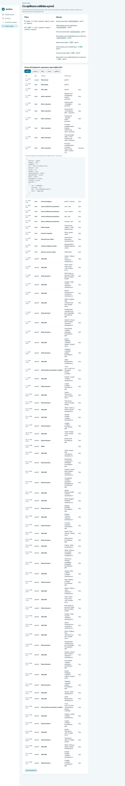

- **Co to je:** plány (stav, platnost, dávky), návyky se stavem a tabulka stopy od nejnovějšího: čas, kdo (pacient / lékař / sestra / aplikace), událost česky, podrobnost; filtr podle toho, kdo jednal; „Zobrazit dalších 80“; technická data v rozbalení řádku (`V.trace`, `traceDetail`). Snímek ukazuje rozbalená data rozhodnutí návrhu ke snídani s polem `polozky` (id, verze, otisk a stav položky D-POSTUP). Od SCHEMA 87 mají české názvy i nové události (`pravidlo.nizka`, `pravidlo.mene`, `pravidlo.nevim`, `plan.davky.overeni`, `plan.kontrolni.otazka`, `nemoc.dotaz`, `otazka.lekari`, `podpora.odeslano`, `zarazeni.*`, `navrh.overeni`, `navrh.overeni.vse`).
- **Kdo a kdy:** lékař a garant, k dohledání, co aplikace udělala a proč.
- **Co se počítá:** řazení podle času události; události prezentační vrstvy (`prezentace.*`) se nezobrazují; kódy a syrová data jen v rozbalení.
- **Pozor:** stopa nesmí obsahovat výsledek generativní AI ani síťové volání. Verze a otisk položek u každé události (`polozky`) se přenášejí. Krácení stopy (4000 / 1000) je omezení makety; ostrá aplikace má stopu úplnou.
- **Testy:** hlavní sada „SCHEMA 87 (bod 1): pravidla pod 4, nevím a menší porce jdou do stopy jako pravidlo.vysoka; události výpočtu nesou verzi a otisk položek; krácení stopy je omezení makety“; hlavní sada „SCHEMA 87 (bod 1): odpovědi pacienta, podmínky zařazení, výchozí hodnoty, ověření dávek a ověřovací body lékaře jdou do stopy“; hlavní test „Stopa má vstupy a výstupy výpočtů; bez exportu“; `faze2-jadro.test.cjs` „Jádro bez demo/ běží a nevolá síť“.

---

## 7. Rozpory k rozhodnutí

Body, které zdroj pravdy neurčuje a rozhodne vlastník. Do rozhodnutí platí chování makety. Rozpory společné celé předávce (denní doby slotů jako klinická položka, otisk katalogu po přidání mezí) jsou v `00-postup.md` odd. 5.

- **R9 Kontextový sloupec.** `15` odst. 15a popisuje ordinaci „od 1600 px: pruh · pracovní sloupec do 880 px · kontextový sloupec“; pod 1600 px se sloupec nezobrazuje vůbec a náhled telefonu u sestry a v kroku 4 se na 1440 px skládá pod pracovní sloupec, ne vpravo („vpravo náhled telefonu“, odst. 5). Jde o rozhodnutí o rozložení, které `15` pro užší obrazovky neříká.

## 8. Vyřešeno v SCHEMA 87

Body R1–R8, které atlas ve SCHEMA 86 našel, vyřešila SCHEMA 87 (rozhodnutí vlastníka 6. 11. 2026, bod 1) nebo dopsání `15` za maketou. Popisy obrazovek výše odpovídají novému stavu.

- **R1 Sestra na kontrole:** maketa beze změny; `15` odst. 3 říká, že ostrá aplikace oprávnění rolí oddělí (sestra jen své části kontroly a zaučení, každá funkce ověří roli, stopa zapíše, kdo jednal). Je to úkol etapy oprávnění.
- **R2 Rozsah voliče dávky:** jeden rozsah 1–60 j. z `NF.DOSE_RANGE` při zařazení, na kontrole i u pacienta (O03, O15, O16, O21).
- **R3 Volič hmotnosti a HbA1c:** `15` odst. 4.1 a 9 dopsány na posuvník.
- **R4 Tlačítka návrhové karty:** „Souhlasím“ a „Jiné rozhodnutí“ dopsány do `CLAUDE.md` a `15` odst. 9 a 18.
- **R5 Podnět z provozu:** v ukázce tlačítko znázorňuje krok výrobce a oznámení to říká; v ostré aplikaci garant jen navrhuje (O29, `15` odst. 13).
- **R6 Stopa bez verze a otisku položek, krácení:** události nesou `polozky` s verzí a otiskem; krácení je omezení makety, ostrá aplikace má stopu úplnou (odd. 4.3, O30).
- **R7 Zápisy z ordinace:** `zarazeni.podminka`, `zarazeni.vylouceni`, `zarazeni.vychozi`, `zarazeni.davky.overeny`, `navrh.overeni`, `navrh.overeni.vse` (O02, O03, O14).
- **R8 Počet provozních položek:** `15` odst. 12 uvádí 14.
